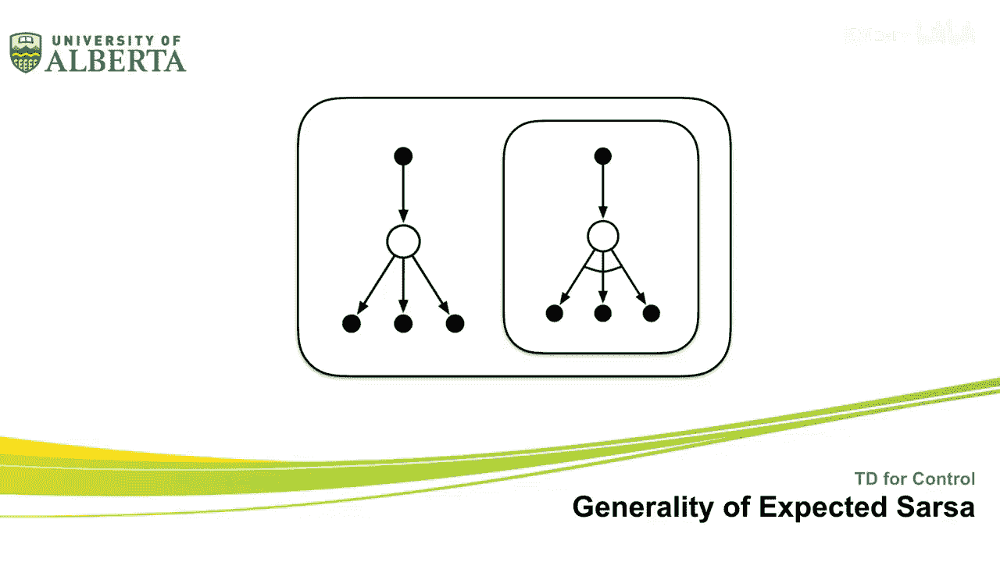
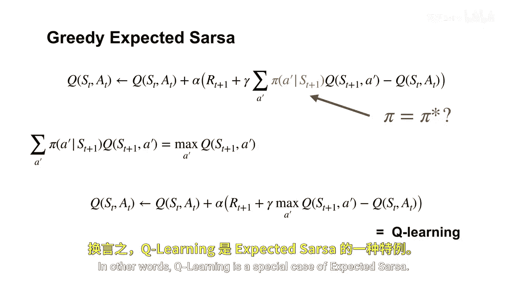

强化学习专项课程：P65：期望SARSA算法的通用性 🧠

在本节课中，我们将探讨期望SARSA算法与Q学习算法之间的关系，并理解期望SARSA如何在不使用重要性采样的情况下进行离策略学习。

---

到目前为止，我们已经学习了三种用于控制的时序差分算法：SARSA、Q学习和期望SARSA。其中，SARSA和期望SARSA都近似于同一个贝尔曼方程。本节中，我们将重点分析期望SARSA与Q学习之间的联系。

通过本视频的学习，你将理解期望SARSA如何在不使用重要性采样的前提下进行离策略学习，并解释期望SARSA如何将Q学习泛化。

---

首先，我们从同策略的情况开始分析，此时行为策略和目标策略是相同的。考虑期望SARSA的更新公式：

`Q(S, A) ← Q(S, A) + α [R + γ * 𝔼[Q(S', A') | S'] - Q(S, A)]`

在这种情况下，下一个动作 `A'` 是从策略 `π` 中采样的。然而，请注意，对动作的期望计算独立于在下一个状态中实际选择的动作。事实上，目标策略 `π` 不必等于行为策略。这意味着，与Q学习类似，期望SARSA可以在不使用重要性采样的前提下进行离策略学习。

---

接下来，我们看看当目标策略相对于其动作价值估计是贪婪策略时会发生什么。此时，在期望计算中只考虑具有最高价值的动作。这等价于计算下一个状态中所有动作的最大值，正如Q学习所做的那样。换句话说，Q学习是期望SARSA的一个特例。

---

在本节课中，我们展示了期望SARSA和Q学习在更新目标时都使用了其目标策略的期望。这一特性使得它们能够在不使用重要性采样的前提下进行离策略学习。当期望SARSA的目标策略是相对于其动作价值的贪婪策略时，它就完全等同于Q学习算法。