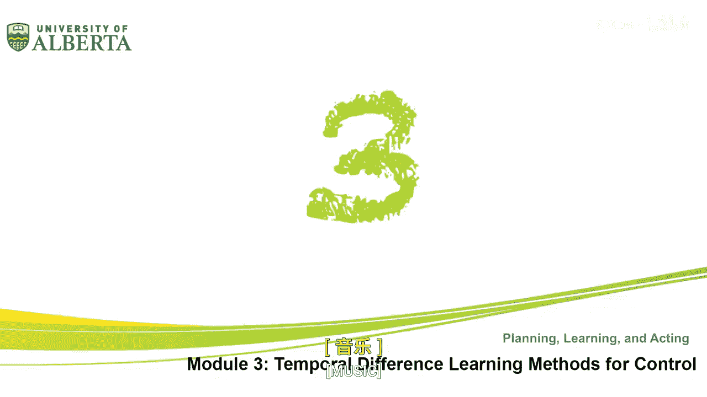
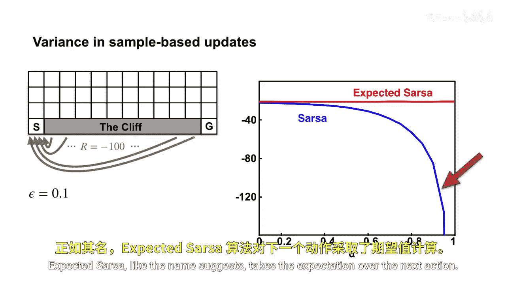

强化学习专项课程：04：第三周总结

在本节课中，我们将回顾第三周学习的核心内容，即如何使用时序差分方法进行控制。我们将总结SARSA、Q学习和期望SARSA这三种关键算法，并比较它们的特点。

上一节我们介绍了时序差分预测方法，本节中我们来看看如何将这些方法应用于控制问题，即寻找最优策略。本周学习的时序差分控制算法均基于贝尔曼方程。

以下是本周学习的三种主要算法：

*   **SARSA**：该算法使用基于样本的贝尔曼方程版本。其目标是学习当前策略π下的动作价值函数 **Qπ**。其更新公式为：
    `Q(S, A) ← Q(S, A) + α [R + γ * Q(S‘, A’) - Q(S, A)]`
*   **Q学习**：该算法基于贝尔曼最优方程。其目标是直接学习最优动作价值函数 **Q***。其更新公式为：
    `Q(S, A) ← Q(S, A) + α [R + γ * maxₐ Q(S‘, a) - Q(S, A)]`
*   **期望SARSA**：该算法使用与SARSA相同的贝尔曼方程，但采用不同的采样方式。它在更新时对下一个状态可能采取的动作价值求期望。其更新公式为：
    `Q(S, A) ← Q(S, A) + α [R + γ * Σ π(a|S‘) * Q(S‘, a) - Q(S, A)]`

接下来，我们探讨同策略与异策略学习的区别。

以下是关于同策略和异策略学习的要点：

*   **SARSA**是一种**同策略**算法，它学习的是其当前正在遵循的策略的动作价值。
*   **Q学习**是一种**异策略**算法，它学习的是最优策略的动作价值。
*   **期望SARSA**兼具两者特点，它既可以作为同策略算法，也可以作为异策略算法，能够学习任意给定策略的动作价值。

在衡量在线性能时，SARSA的表现可能优于Q学习。这是因为同策略控制方法会考虑其自身的探索行为。在悬崖漫步世界中，我们看到Q学习由于其探索性行动而频繁坠崖。相比之下，SARSA学会了更长但更安全的路径，很少坠崖，从而获得了更高的累积奖励。

随后，我们研究了一种对SARSA的改进算法，称为期望SARSA。在悬崖漫步世界的测试中，期望SARSA在所有步长参数值下的表现都优于SARSA。这是因为期望SARSA通过求期望值，减少了因其策略本身随机性带来的方差。正如其名，期望SARSA对下一个动作的价值进行了期望计算。

本节课中我们一起学习了三种基于时序差分的控制算法：SARSA、Q学习和期望SARSA。我们理解了它们与贝尔曼方程的关系、同策略与异策略的区别，并通过悬崖漫步示例看到了它们在性能上的差异。下一模块，我们将学习如何将规划、学习和行动结合起来。