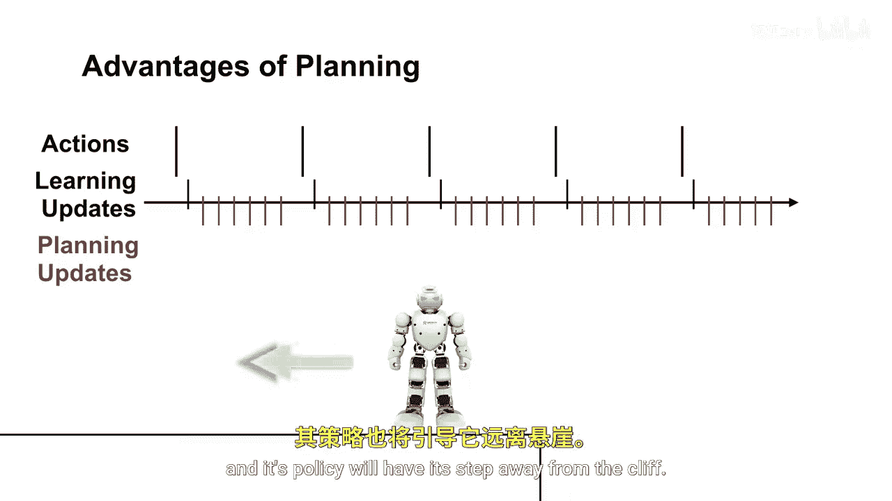

# 069：随机表格Q规划 🧠

在本节课中，我们将学习如何利用模型（Model）进行规划（Planning），即在不与环境实际交互的情况下，通过模拟经验来改进策略。我们将重点介绍一种具体的规划方法：随机采样一步表格Q规划。

---

## 模型与规划

上一节我们介绍了模型的概念。本节中，我们来看看如何将模型应用于强化学习。

规划是一个以模型作为输入，并输出一个改进后策略的过程。一种可能的规划方法是先从模型中采样经验。这类似于根据你对世界运作方式的理解，想象世界中可能发生的情景。然后，这些生成的经验可以像真实世界交互一样，用于更新价值函数。基于这些改进后的价值函数采取贪婪行为，就能得到一个改进的策略。

## 从Q学习到Q规划

回顾一下，Q学习利用来自环境的经验，执行更新以改进策略。在Q规划中，我们则利用来自模型的模拟经验，执行类似的更新来改进策略。

随机采样一步表格Q规划（Random sample one-step tabular Q-planning）阐释了这一思想。该方法假设我们拥有一个关于状态转移动态的采样模型，并且假设我们有一个采样相关状态-动作对的策略。一种可能的选项是均匀地采样状态和动作。

以下是该算法的步骤：

1.  从所有状态和动作的集合中，随机选择一个状态-动作对 `(S, A)`。
2.  用这个状态-动作对查询采样模型，以生成下一个状态 `S'` 和奖励 `R` 的样本。
3.  对这个模型转移样本执行一次Q学习更新。更新公式为：
    `Q(S, A) ← Q(S, A) + α [R + γ * max_a Q(S', a) - Q(S, A)]`
4.  根据更新后的动作价值函数，通过采取贪婪行为来改进策略。

一个关键点是，这种规划方法只使用想象或模拟的经验。所有这些更新都可以在不与环境交互的情况下完成，或者与交互循环并行执行。

## 规划的优势与应用场景

想象一下，智能体只能在特定的时间点采取行动，但学习更新可以相对快速地执行。这就导致了从一次学习更新完成到采取下一个动作之间，存在一些等待时间。我们可以用规划更新来填充这段等待时间。

设想我们有一个站在悬崖边的机器人。假设它的模型知道掉下悬崖的后果，但这种后果尚未在其价值函数或策略中得到准确体现。它可以生成掉下悬崖的模拟经验，并对这些转移样本执行多次规划步骤。最终，它的价值函数将能更好地反映掉下悬崖是糟糕的，其策略也会让它远离悬崖。

---

## 总结

本节课中，我们一起学习了：
1.  规划方法如何利用模拟经验来改进策略。
2.  随机采样一步表格Q规划如何使用采样模型来随机生成经验。
3.  价值函数如何通过Q学习更新得到改进。