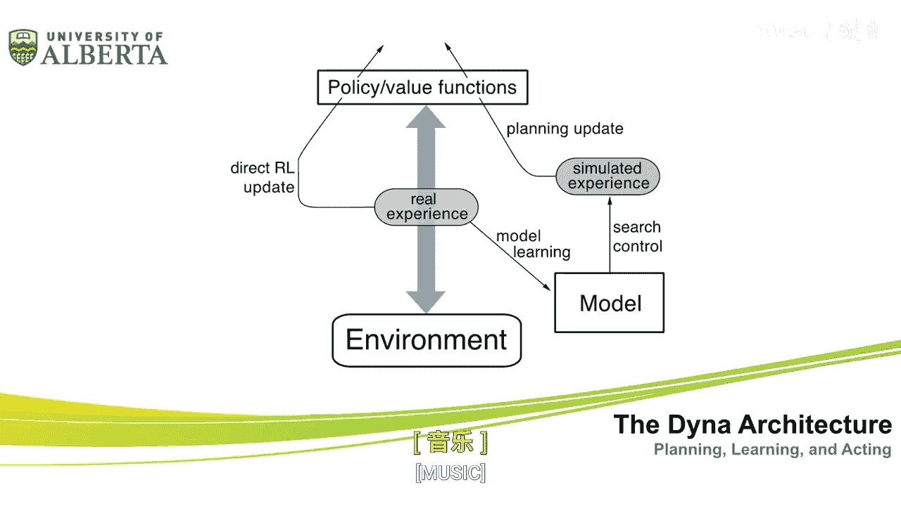
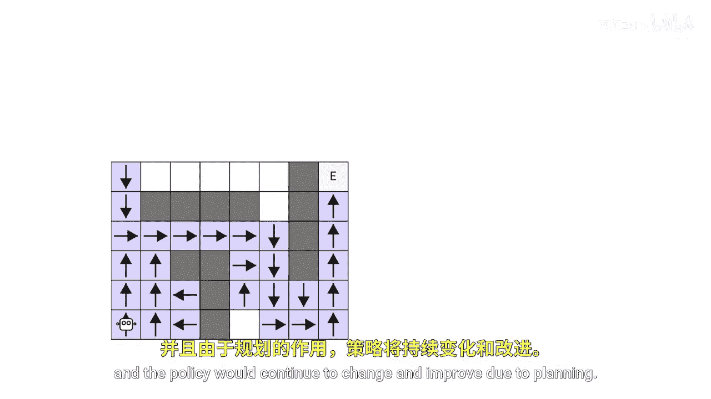

# 070：Dyna架构 🧠

在本节课中，我们将要学习如何将直接强化学习与规划相结合，介绍一种名为Dyna的架构。我们将了解模拟经验与真实环境经验的区别，并理解Dyna如何整合这两种更新方式，从而更高效地利用有限的经验数据。

---

## 经验的两个来源

到目前为止，我们讨论了两个经验来源：**环境**和**模型**。

在**直接强化学习**中，智能体通过与真实世界交互产生的经验进行学习，例如Q学习算法。

同时，智能体也可以从**模型**中生成模拟经验，并将其用于**规划**。

## 结合直接RL与规划：Dyna架构

上一节我们介绍了经验的两种来源，本节中我们来看看如何将它们结合起来。

Dyna架构就是一种结合直接强化学习更新和规划更新的方法。以下是其主要组成部分：

*   **环境与策略**：它们生成一系列真实经验流。
*   **直接RL更新**：我们使用上述真实经验进行直接强化学习更新。
*   **模型**：要进行规划，我们需要一个模型。这个模型需要通过某种方式获得。
*   **模型学习**：环境经验可用于学习这个模型。
*   **搜索控制**：我们希望控制模型如何生成模拟经验，即智能体将从哪些状态开始规划。
*   **规划更新**：使用模型生成的模拟经验执行规划更新。

## Dyna工作原理图解

为了更直观地理解，让我们通过一个简单的迷宫示例来看看Dyna是如何工作的。

我们有一个迷宫和一个试图找到出口的机器人。这是一个折扣问题，机器人在目标点获得+1奖励，其他情况奖励为0。

1.  **初始探索**：开始时，机器人一无所知。它随机遍历迷宫，直到第一次偶然到达目标。
2.  **直接RL更新**：机器人只更新了一个动作价值（用蓝色表示），这是唯一产生非零奖励的状态转移。这次更新由直接强化学习完成。
3.  **模型学习**：Dyna利用第一轮探索中产生的所有经验来学习环境模型。黄色方格代表第一轮中访问过的状态。
4.  **规划阶段**：第一轮结束后，规划开始发挥作用。机器人脑海中的“思想泡泡”代表其内部模型。模型知道机器人在第一轮中访问过的所有状态会发生什么。
5.  **执行规划**：在第二轮开始时运行规划循环。Dyna可以模拟从第一轮访问过的任何“状态-动作”对出发的转移。规划过程回放这些模拟转移，就像它们在真实世界中发生一样。
6.  **策略改进**：规划的每一步都对模拟转移应用Q学习更新来更新价值函数。经过足够的规划步骤，智能体可以改进其在第一轮访问过的所有状态下的策略。
7.  **结果**：规划产生了一个相当不错的策略（尽管并非完美，在某些未访问过的状态策略仍是随机的，用白色方格表示）。现在，机器人仅经过一轮真实探索，就知道如何快速到达目标。

相比之下，纯Q学习需要许多轮探索才能达到类似的性能。Dyna在每一步进行了更多计算，但更高效地利用了有限的经验。

> **注意**：这是一个简化示意图。实际的Dyna在第二轮中会继续探索和规划，因此策略偶尔会采取随机动作，并因持续的规划而不断改进。

---

## 总结与预告

本节课中我们一起学习了Dyna架构，它通过结合直接强化学习和规划更新，能够同时从环境和模型经验中学习。

我们将在下次讨论如何具体实现Dyna。

本节课的内容到此结束。希望下次课程再见。