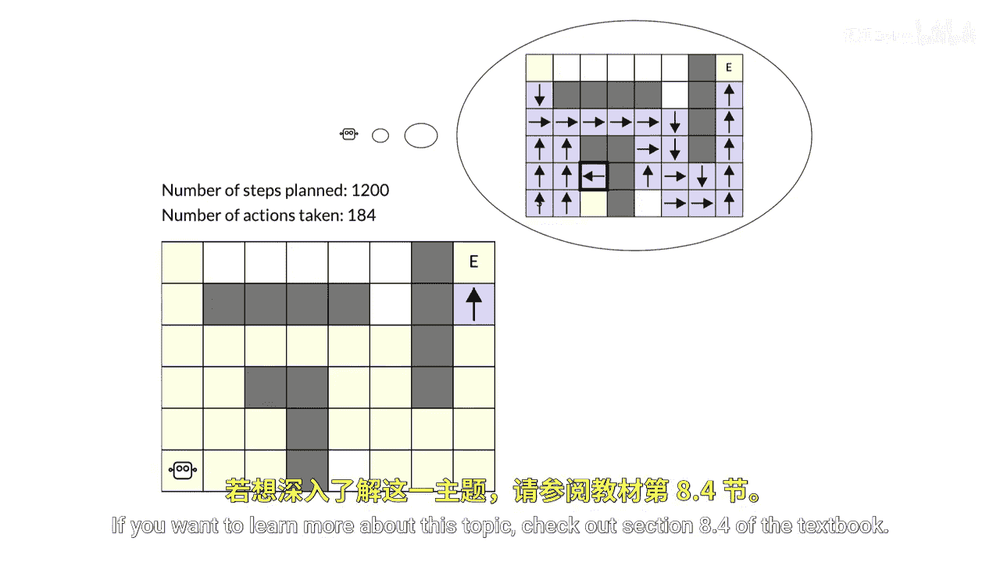

# 072：简单迷宫中的Dyna-Q学习 🧠

在本节课中，我们将通过一个简单的网格世界迷宫环境，对比分析表格型Dyna-Q算法与无模型Q学习算法的性能。我们将重点关注规划步骤如何影响学习效率，并解释模型如何让智能体以更少的环境交互次数学到有效的策略。

---

上一节我们介绍了Dyna架构及其如何结合规划、学习和行动。本节中，我们来看看Dyna-Q在一个具体网格世界中的实际运行效果。

今天我们将在这个小型迷宫环境中进行一些实验。和之前一样，智能体有四个可执行的动作。进入目标状态会产生+1的奖励，所有其他状态转移产生的奖励均为0。这是一个分幕式任务，我们将使用折扣因子 **`γ = 0.95`**。

我们将比较具有不同规划步数的Dyna-Q算法。我们设置了三个智能体进行对比：
*   每个智能体都使用学习率 **`α = 0.1`** 和探索率 **`ε = 0.1`**。
*   所有三个智能体的动作价值估计初始值都设为0。
*   实验共运行50幕，重复30次，然后对结果取平均。

以下是实验结果：

我们可以绘制出智能体在经历越来越多幕之后，完成每一幕所需的平均步数。如果智能体表现良好，那么随着幕数增加，所需步数应该减少。也就是说，在Y轴上，数值越低越好。

*   如果使用0个规划步数运行Dyna-Q，我们得到的就是精确的Q学习算法。如图所示，它进步缓慢，最终稳定在每幕约14步的水平。
*   如果使用5个规划步数运行Dyna-Q，它能达到与Q学习相同的性能，但速度要快得多。
*   使用50个规划步数的Dyna-Q仅需大约3幕就能找到一个优秀的策略。

Dyna-Q的效率要高得多。观察Y轴，在经历2幕之后，Q学习找到的策略仍然需要数百步才能走出迷宫。而对于相同次数的环境交互，Dyna-Q能学到的东西要多得多。这表明，如果模型正确，规划能更有效地利用环境经验。

---

为了更直观地理解，让我们在一个略有不同的迷宫中可视化学习过程。我们使用箭头表示每个状态下根据估计价值得出的贪婪动作。没有箭头的状态表示在该策略下所有动作被选择的概率均等。

经过第一幕后，Q学习只更新了一个动作价值，即目标旁边状态中“向上”动作对应的价值。因为这是唯一经历了非零奖励转移的状态。需要再经过好几幕，才能通过自举将状态价值传播回附近的其他状态。

---

让我们更仔细地观察搜索控制如何影响规划。我们的机器人将采取与标准Dyna-Q略有不同的操作，以便更清晰地阐明观点。

我们首先设置10个规划步数，并连续调用规划循环10次。这样总共进行了100步规划。正如你所见，许多规划更新并未改变价值函数。事实上，在100步规划之后，智能体只更新了两个“状态-动作”对的价值。

我们继续实验。这次，我们尝试每次调用进行100步规划，并让智能体运行更长时间。即使有100个规划步数，最初几次调用也只更新了少数几个动作价值。

为什么智能体需要这么多规划步数才能学到合理的价值函数和策略？智能体需要大量规划步数，是因为搜索控制是随机采样“状态-动作”对的。如果采样的“状态-动作”对产生的时序差分误差为零，那么规划更新将不会产生任何效果。在这个环境中，由于所有奖励都是零，且初始价值也是零，这种情况经常发生。

如果我们以更高效的方式排序“状态-动作”对会发生什么？事实证明，智能体可以仅使用六分之一的规划更新就学会一个好策略。在大型环境中，随机搜索控制会带来更大的问题。如果你想深入了解这个主题，请查阅教材的第8.4节。

---

本节课中，我们在一个简单的网格世界中测试了表格型Dyna-Q算法。我们看到了规划如何能显著加速学习。在我们的实验中，进行的规划越多，智能体的表现就越好。规划使智能体能够从真实经验和模型经验中同时学习，从而更高效地利用有限的环境交互。