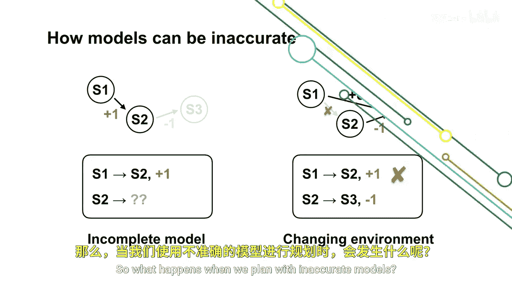
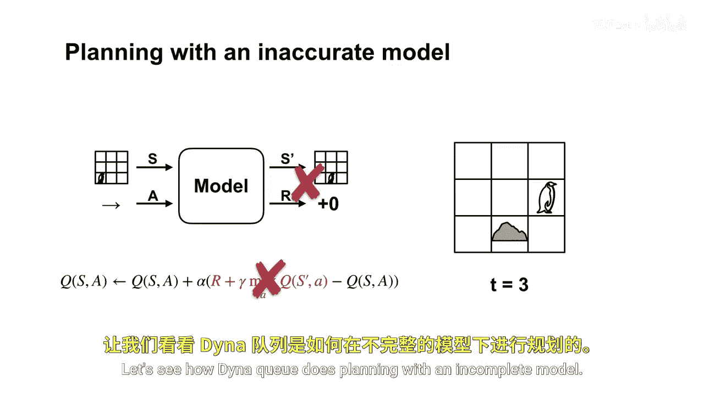
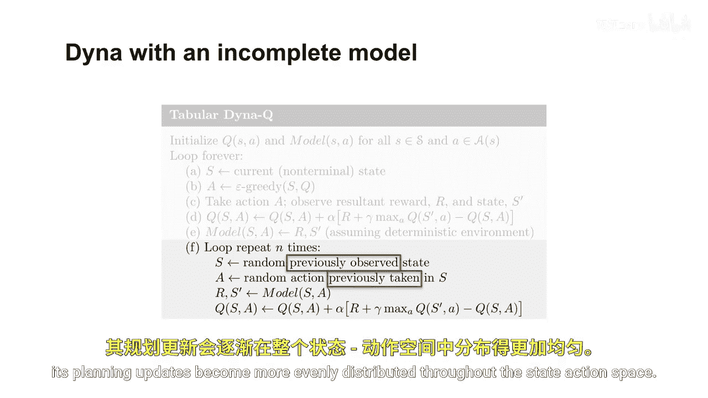

强化学习专项课程：P73：模型不准确时的应对策略 🧠

在本节课中，我们将探讨当智能体使用的模型不准确时会发生什么。我们将学习识别模型不准确的几种方式，解释使用不准确模型进行规划的影响，并描述智能体如何能够成功地与不完整的模型一起进行规划。

---

### 模型不准确的含义

到目前为止，在课程中我们已经讨论了智能体如何通过使用模型生成的经验进行规划，来改进其策略或价值函数。

那么，如果智能体使用来自不准确模型的经验进行规划，会发生什么情况呢？

首先，我们来谈谈模型不准确意味着什么。当模型存储的状态转移与环境实际发生的情况不同时，模型就是不准确的。

在学习开始时，智能体尚未尝试过几乎所有状态中的大多数动作。与在这些状态下尝试这些动作相关的转移信息，在模型中完全是缺失的。我们称这种缺少转移信息的模型为**不完整模型**。

如果环境发生变化，模型也可能变得不准确。在某个状态下采取一个动作，可能导致的下一个状态和奖励，与智能体在环境变化前观察到的情况不同。我们说模型不准确，是因为实际发生的情况与模型所描述的情况不同。



---

### 使用不准确模型进行规划的影响

使用不准确模型进行规划的效果，取决于模型不准确的具体方式。

在开始时，模型是不完整的。由于模型无法产生下一个状态或奖励，因此无法用于规划。然而，随着智能体与环境交互，模型会存储越来越多的转移信息。然后，智能体可以通过模拟它以前见过的转移来执行更新。这意味着，只要智能体见过一些转移，它就可以使用模型进行规划。

现在，让我们思考环境变化如何影响规划。

想象一下，智能体已经访问过每一个“状态-动作”对，并将其经验存储在模型中。然后环境发生了变化。模型中的某个转移不再反映环境中的实际转移。当智能体尝试使用其不准确的模型进行规划时，会发生什么？

如果智能体尝试使用模型中一个不正确的转移来执行规划更新，那么智能体更新的价值函数或策略可能会朝着错误的方向改变。请记住，规划是根据模型认为会发生的情况来改进策略，而不是根据环境中实际会发生的情况。当环境发生变化时，模型就会过时。使用该模型进行规划，很可能会使智能体的策略相对于环境变得更差。

---

### 如何与不完整模型成功规划

既然我们已经了解了模型可能不准确的两种主要方式，现在让我们思考智能体如何能够成功地与不完整的模型一起进行规划。

实际上，我们已经介绍过一种这样的算法：**Dyna-Q**。

让我们看看 Dyna-Q 是如何与不完整模型一起进行规划的。

在规划步骤中，我们必须确定使用哪些“状态-动作”对来查询模型。模型只知道它已经访问过的“状态-动作”对的下一个状态和奖励。因此，Dyna-Q 只能从先前访问过的“状态-动作”对进行规划更新。



以下是 Dyna-Q 算法的核心规划步骤代码表示：

```python
# 假设 model 是一个存储了已访问 (state, action) -> (next_state, reward) 的字典
# visited_sa_pairs 是已访问过的 (state, action) 对列表

for _ in range(num_planning_steps):
    # 仅从已访问过的对中采样
    state, action = random.choice(visited_sa_pairs)
    next_state, reward = model[(state, action)]
    # 使用这些模拟经验进行 Q-learning 更新
    # ... 更新 Q(state, action) ...
```

Dyna-Q 只对它已经见过的转移进行规划，因此在学习的最初几个时间步，Dyna-Q 可能会对同一个转移进行相当多的规划更新。然而，随着 Dyna-Q 在环境中访问更多的“状态-动作”对，其规划更新在整个“状态-动作”空间中的分布会变得更加均匀。



---

### 总结

在本节课中，我们一起学习了：
1.  模型可能因为**不完整**（缺少转移信息）或**环境发生变化**而变得不准确。
2.  使用不准确的模型进行规划，是根据模型（而非真实环境）来改进策略或价值函数，这可能导致策略在真实环境中表现变差。
3.  **Dyna-Q** 算法通过**仅采样先前访问过的“状态-动作”对**进行模拟更新，实现了与不完整模型的成功规划。

理解模型准确性的局限性和应对方法，是构建稳健强化学习智能体的关键一步。