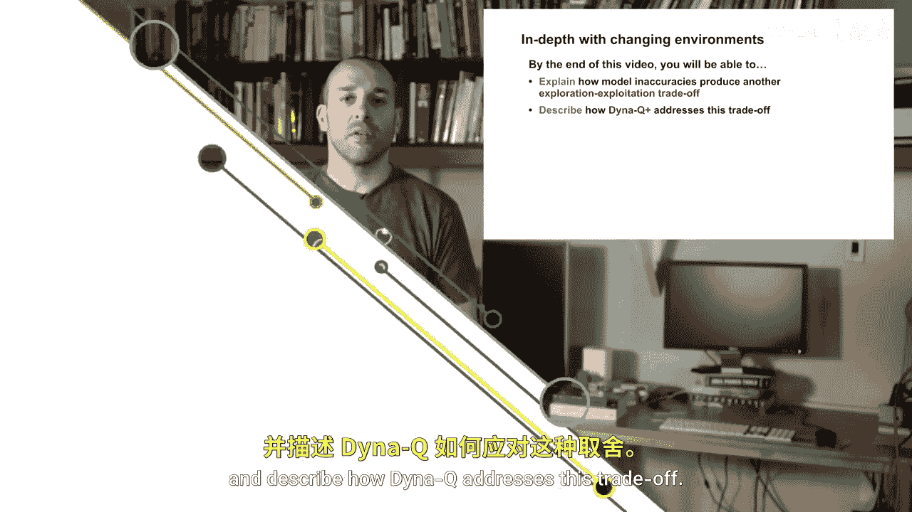
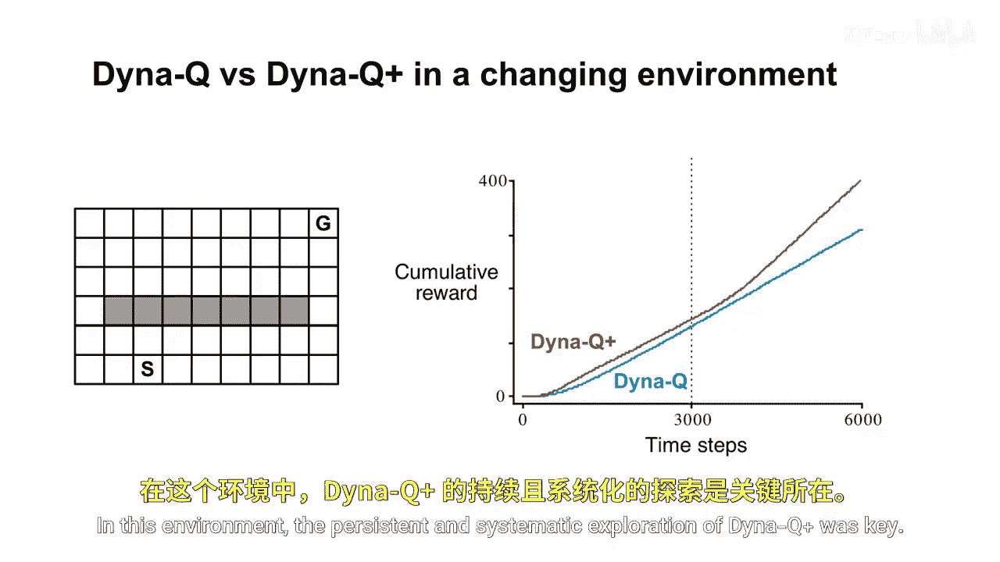

# 074：深入探讨变化环境中的问题 🧠

在本节课中，我们将学习当智能体的环境模型因环境变化而变得不准确时，智能体应如何应对。我们将探讨模型不准确性如何引发新的探索与利用权衡，并详细介绍Dyna-Q+算法如何通过引入探索奖励来解决这一挑战。

---

我们之前讨论了智能体如何在模型不完整的情况下进行规划。

现在，让我们探讨智能体如何应对因环境变化而导致模型不准确的问题。

通过本视频的学习，你将能够：解释模型不准确性如何产生另一种探索与利用的权衡，并描述Dyna-Q+算法如何应对这种权衡。

---

当智能体的模型不准确时，基于此模型的规划很可能会使策略或价值函数相对于真实环境变得更差。

这意味着智能体有强烈的动机确保其模型保持准确。在这个例子中，兔子的初始模型认为，如果它在最左侧格子选择向右移动，将直接到达胡萝卜处。

然而，在向右移动后，兔子发现自己处于中间的格子。

经历了这次状态转移后，兔子可以更新它对世界的模型。

这次更新反映了在最左侧格子选择向右移动动作将导致移动到中间格子。

我们看到兔子在环境中经历一次转移后纠正了它的模型。

通常，智能体可能希望复核其模型中所有的状态转移是否正确。

然而，复核那些低价值动作对应的转移通常会导致低回报。

在变化的环境中，智能体的模型可能随时变得不准确。

因此，智能体必须做出选择：进行探索以确保模型准确；或者假设模型正确，利用模型来计算最优策略。

当环境发生变化时，模型将变得不正确。

它将保持不正确，直到智能体重新访问环境中发生变化的那个部分并更新模型。

这表明智能体应该探索它有一段时间未曾访问过的地方。

让我们思考一下这如何实现。粗略地说，模型在智能体长时间未访问的状态上更可能出错。

例如，假设兔子知道乌龟起始于某个格子。

由于乌龟移动缓慢，它在最初几个时间步内无法移动很远。然而，经过很长时间后，乌龟可能处于与起始位置完全不同的格子，这使得兔子的模型变得不准确。

为了鼓励智能体定期重新访问状态，我们可以在规划使用的奖励上添加一个奖励加成。

这个加成项是 **`Kappa * sqrt(tau)`**。其中，R是来自模型的奖励，`tau`是该状态-动作对上次在真实环境中被访问后经过的时间。

`tau`不会在规划循环中更新，因为那并非一次真实的访问。

`Kappa`是一个小的常数，用于控制加成项对规划更新的影响程度。如果`Kappa`为零，我们将完全忽略这个加成。

将这种探索奖励加成添加到规划更新中，就得到了**Dyna-Q+算法**。

通过人为地增加规划中使用的奖励，我们提高了最近未被访问过的状态-动作对的价值。

这具体是如何鼓励探索的呢？想象一个状态-动作对`(s, a)`已经很长时间没有被访问过。这意味着`tau`值会很大。

随着`tau`增长，奖励加成变得越来越大。最终，由于巨大的加成，规划过程将改变策略，使智能体直接前往状态`s`。

当智能体最终访问状态`s`时，它可能会看到高额奖励，也可能会失望。

无论哪种情况，模型都将被更新以反映环境的真实动态。

---

让我们通过“捷径迷宫”的例子来理解Dyna-Q和Dyna-Q+的区别。在这个例子中，目标是从起始状态尽快到达目标状态。

除终止转移产生+1的奖励外，其他所有转移的奖励均为零。

折扣因子小于1，因为我们希望鼓励智能体快速到达目标。

Dyna-Q和Dyna-Q+都使用ε-贪心动作选择。

在实验的前半段，Dyna-Q和Dyna-Q+的行为非常相似。在这种情况下，Dyna-Q+增强的探索性帮助它更快地找到了一个好的策略。这就是为什么图中Dyna-Q+的曲线位于Dyna-Q曲线上方。

现在，我们在墙的右侧创建一条捷径。

让我们看看Dyna-Q和Dyna-Q+如何适应这个变化。它们能找到穿过墙右侧到达目标的更短路径吗？

以下是结果：Dyna-Q+在环境变化后不久就找到了捷径。而Dyna-Q在给定的时间内没有找到捷径。

最终，Dyna-Q通过使用ε-贪心策略重新探索整个状态-动作空间也能找到捷径，但这至少需要连续执行七次探索性动作，因此可能需要非常长的时间。

在这个环境中，Dyna-Q+持续且系统性的探索是关键。

---

在本节课中，我们讨论了模型不准确性如何产生一种新的探索与利用权衡变体。智能体必须进行探索以确保其模型准确。

我们还探讨了Dyna-Q+算法如何利用探索奖励加成来探索环境，从而在动态变化的世界中更有效地学习和适应。