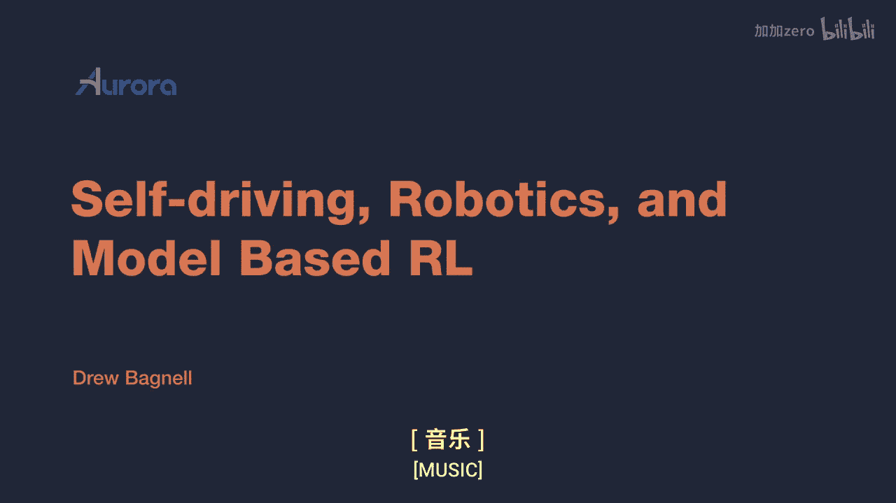

# 075：自动驾驶、机器人技术与基于模型的强化学习 🚗🤖

在本节课中，我们将跟随Aurora Innovation的首席技术官Drew Bagnell，探讨自动驾驶、机器人技术领域如何应用基于模型的强化学习。我们将重点了解处理连续状态和动作空间的核心方法，特别是二次价值函数近似技术。

大家好，我是Drew Bagnell，Aurora Innovation的首席技术官。
今天我将与大家探讨自动驾驶、机器人技术以及基于模型的强化学习。
我们正处在一场机器人技术革命的起点，从机械臂操作到无人机，再到自动驾驶汽车。
这些技术普遍深度依赖于机器学习。
例如，在感知领域，近二十年来，如果没有机器学习，我们几乎无法实现可靠的感知系统。

大家现在看到的视频中，一辆自动驾驶汽车正在典型的城市复杂环境中行驶。
**蓝色**框显示的是基于机器学习的感知系统，它正在检测和理解停放及行驶中车辆的运动。
**金色**框标识的是共享道路的骑行者。
**红色**框则标识了密集的行人群。
在这些应用中，实现所有天气和遮挡情况下的极高精度至关重要。

过去十年中，一个有趣的趋势是在决策过程中使用机器学习的重要性日益增加。
在城市环境中，决策制定非常复杂。
例如，这里展示的是一辆自动驾驶汽车在密集的人流中寻找穿行间隙。
这项任务的难点在于场景**上下文**和**其他参与者**的重要性。
事实证明，为类似此处演示的问题，甚至是像停车标志或并道这样简单的情况，手工制定规则都非常困难。

大家会注意到，我讨论的这些机器人技术示例都依赖于**连续的状态和动作空间**。
这里展示的是一个将基于模型的强化学习应用于特技直升机控制的精彩案例。
在Pieter Abbeel及其同事的这项工作中，他们证明了可以在连续的状态和动作空间（即模型直升机的位置、速度和控制指令）上，使用基于模型的强化学习技术，使其完成卓越的特技飞行。
使此类技术变得实用的关键，在于使用了直升机动力学的**连续状态和动作模型**。

## 什么是模型？🤔

那么，模型指的是什么？
所谓模型，我指的是一个**转移函数**或**动力学模型**，它是一个将当前状态和动作映射到下一个状态的函数。
同时，也包括一个可以评估在特定状态和动作下**成本**的函数。
该领域一个不为人知的秘密是，实际上所有涉及决策的机器人学习问题，在某种程度上都是基于模型的。

你可能会问，为什么会这样？
从根本上说，机器人与世界的交互是昂贵且耗时的。
常言道，**宁可在仿真中失败，也不要在现实世界中犯错**。
将这种直觉形式化的方法是讨论**样本复杂度**，即要达到高性能需要与世界进行多少次交互。
我们从实践和近期的理论研究中了解到，**使用模型进行学习所需的交互次数，可能比不使用模型时呈指数级减少**。

## 利用连续状态动作模型 🧮

接下来，我将带大家了解如何利用连续状态和动作模型。
我们将使用**二次价值函数近似**。
二次价值函数近似是一种用于基于模型的强化学习的强大技术，其根源可追溯到20世纪60年代的最优控制理论。
这类技术正是上面看到的精彩直升机特技表演中所使用的，并且被广泛用于从无人机到医疗机器人，从机械臂到自动驾驶汽车的轨迹生成。

这种对价值函数（同样是连续状态和动作）的二次形式近似特别优雅，原因有几个：
1.  对于一类简单的系统（特别是那些**动力学是线性**且**成本是二次型**的系统），这种二次价值函数近似是精确的，而非近似。
2.  对于其他问题，当动作价值函数在连续状态或动作上是凸的或局部凸的时，它被证明是对真实动作价值函数的优秀局部近似。

这里的关键在于，给定这种近似，我们可以**以闭式解的形式快速计算出最优策略**，即使是在连续动作空间中。
因此，实际动手计算最优策略是什么，是一个有趣的练习。

## 计算最优策略：一个练习 ✍️

对于单个标量状态变量 `X` 和单个标量控制或动作变量 `A`，手动进行这个计算是值得的。
如果你熟悉矩阵微积分，这会是一个非常快速的计算；但如果不熟悉，花些时间理解其工作原理是值得的。
美妙之处在于，一旦计算出这个最优策略，你可以将其代回动作价值函数，并提取出最优价值函数 `V`，而 `V` 也将是二次型的。

利用这一点的通用技术家族被称为**微分动态规划**。

## 整合与迭代：微分动态规划 🔄

一旦完成了上述练习，你可以将其与已在动态规划或使用贝尔曼方程中学到的技术结合起来，计算所有时间步的最优策略。
其思想是，我们以标准的动态规划形式**反向进行时间迭代**。
在每个时间步，我们计算模型和已知成本函数的一阶或二阶泰勒级数近似。
然后，我们使用贝尔曼方程，在给定未来价值的二次近似以及我们刚刚计算的模型和成本的二次近似的情况下，**反向推导出动作价值函数的二次近似**。
接着，你使用上面所做的练习来计算时间步 `t-1` 的最优策略，从而得到该步的最优价值。
这个过程在时间上反向迭代。

现在，利用我们描述的方法，然后回过头来**利用我们得到的新策略来改进泰勒级数近似**，是非常常见的。可以将其视为为我们提供了一个新的点来对模型进行线性化。

## 深入学习资源 📚

关于其中的代数运算和实际实现，有很多细节。幸运的是，网上有大量优秀的资源可供利用，以深入了解这些技术。
你可以找到我关于上述讨论技术的笔记，以及Katerina Fragkiadaki关于同一主题的讲座。
我还要指出，Yevgen Chebotar等人的论文《Online Trajectory Optimization》对于我刚描述的方法阐述得特别清晰易懂。

## 总结 📝

本节课中，我们一起学习了基于模型的强化学习在自动驾驶和机器人技术中的关键作用。
我们了解到，使用模型可以显著降低学习的样本复杂度。
我们重点探讨了**二次价值函数近似**这一强大工具，它允许我们在连续状态和动作空间中高效地计算最优策略。
通过**微分动态规划**方法，我们可以迭代地优化策略。
最后，我们掌握了如何通过泰勒级数近似来构建和优化模型，从而解决实际的强化学习问题。
现在，我们已经有了一种可以利用连续状态和动作模型来学习最优或接近最优策略的技术，下一步我们将讨论如何构建模型以解决更广泛的RL问题。