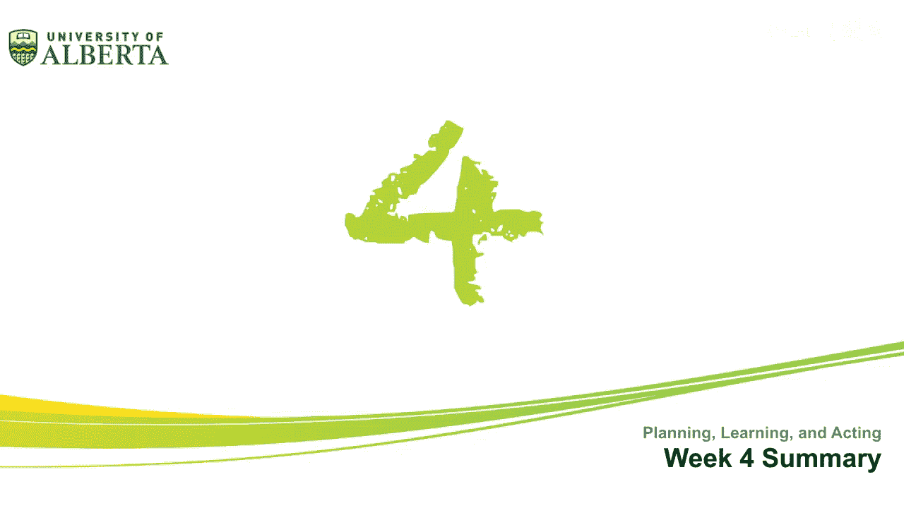
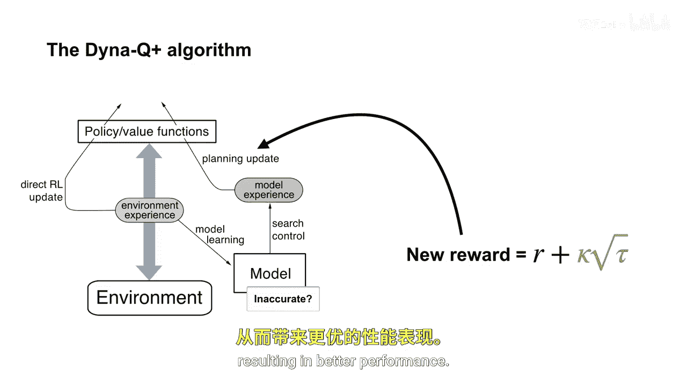

强化学习专项课程：04：第四周总结

在本节课中，我们将回顾第四周学习的核心概念与算法。本周我们聚焦于规划、学习与行动的结合，探讨了模型、规划算法以及如何整合它们以构建更高效的智能体。

## 🧠 第一课：模型介绍

上一节我们完成了对学习方法的探讨，本节中我们来看看智能体如何利用对环境的理解进行规划。我们首先引入了**模型**的概念，并讨论了**分布模型**与**样本模型**的区别。

*   **分布模型**：存储每个可能结果发生的概率。然而，这可能需要大量的内存。
*   **样本模型**：通常比分布模型紧凑得多，因为它们不显式存储每个结果的概率。

## 🔄 第二课：一步Q规划

了解了模型的基本类型后，我们来看看如何利用模型进行规划。我们介绍了**一步Q规划**。Q规划使用与Q学习相同的更新规则，但其使用的经验是由模型生成的，而非来自真实环境。

其更新公式与Q学习一致：
`Q(S, A) ← Q(S, A) + α [R + γ * max_a Q(S', a) - Q(S, A)]`
区别在于 `(S, A, R, S')` 这个元组来源于模型模拟，而非实际交互。

## 🏗️ 第三课：Dyna架构

我们已经分别学习了利用真实经验的学习和利用模型经验的规划，本节我们将二者结合。我们引入了**Dyna架构**。Dyna将规划和学习整合在同一个智能体中。

我们看到，Dyna-Q智能体可以通过执行多次规划更新，显著加快学习速度。其核心流程是：智能体从真实环境获得经验，用此经验**学习**更新模型和Q值，同时利用已学习的模型反复进行**规划**来更新Q值。

## ⚠️ 第四课：不准确模型的影响

然而，模型并非总是准确的。在第四课中，我们讨论了**不准确的模型如何影响规划**。

我们指出，Dyna-Q可以利用一个**不完整**的模型（即只覆盖部分状态-动作对）进行有效规划，但如果模型是**错误**的（即对状态转移或奖励的预测有误），规划就会产生问题，导致智能体学到次优策略。

## 🚀 第五课：Dyna-Q+ 算法

为了解决模型不准确的问题，我们最后介绍了**Dyna-Q+** 算法。该算法在其规划更新中使用了一个**奖励加成**，以鼓励对长期未访问的状态-动作对进行探索。

通过主动探索，Dyna-Q+ 能使其模型保持更新和准确，从而获得更好的性能。其规划更新中的奖励公式可表示为：
`R + κ * √(τ)`
其中 `τ` 代表自某个状态-动作对被访问以来经过的时间步数，`κ` 是一个调节探索强度的参数。

## 📚 本周总结

本节课中，我们一起学习了第四周的核心内容。我们首先区分了分布模型和样本模型，然后介绍了一步Q规划算法。接着，我们探讨了将规划与学习结合的Dyna架构，并分析了模型不准确时带来的挑战。最后，我们引入了Dyna-Q+算法，它通过奖励加成鼓励探索，以维持模型的准确性。本周涵盖了从基础模型到高级整合算法的大量内容，为构建更高效的强化学习智能体奠定了重要基础。