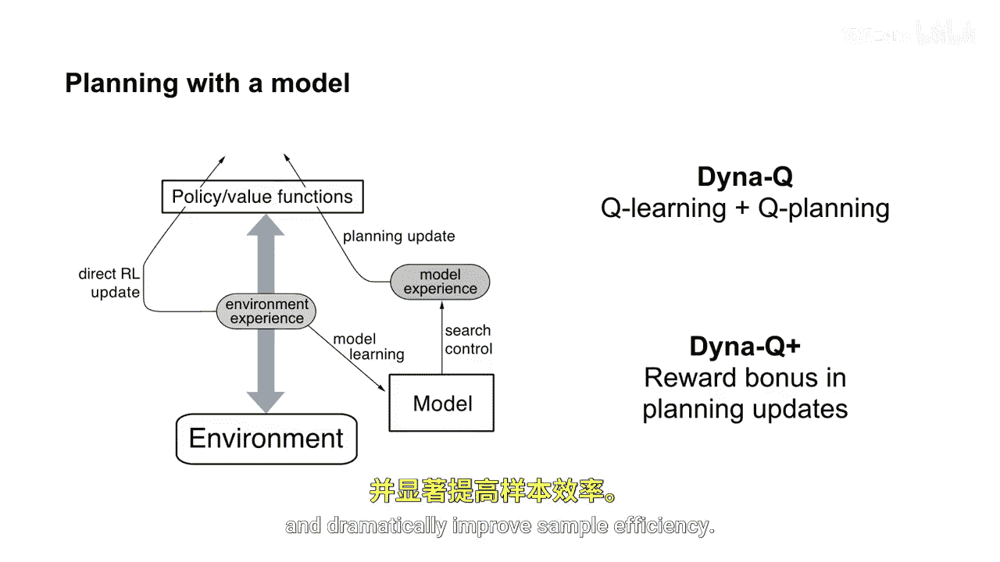

强化学习专项课程：第77讲：课程回顾与总结 🎉

在本节课中，我们将回顾基于采样学习方法课程的全部内容。我们将总结已涵盖的核心概念，并简要展望后续课程的方向。

您已经完成了整个基于采样学习方法的课程。让我们快速回顾一下所涵盖的内容。

我们讨论了两种从采样经验中学习的方法。第一种是蒙特卡洛方法，它通过平均回报来估计价值函数。第二种是时序差分学习，它在更新目标中使用对下一状态的估计价值。

我们发现，时序差分学习像蒙特卡洛一样从采样经验中学习，但也像动态规划一样进行自举更新。我们展示了如何实现时序差分算法来估计状态价值函数和动作价值函数。

随后，我们讨论了使用Sarsa、期望Sarsa和Q学习进行控制的方法。Sarsa是一种同策略算法，它估计其正在遵循的策略的价值。Q学习是一种异策略算法，它估计最优策略的价值函数。期望Sarsa既可以用于同策略，也可以用于异策略。它在更新目标中显式计算下一状态的期望价值。这个期望可以基于任何策略进行计算，因此期望Sarsa可以用于异策略学习。我们证明了Q学习是期望Sarsa的一个特例。

在最后一个模块中，我们讨论了使用模型经验进行规划。我们介绍了Dyna架构，它结合了从模型经验进行规划和从环境经验进行学习。我们讨论了Dyna-Q，它结合了Q学习和Q规划。在一个实验中，我们看到Dyna-Q的规划更新使其比单纯的Q学习具有更高的样本效率。

最后，我们考虑了当模型不准确时会发生什么。我们展示了Dyna-Q+如何在规划更新中添加探索奖励，以鼓励探索。这个奖励帮助Dyna-Q+注意到Dyna-Q可能忽略的环境变化。

我们希望您喜欢学习基于采样的学习方法。在下一门课程中，我们将看到如何将基于采样的学习与函数近似相结合。我们将学习泛化，这是一种扩展强化学习并显著提高样本效率的强大工具。

您已学到的许多概念将会延续，但也将面临一些新的挑战。请继续关注，我们将一同探索如何解决它们。

在本节课中，我们一起回顾了基于采样学习方法的核心内容，包括蒙特卡洛与时序差分学习、多种控制算法（如Sarsa、Q学习、期望Sarsa），以及结合规划与学习的Dyna架构。最后，我们展望了下一阶段将函数近似与强化学习结合的前景。