# 078：函数近似简介 🚀

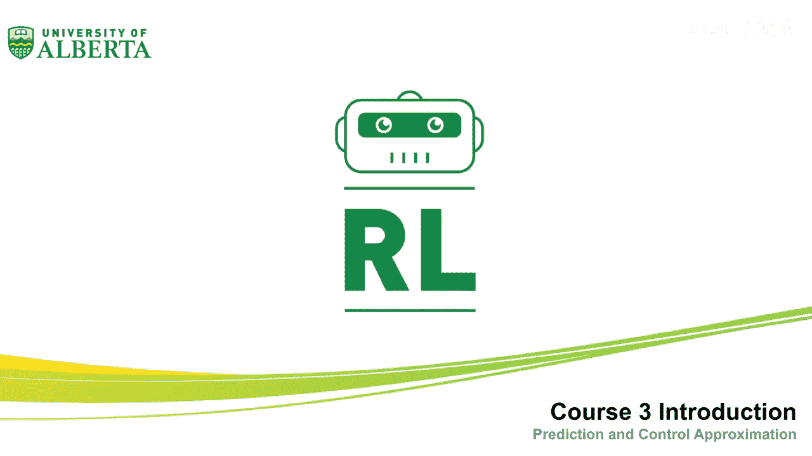

在本节课中，我们将要学习强化学习课程3的核心内容。课程3标志着学习旅程的一个重要转折点，我们将从表格型方法转向**函数近似**。这既包含了对已学概念的延续，也引入了全新的技术视角，例如**目标函数**、**梯度下降**和**参数化函数**。

---

## 新旧交融的旅程 🔄

课程3的故事是关于“旧”与“新”的结合。

我们即将开启在函数近似框架下的强化学习新旅程。说它“新”，是因为我们将首次深入讨论**目标函数**、**梯度下降**、**参数化函数**、**泛化**与**区分**这些概念。

但你已经为此做好了充分准备。关于探索、利用、价值函数、策略的核心理念，以及你已经学过的许多算法，都能以一种自然的方式迁移到函数近似的设定中。

---

## 视角的重大转变 🧠

课程的开篇代表着一个重要的视角转变。我们需要将焦点转向学习**参数化函数**。

我们将不再假设能够将所有状态的价值存储在一个表格中。事实上，我们甚至无法保证能再次见到同一个状态。取而代之的是，我们将学习由一组权重（例如神经网络）参数化的函数，来近似估计价值。

我们无法使这种近似达到完美。这意味着在某些状态下，我们必须接受价值函数存在不准确性。

尽管如此，转向参数化价值函数整体上是积极的，因为它带来了**泛化**能力。这实际上反映了我们人类的学习方式：你会根据修读其他课程的经验，来泛化预测这门课程需要投入多少工作量。

---

## 技术概念的深化 ⚙️

接下来的概念会更具技术性。我们将分析智能体遇到的状态分布，以及这如何影响价值函数的准确性。我们将计算**目标函数的梯度**，并推导出新的学习规则。

在专项课程的这个阶段，你已经学习了许多内容，现在我们将学习一系列新东西。这很容易让人迷失方向，更糟的是，你可能会看不清哪些算法对当前任务最相关。

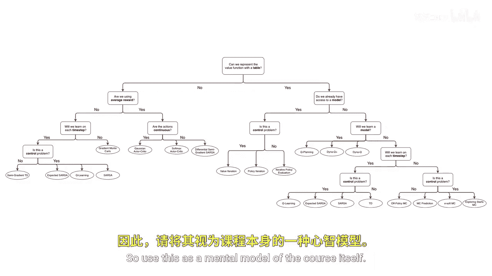

为了帮助解决这个问题，我们开发了一张**课程地图**。

---

## 课程地图导航 🗺️

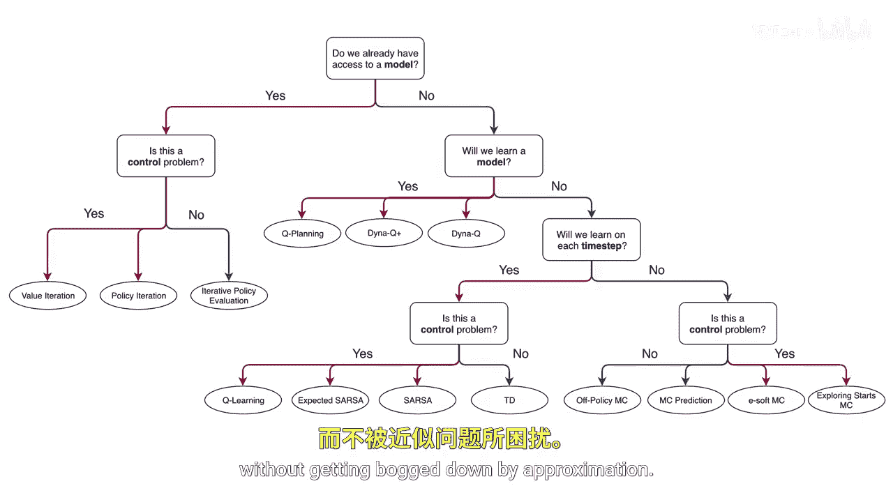

课程地图的理念是，你可以从树状图的顶部开始，逐步向下找到最适合你问题的算法。请记住，这是一张课程地图，它并未包含强化学习中的所有算法，只涵盖了我们讨论过的那些。这张地图旨在总结本课程的算法，并不一定是分类更广泛RL算法的最佳方式，因此请将其视为对本课程内容的一个心智模型。

让我们借助地图回顾一下在课程一和课程二中涵盖的内容。

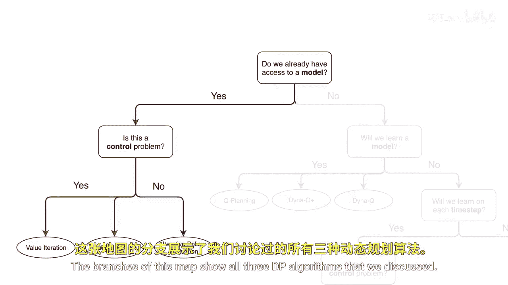

我们最初假设智能体可以用表格完美地表示价值。这样做是为了专注于强化学习的基本概念，而不被近似问题所困扰。

我们讨论的第一类RL方法使用一个给定的（而非学习的）世界模型。我们使用**动态规划**方法，无需与环境交互，直接从模型计算价值函数和最优策略。地图的这个分支展示了我们讨论过的所有三种DP算法。

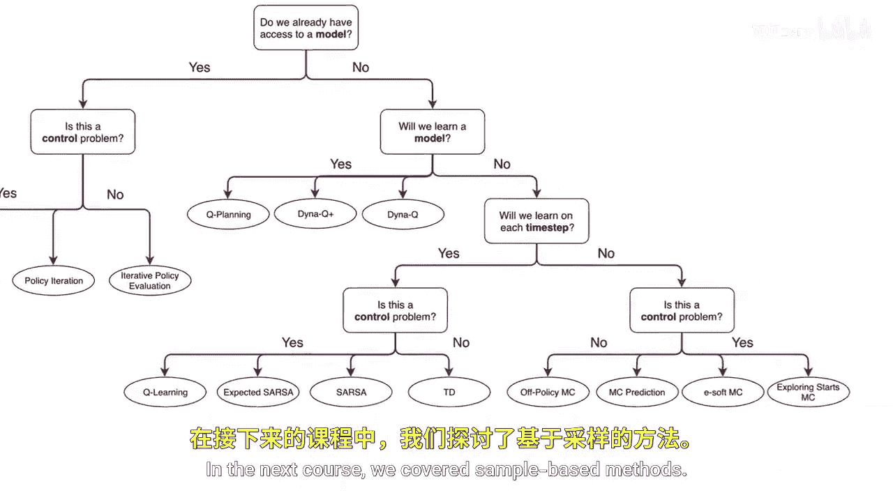

在下一门课程中，我们涵盖了**基于样本的方法**。我们首先讨论了必须等到一个回合结束后才能进行更新的**蒙特卡洛方法**。我们学习了两种用于预测和两种用于控制的MC方法。

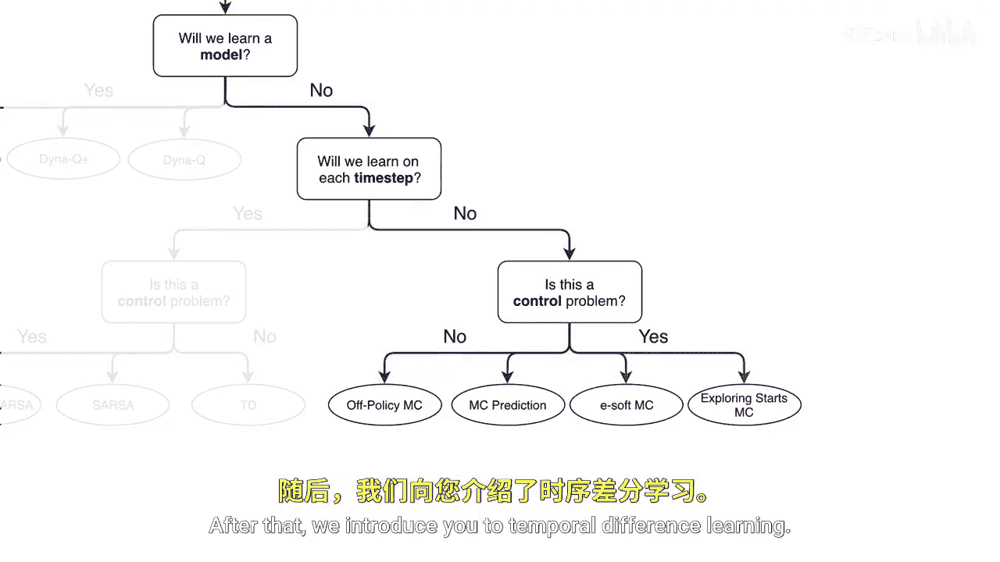

之后，我们向你介绍了**时序差分学习**。这类算法允许智能体在回合的每一步更新价值函数和策略。在这里，我们学习了一些强化学习中最广泛使用的算法，包括 **Q学习**、**SARSA** 和 **期望SARSA**。

我们通过循环回到**基于模型的规划方法**来结束课程二，研究了智能体在与世界交互时学习模型的**Dyna架构**。

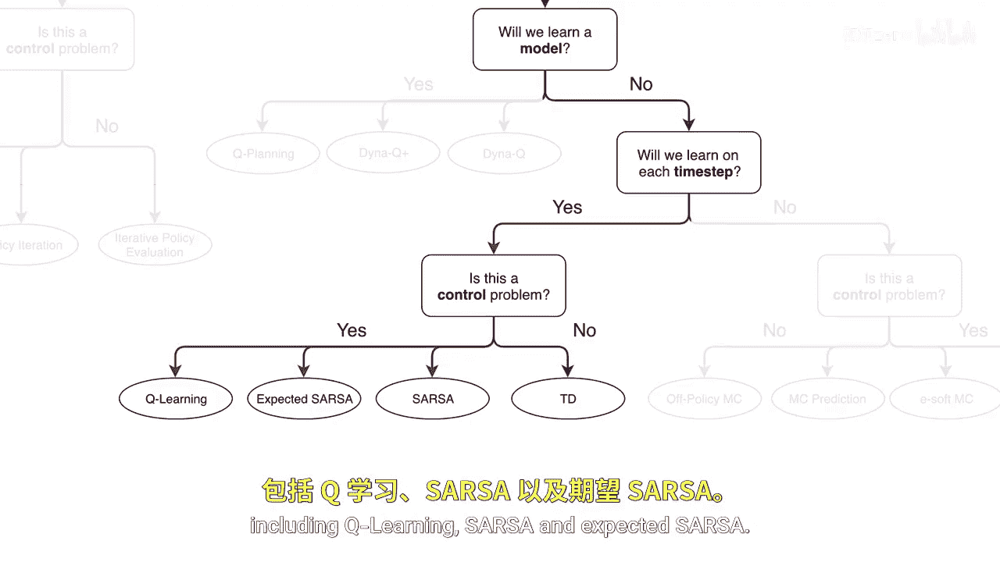

---

## 课程3的学习路径 ➡️

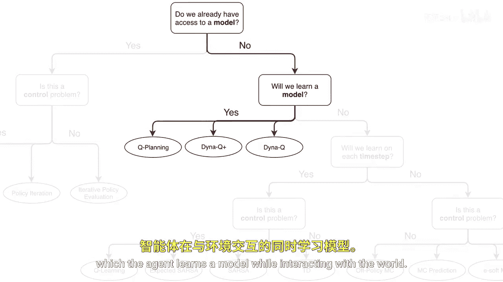

对于课程3，我们只需要这张地图的右侧部分。

我们将首先介绍**参数化函数**，以及如何用它们来近似价值函数。我们将讨论**泛化**与**区分**，以及特定的函数近似器，包括**粗编码**和**神经网络**。

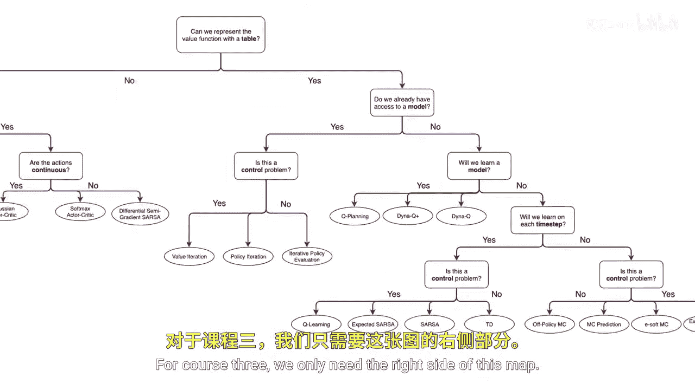

和之前一样，我们将从**预测**开始，利用监督学习和梯度下降的思想，推导出新的蒙特卡洛和TD算法。

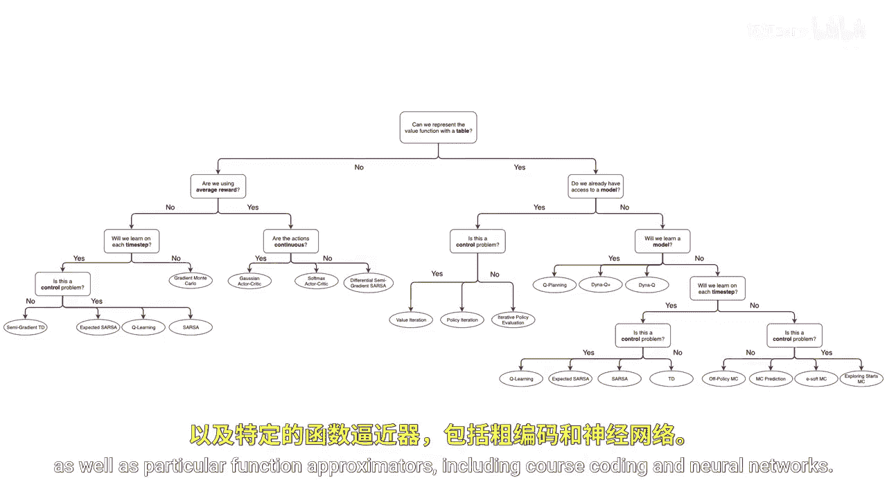

然后，我们将讨论用于函数近似的**控制算法**，这包括期望SARSA和Q学习。

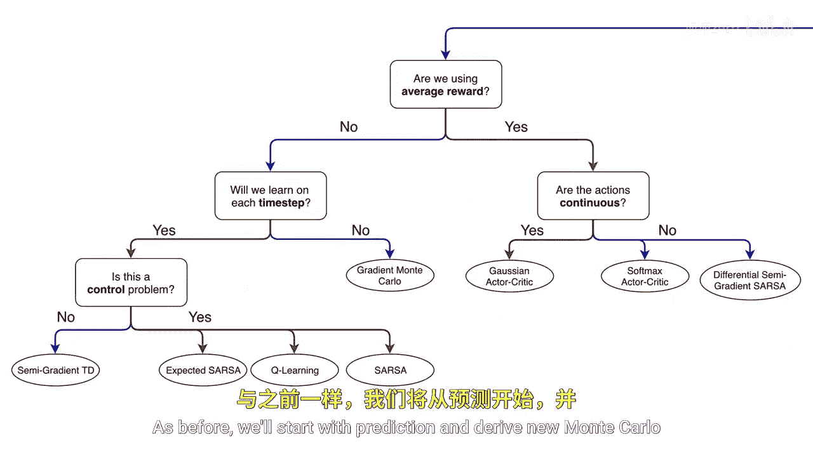

之后，我们将用一种称为**平均奖励**的、表述持续性控制问题的新方法，彻底颠覆你的认知。

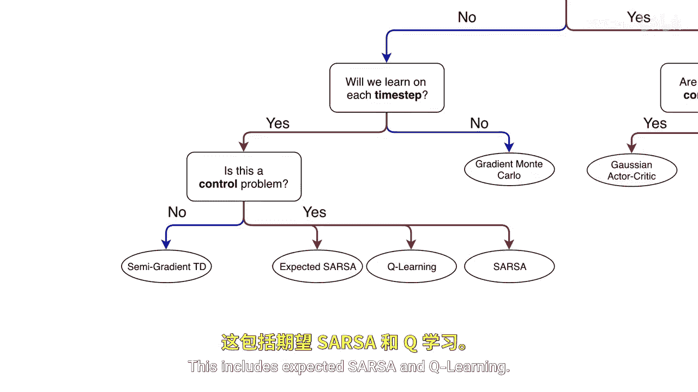

我们将以**参数化策略**作为课程3的收尾。简而言之，我们可以像参数化价值函数一样参数化策略。我们将讨论如何在平均奖励设定下做到这一点。

---

## 总结与展望 🎯

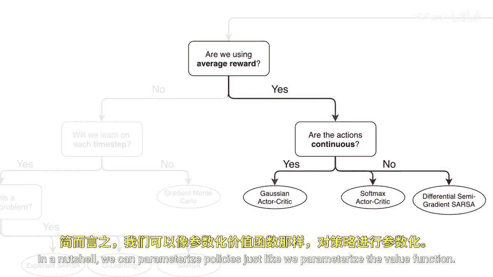

在本节课中，我们一起学习了课程3的总体框架和核心转变。我们了解到，课程3将结合已学的强化学习基础，引入函数近似这一关键技术，包括目标函数、梯度下降和参数化表示。

通过本课程的学习，你将掌握将强化学习扩展到实际问题所需的大部分知识。然后，你将能够在课程4中运用所有这些新获得的理解，去实现一个完整的强化学习系统。

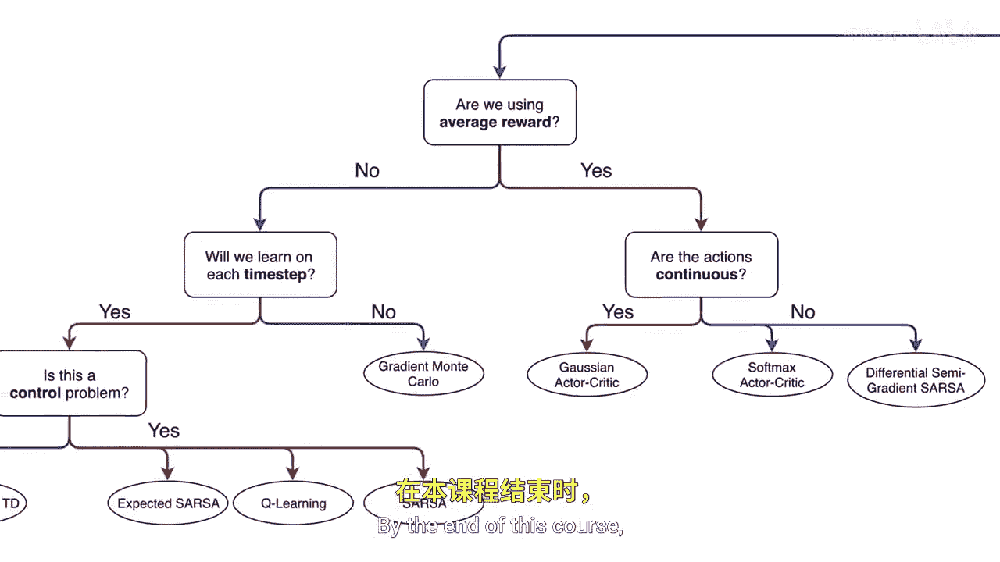

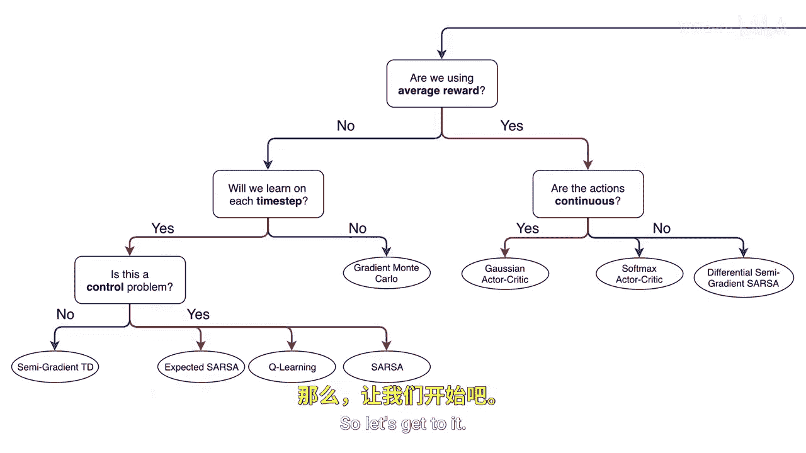

那么，让我们开始吧！