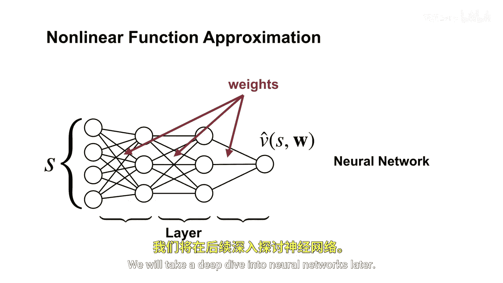

# 080：转向参数化函数

在本节课中，我们将要学习如何从表格化方法转向使用参数化函数来近似价值函数。我们将理解参数化函数的概念，解释线性函数近似，并认识到表格化表示其实是线性价值函数近似的一个特例。

## 从表格化方法到函数近似

上一节我们介绍了表格化方法，即存储一个表格，为每个可能的状态单独学习一个价值。

在现实世界的问题中，这些表格会变得异常庞大。想象一个通过摄像头观察世界的机器人，我们显然无法为每一张可能的图像都存储一个表格条目。

幸运的是，表格化并非唯一的选择。本节中，我们将探讨更通用的近似价值函数的方法。

## 理解参数化函数近似

在之前的课程中，我们花了大量时间思考如何估计价值函数。到目前为止，我们的价值近似始终采用同一种形式：为每个状态在表格中存储一个独立的价值，并在学习过程中查找和修改这些值。

但这并非近似价值函数的唯一方式。原则上，我们可以使用任何以状态为输入、输出一个实数的函数。例如，在一个网格世界中，我们的价值函数近似可以接收x和y坐标，并将它们相加来产生一个价值估计。

这只是一个启发性的例子。我们不会真的使用这个函数作为价值函数，因为它无法被修改，我们也就无法进行学习。

这正是参数化函数概念的用武之地。我们引入一组实数值权重，通过调整这些权重来改变函数。例如，在这个网格中，我们可以使用形如 `W1 * x + W2 * y` 的函数，而不是固定的x与y之和。

权重 `W1` 和 `W2` 参数化了我们的函数，它们允许我们改变函数生成的输出。为了表示这个函数近似于真实的价值函数，我们使用符号 `V_hat`。`W` 是一个向量，包含了参数化近似的所有权重。

我们不再需要存储整个价值表格，而只需存储两个权重来表示我们的价值函数近似。你可以想象，对于大型状态空间，这种紧凑的表示方式非常有用。

## 参数化函数的影响

使用表格化表示时，修改一个状态的价值估计不会影响其他状态。对于参数化函数，情况则不同。

观察当我们改变 `W1` 时，每个状态的价值估计会发生什么变化。如果我们改变 `W1` 或 `W2`，将会改变**每一个**状态的价值估计。

现在，我们的学习算法将修改权重，而不是修改单个状态的价值。

## 线性价值函数近似

我们刚刚讨论的例子是一个特例，称为**线性价值函数近似**。在这种情况下，每个状态的价值由权重的线性函数表示。

这意味着每个状态的价值被计算为权重乘以状态某些固定属性（称为**特征**）的总和。我们可以简洁地表达这一点：近似价值由特征向量和权重向量的内积给出。

我们用粗体 `x(S)` 来表示特征向量。

**公式：**
`V_hat(S, W) = x(S)^T * W`

我们的特征选择会影响我们能够表示的价值函数类型。例如，考虑我们目前讨论的近似方法。使用它，我们只能表示那些随特征 `x` 和 `y` 线性变化的价值函数。

考虑一种情况，真实价值函数由网格上的数字给出。我们无法将其表示为 `x` 和 `y` 的线性函数。为了让外围的值正确，`W1` 和 `W2` 都需要为0。然而，这将意味着内部的值不正确，因为要使和为5，`W1` 和 `W2` 中至少有一个必须非零。

但我们不必使用 `x` 和 `y` 作为特征。线性函数近似的关键在于拥有好的特征。在这里，`x` 和 `y` 对于这个问题来说不是好特征。不过，正如你稍后将看到的，有许多强大的方法可以构造特征。

## 表格化是线性近似的特例

线性函数近似实际上非常通用。事实上，表格化表示是线性函数近似的一个特例。

为了构建一个线性价值函数来表示这个表格化价值函数，我们需要定义特征。让我们选择特征为特定状态的指示函数。

对于状态 `S_i`，特征 `i` 为1，其余特征为0。我们有16个特征，每个状态一个。

让我们用这些特征计算一个状态的近似价值。由于除了一个特征外，所有特征都为零，内积就等于与该状态相关联的单个权重。

由于每个状态的价值都由一个独立的权重表示，这等价于一个表格化价值函数。

## 其他参数化函数类型

这些参数值是通用的，我们可以考虑许多不同类型的函数。

神经网络是非线性状态函数的一个例子。网络的输出是给定状态的近似价值。状态作为输入传递给网络。网络中的所有连接都对应实数值权重。当数据通过连接传递时，权重会乘以其输入。这个过程通过一系列层转换输入状态，最终产生价值估计。我们将在后续课程中深入探讨神经网络。

## 总结

本节课中，我们一起学习了参数化函数的概念，以及如何利用它们来近似价值函数。你现在应该对参数化函数及其在价值函数近似中的应用感到熟悉。

我们了解到，线性函数近似是一种强大的方法，它通过特征向量和权重向量的组合来表示价值，而表格化方法只是其一个特例。我们还认识到，除了线性函数，还有其他如神经网络等非线性函数可用于近似。

在接下来的课程中，我们将讨论如何在智能体与世界交互的同时，更新这些近似的价值函数。