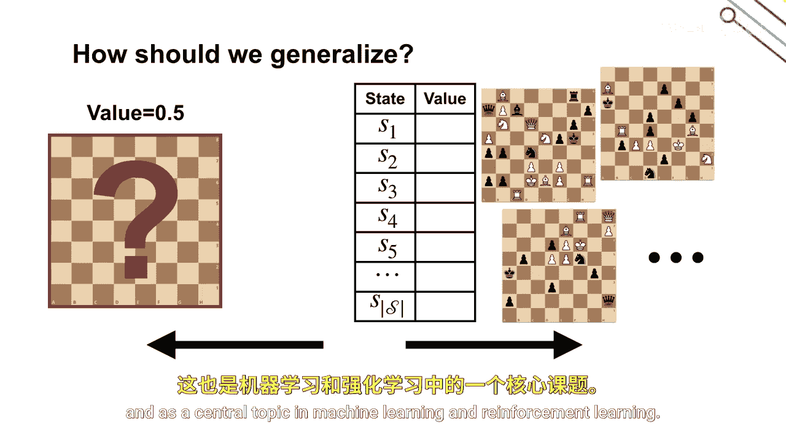

# 081：泛化与辨别

在本节课中，我们将要学习函数近似中两个核心且相互关联的概念：泛化与辨别。理解它们如何影响智能体的学习效率和最终性能至关重要。

## 泛化的概念与益处

上一节我们介绍了函数近似的基本思想，本节中我们来看看泛化的具体含义。泛化直观上意味着将特定情境中学到的知识，应用到更广泛的情境中得出结论。在策略评估的语境下，泛化指的是**对一个状态价值估计的更新，会影响到其他状态的价值**。

想象一个机器人收集易拉罐的任务，它通过分布在各地的传感器观察世界。在许多位置，机器人开车到最近易拉罐所需的时间是相同的。尽管这些位置对应的传感器读数不同，但它们具有相似的价值，因此我们希望价值函数能在这些状态之间进行泛化。

泛化可以通过更好地利用已有经验来加速学习。如果我们能从相似状态学习到一个状态的价值，那么我们可能无需频繁访问每一个状态就能获得其正确的价值估计。

## 辨别的必要性

然而，仅有泛化是不够的。辨别指的是**区分两个状态价值的能力**，即为两个状态赋予不同价值。

回到机器人收集易拉罐的例子。设想一个状态：易拉罐在3英尺外，但隔着一堵墙。对比另一个状态：易拉罐同样在3英尺外，但有一条畅通的路径可以到达。机器人需要为这两个状态分配不同的价值。

因此，虽然在与最近易拉罐距离相似的状态之间进行泛化很有用，但**当其他信息可能影响状态价值时，基于这些信息对不同状态进行辨别也同样重要**。

## 泛化与辨别的权衡

我们可以用一个以泛化和辨别为二维坐标的图来可视化可能的方法空间。

*   **表格方法**位于图的下方。它们能完美地区分不同状态，但完全不会泛化学到的价值。每个价值都是独立表示的。
*   **另一个极端**是将所有状态视为相同。每次更新都会泛化到所有状态，但完全无法进行辨别。最多只能学到独立于当前状态的平均回报，这并不实用。

我们真正需要的是**一种能实现良好泛化和良好辨别的学习方法**。这种方法会将学到的价值泛化到相似状态，从而学得更快；同时也能区分状态，这意味着随着数据增多，价值函数近似可以准确地表示价值。

在实践中，我们更可能得到一个权衡点，例如**用一定程度的辨别能力来换取泛化能力**。我们可能会将相似的状态组合在一起，并用一个数字来表示它们的价值。

## 实例分析：国际象棋

为了建立更多直觉，让我们以国际象棋游戏作为一个具体例子。

*   **极端情况一：将所有状态视为相同**。这个价值对应于不考虑游戏状态时的获胜概率。对于实力相当的玩家，这个数字可能是50%。
*   **极端情况二：表格情况**，将每个状态都视为完全不同。这对于小问题可行，但在像国际象棋这样的游戏中，甚至枚举所有可能状态都是不切实际的（大约有10^46个状态）。进一步想象，单独学习所有这些状态的价值需要多长时间。

我们显然需要一种介于两者之间的方法，在**获胜概率相似的状态之间进行泛化**。如何识别这些相似性以获得这样的分组是一个难题，没有单一的答案。如何进行泛化对我们的算法性能有重大影响，这也是机器学习和强化学习中的一个核心主题。

## 总结

本节课中我们一起学习了：
1.  **表格表示法**提供了良好的辨别能力，但没有泛化能力。
2.  **泛化**对于加速学习非常重要。
3.  同时具备**泛化和辨别能力**是理想状态，但在实践中通常需要进行权衡。

在接下来的几个模块中，我们将在研究具体的函数近似器时，再次探讨这些概念。