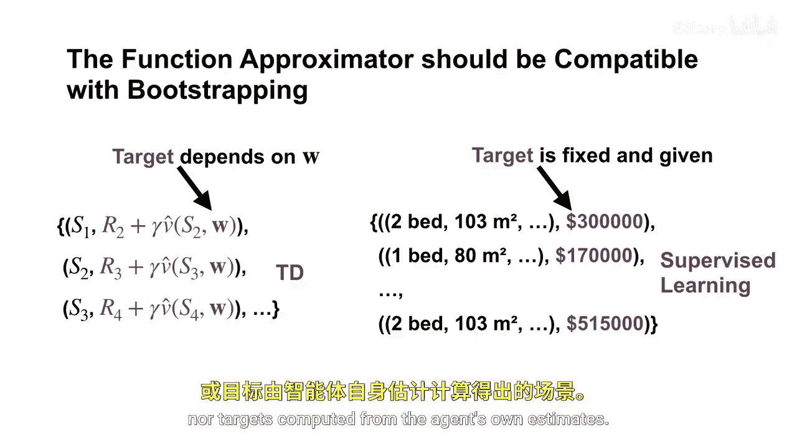

强化学习专项课程：05：将价值估计构建为监督学习问题

在本节课中，我们将学习如何将强化学习中的价值估计问题，构建成一个监督学习问题。我们还将认识到，并非所有的函数近似方法都适用于强化学习。

---

监督学习方法通过一组输入-目标示例来学习一个函数，这与强化学习非常不同。

然而，监督学习方法对于处理强化学习问题的某些部分可能很有用。

到本视频结束时，你将能够理解价值估计如何被构建为监督学习问题，并认识到并非所有的函数近似方法都适合用于强化学习。

---

### 监督学习概述

监督学习涉及在给定一组输入-目标对数据集的情况下近似一个函数。

例如，假设我们有一份房屋价格列表，以及每栋房屋的一系列属性。

我们可以使用监督学习来训练一个函数，该函数以房屋属性作为输入，并估计该房屋的预期价格。

我们希望学习到的函数也能推广到训练集中未出现的房屋，近似其预期价格。

这个参数化函数可以用多种方式表示，例如，一个神经网络。

---

### 将策略评估构建为监督学习问题

强化学习中的策略评估问题可以类似地构建。

这种相似性在蒙特卡洛方法中最为明显。

请记住，蒙特卡洛方法使用回报样本来估计价值函数。

我们可以将其视为一个监督学习问题的例子，其中输入是状态，目标是回报。

通过在足够多的示例上进行训练，我们希望学习到的函数的输出能够很好地近似预期回报，换句话说，近似每个状态的价值。

---

### 时序差分方法

时序差分方法也可以构建为监督学习。

在这种情况下，目标是单步自举回报。

原则上，监督学习中的任何函数近似技术都可以应用于策略评估任务。

然而，并非所有技术都同样适用，让我们看看原因。

---

### 强化学习的独特挑战

在强化学习中，智能体与环境交互并不断生成新数据。

这通常被称为**在线设置**，以区别于**离线设置**。在离线设置中，完整的数据集从一开始就可用，并且在学习过程中保持不变。

如果我们想使用函数近似技术，我们应该确保它能在在线设置中工作。

有些方法与在线设置不兼容，因为它们要么是为固定批次数据设计的，要么不是为时间相关的数据设计的。

而强化学习中的数据总是相关的。

---

### 自举带来的额外复杂性

在应用监督学习技术时，时序差分方法引入了额外的复杂性。

时序差分方法使用自举，这意味着我们的目标现在依赖于我们自己的估计。

这些估计会随着学习的进行而改变，因此我们的目标也在不断变化。

这与监督学习不同，在监督学习中，我们有一个真实标签作为目标。

例如，房屋的价格不依赖于我们的估计，也不会因为我们的估计改变而改变。

监督学习方法通常不是为变化的目标而设计的，也不是为从智能体自身估计计算出的目标而设计的。

---

### 总结

本节课中，我们一起学习了如何将策略评估任务构建为监督学习问题。

但我们也认识到，并非所有来自监督学习的方法都适用于强化学习。

我们需要与在线更新和自举兼容的方法。下次见。