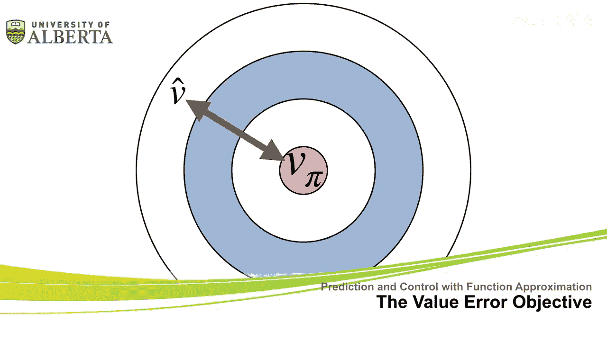
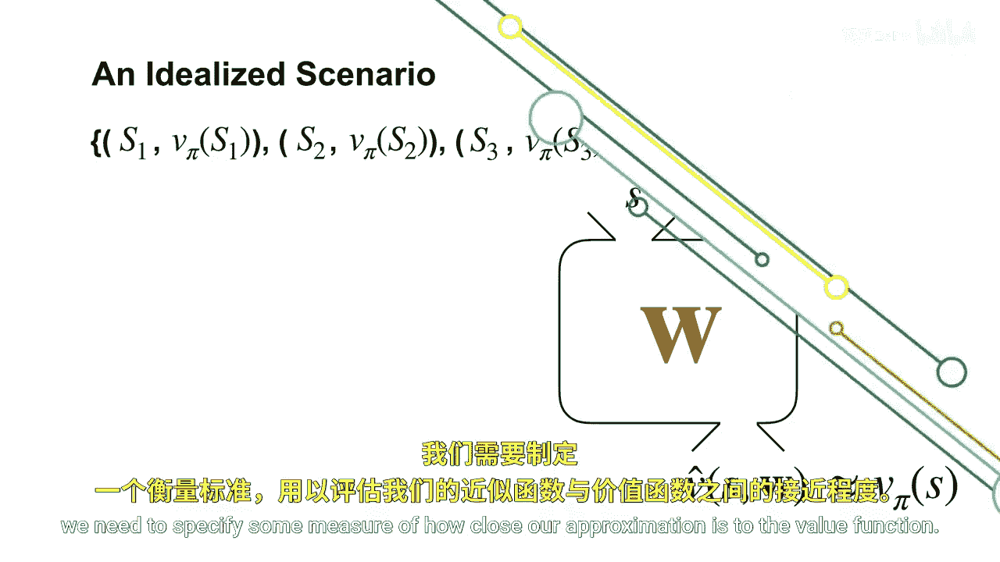
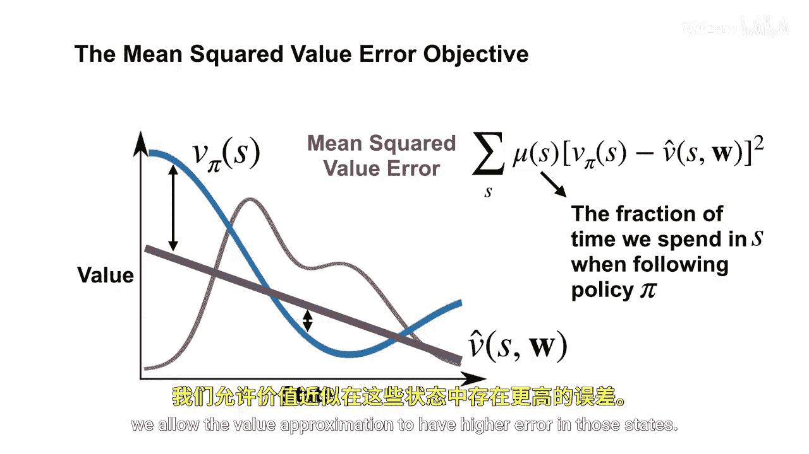

# 083：价值误差目标 🎯

在本节课中，我们将学习如何将价值估计问题形式化为一个监督学习问题，并明确其需要优化的目标函数。

上一节我们讨论了将价值估计视为监督学习问题的框架。在监督学习中，确定需要优化的目标是一个关键步骤。本节中，我们将更精确地定义我们希望优化的目标。

## 理想化场景与目标定义

首先，让我们想象一个理想化的场景：我们获得了一系列状态及其对应真实价值的数据对。我们的目标是找到一个参数化的函数，使其能够紧密地近似真实的价值函数 Vπ。

我们通过调整函数权重来实现这一点，使得对于给定的状态，函数的输出能尽可能接近其关联的真实价值。然而，我们通常无法在所有状态上都完美匹配价值函数。我们所选择的函数近似方法会限制我们能够表示的价值函数范围。

为了使目标更精确，我们需要定义一个衡量标准，来量化我们的近似值与真实价值函数之间的接近程度。

## 均方价值误差目标

考虑一个用 **`V̂(s, w)`** 表示的线性价值函数近似。为了可视化更简单，我们假设状态是单维且连续的。下图展示了我们估计的价值函数。

现在，假设真实的价值函数如下图所示。显然，我们的近似并不完美，但差距有多大呢？

让我们更精确地定义这个差距。首先，我们定义一个衡量单个状态价值与其近似值之间误差的指标。一个自然的选择是**平方误差**，即真实价值与近似值之差的平方。

然而，仅凭单个状态的误差不足以定义函数近似的整体目标。因为提高一个状态的估计精度，往往意味着会降低另一个状态的精度。

因此，我们需要指定我们有多关心每个状态的价值估计准确性，我们将这个权重称为 **μ(s)**。关于这一点，稍后会详细说明。

现在，我们可以将完整的目标函数写为在整个状态空间上加权平方误差的总和，其中每个状态的权重是 μ(s)。我们称此目标为**均方价值误差**。

## 状态分布 μ(s) 的作用

回到 μ(s) 的选择问题。记住，μ(s) 应该告诉我们有多关心每个状态。

一个自然的衡量标准是，在遵循策略 π 时，访问每个状态的时间比例。这意味着我们希望最小化在遵循策略 π 时所访问状态的平均价值误差。策略花费更多时间访问的状态，在目标函数中具有更高的权重；而对于策略较少访问的状态，我们对其误差的关心程度则较低。

μ(s) 是一个概率分布，如幻灯片所示。在这个例子中，策略在状态空间两端花费的时间很少。这意味着在均方价值误差目标下，我们允许价值近似在这些状态上具有更高的误差。

## 目标的意义与后续步骤

请记住定义这个目标的目的：我们希望调整权重参数 **w**，以使均方价值误差 **`VĒ(w)`** 尽可能低。

以某种方式改变权重可能会增加价值误差，而以另一种方式改变则可能减少价值误差。在下一讲中，我们将讨论如何利用梯度下降法来逐步调整权重。

---

本节课中，我们一起学习了为什么在函数近似下进行策略评估需要我们指定一个目标函数，而均方价值误差是其中一个可能的目标。我们明确了误差的衡量方式，并理解了状态访问分布 μ(s) 在加权误差、定义整体优化目标中的关键作用。