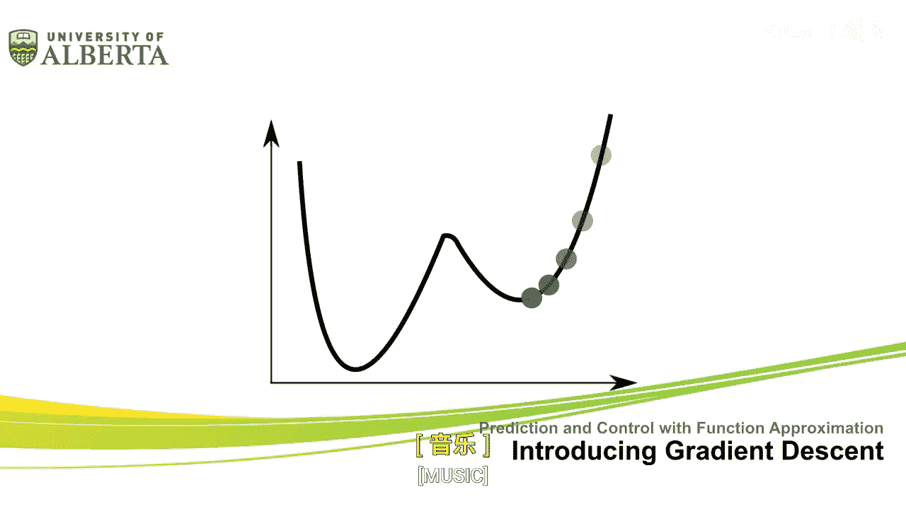

强化学习专项课程：第2章：梯度下降简介 🎯

在本节课中，我们将要学习一种用于最小化目标函数的通用策略——梯度下降。我们将理解其基本思想，并了解它如何收敛到驻点。

---

上一节我们介绍了如何将价值函数估计构建为监督学习问题，并通过指定一个目标函数使其精确化。现在，我们希望找到解决这个目标函数的方法。

本节中，我们来看看一种名为梯度下降的通用优化策略。在后续视频中，我们将介绍强化学习中针对特定目标函数的算法。

### 目标：最小化价值误差

我们希望最小化均方价值误差，使我们的价值估计接近真实的价值函数。回想一下，我们的价值估计由一个关于状态的函数给出，该函数由一组实值权重 **w** 参数化。这些权重决定了如何为每个状态计算价值，改变权重将修改许多状态的价值估计。

为了最小化整体价值误差，我们需要考虑如何改变权重，这需要用到一些微积分知识。

### 导数与梯度的概念

希望你还记得微积分中导数的概念。对于一个以标量参数 **W** 为自变量的函数 **F**，导数告诉我们如何局部地改变 **W** 来增加或减少 **F**。

*   在某点 **W** 处，**F** 的导数的符号指示了改变 **W** 以**增加** **F** 的方向。
*   导数的大小表示函数 **F** 在该点 **W** 处的斜率，即随着 **W** 变化，**F** 变化的快慢程度。

如果 **F** 由多个变量（即向量 **W**）参数化，则需要引入**梯度**的概念来描述 **F** 如何随向量 **W** 的变化而变化。

*   梯度是一个由偏导数组成的向量，指示了 **W** 的每个分量发生局部变化时对函数的影响。
*   梯度中每个分量的符号指明了改变 **W** 对应分量以**增加** **F** 的方向（正或负）。
*   分量的大小指明了 **F** 随 **W** 在该方向移动而变化的快慢程度。
*   无论大小如何，梯度给出了**最陡上升**的方向，即局部上能使 **F** 最大程度增加的方向。

### 线性价值函数的梯度示例

以下是一个具体示例，我们来推导线性价值函数的梯度。记住，线性价值近似只是权重与状态特征向量的内积：
`V̂(s, w) = w · x(s)`
其对单个权重 **w_i** 的偏导数就是与该权重相关联的特征 **x_i(s)**：
`∂V̂/∂w_i = x_i(s)`
这意味着线性价值近似的梯度就是该状态的特征向量 **x(s)**。

### 梯度下降更新规则

我们的目标函数（例如均方价值误差）是权重的函数，因为它是 **V̂** 的函数，而 **V̂** 又是权重的函数。我们的目标是调整权重以使目标函数值变小。

梯度下降的核心思想是：为了减少目标函数，我们应该沿着**负梯度**的方向移动权重。这被总结为以下更新规则：
`w ← w - α * ∇_w J(w)`
其中：
*   **α** 是步长参数，控制我们移动的距离，以防止步幅过大（因为沿此方向移动仅保证在局部减少目标函数）。
*   **∇_w J(w)** 是目标函数 **J** 关于权重 **w** 的梯度。

通过以足够小的 **α** 重复进行此类更新，我们最终将收敛到一个梯度为零的**驻点**。

### 驻点与收敛

这个驻点很可能是一个**局部最小值**，意味着这些权重比紧邻区域的所有权重都要好，但可能不是全局最优的。其他可能的驻点包括局部最大值和鞍点，这些是不稳定的解；我们算法中固有的随机性通常足以避免陷入这些不良驻点。

另一方面，局部最小值是稳定的，因此即使是随机算法也倾向于收敛到那里。因此，我们通常讨论算法收敛到局部最小值。

在某些情况下，梯度下降保证收敛到**全局最小值**，即目标函数权重的最佳可能设置。例如，对于使用线性函数近似的均方价值误差，这一点是成立的。

对于更复杂的函数近似器（如神经网络），一个驻点可能不是全局最小值。请注意，全局最小值不一定对应于真实的价值函数。它受到我们选择的函数参数化的限制，并取决于我们选择的目标函数。

想象一个特征向量，它只包含一个始终为1的元素（无论处于什么状态）。那么，最小化均方价值误差的近似价值函数将收敛到所有状态价值的平均值，这并不是一个很好的价值函数。然而，就价值误差目标而言，这仍然是在该参数化下我们能做的最好结果。

---

本节课中我们一起学习了梯度下降的基本原理，理解了它如何通过沿负梯度方向更新参数来最小化目标函数，并认识到其解通常会收敛到局部最小值，而不一定是全局最优解。下一节，我们将探讨如何将梯度下降具体应用于强化学习问题。