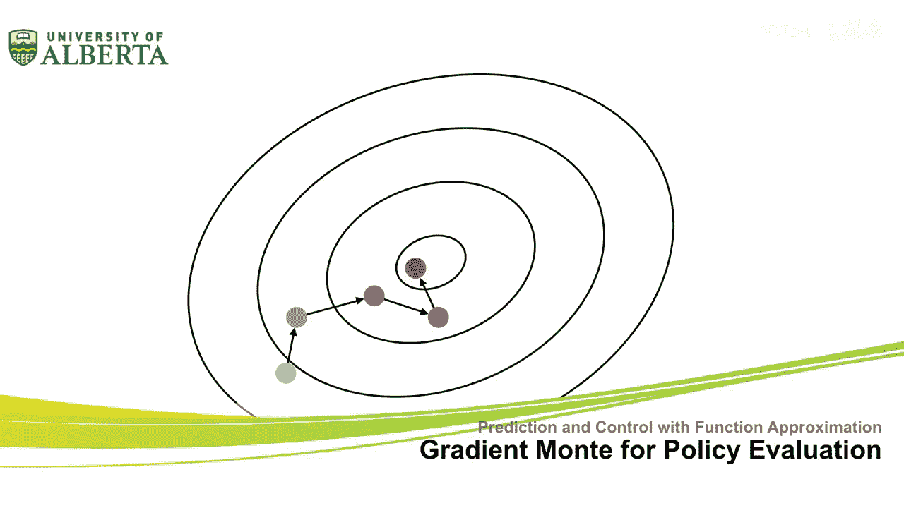
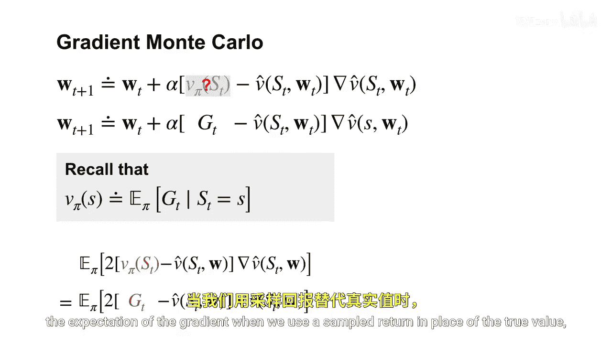

# 085：用于策略评估的梯度蒙特卡洛法

在本节课中，我们将学习如何将梯度下降法与策略评估的目标相结合，从而近似价值函数。我们将重点介绍梯度蒙特卡洛算法，这是一种利用采样回报来估计价值函数的方法。

## 概述

你已经掌握了一种最小化目标函数的方法——梯度下降法。同时，我们也为策略评估定义了一个明确的目标——价值误差。现在，我们应该能够将这两者结合起来，以近似价值函数。让我们回顾一下老朋友蒙特卡洛法，看看它如何被用来最小化价值误差。

观看本节后，你将能够：理解如何使用梯度下降和随机梯度下降来最小化价值误差，并概述用于价值估计的梯度蒙特卡洛算法。

## 计算价值误差的梯度

我们刚刚学习了如何使用梯度下降来最小化目标函数。要使用这种方法，第一步是找到目标函数相对于参数的梯度。

因此，让我们从计算均方价值误差相对于近似函数权重 `w` 的梯度开始。请记住，这个目标函数是所有状态上误差平方的加权和。

根据微积分法则，我们可以将梯度算子移入求和符号内。

然后，我们对求和内的每一项求梯度，这需要用到链式法则。`V_π(s) - V_hat(s, w)` 的梯度等于 `-V_hat(s, w)` 的梯度，因为 `V_π(s)` 不是 `w` 的函数。换句话说，改变 `w` 不会改变 `V_π(s)`。

价值函数近似 `V_hat(s, w)` 的梯度取决于我们使用的具体参数化函数。在线性函数近似的情况下，梯度的计算特别简单，正如我们在上一个视频中展示的，它简单地等于该状态下的特征向量 `x(s)`。

这个梯度是有意义的：价值函数近似的梯度指明了如何改变权重以增加该状态的价值估计。我们沿着这个方向，乘以真实价值与我们的估计值之间的差值。

如果差值为正，意味着真实价值高于我们的估计，因此我们应该朝着增加估计值的方向改变权重。如果当前误差为负，我们应该朝相反方向改变权重。

## 从梯度下降到随机梯度下降

计算均方价值误差的完整梯度需要对所有状态求和，这通常是不可行的。此外，我们可能并不知道分布 `μ`。

因此，让我们来近似这个梯度。设想一个理想化场景：我们虽然无法显式获得 `μ`，但可以通过遵循策略 `π` 来从中采样状态。假设我们采样到一个状态 `S1`，并知道其目标价值 `V_π(S1)`。

我们可以使用这一对数据来更新权重，以减少在该样本上的误差。以下是针对单个状态的梯度。我们可以使用这个梯度进行梯度下降，以减少该状态上的误差。

以下是针对 `S1` 的对应梯度更新规则：
`w ← w + α * [V_π(S1) - V_hat(S1, w)] * ∇_w V_hat(S1, w)`

我们可以执行此更新以减少这对数据上的误差。然后，我们可以对遵循策略 `π` 时观察到的另一个状态 `S2` 重复此过程。通过对每个样本对进行小的、改善其误差方向的更新，虽然有时可能会增加整体目标函数的误差，但总体趋势将是朝着最小化整体目标前进。

这种更新方法被称为**随机梯度下降**，因为它只使用了梯度的随机估计。事实上，每个随机梯度的期望值等于目标函数的真实梯度。你可以将这个随机梯度视为真实梯度的一个有噪声但计算成本低得多的近似，它仍然可以稳步向最小值前进。

## 处理未知的真实价值 V_π

随机梯度下降允许我们通过采样梯度来高效地更新每一步的权重。然而，还有一个实际的问题：我们无法获得真实的 `V_π`。

让我们看看如何从更新规则中去除它。我们可以用 `V_π` 的一个估计值来替代它。一个选择是使用对每个访问状态 `S_t` 的回报采样，就像我们在蒙特卡洛方法中所做的那样。这是合理的，因为价值函数正是这些样本的期望值。

事实上，当我们使用采样回报代替真实价值时，梯度的期望值仍然等于均方价值误差的梯度。

## 梯度蒙特卡洛算法

这引出了用于估计 `V_π` 的**梯度蒙特卡洛算法**。

以下是算法的步骤：

1.  **选择待评估的策略**：我们选择任意想要评估的策略 `π`。
2.  **选择可微函数**：我们选择一个函数 `V_hat(s, w)`，它将状态和权重映射为一个实数，并且该函数在给定权重 `w` 时可微。对于一组给定的权重，`V_hat` 是一个输出近似价值的状态函数。
3.  **设置步长**：我们选择步长参数 `α` 的值。
4.  **初始化权重**：我们以任意方式初始化参数化我们估计的权重 `w`，例如全部设为0。
5.  **迭代过程**：
    *   在每次迭代中，智能体与环境交互，生成一个完整的回合。
    *   我们为回合中访问的每个状态计算采样回报 `G_t`。
    *   然后，我们遍历回合中的每一步，基于采样回报执行一次随机梯度下降更新。更新规则为：
        `w ← w + α * [G_t - V_hat(S_t, w)] * ∇_w V_hat(S_t, w)`

## 总结

本节课中，我们一起学习了如何利用随机梯度下降来估计价值函数，并详细介绍了梯度蒙特卡洛算法的工作原理。该算法通过采样回报替代未知的真实价值，结合随机梯度下降，实现了对策略价值函数的高效近似。在接下来的课程中，你将看到这个算法的实际应用。