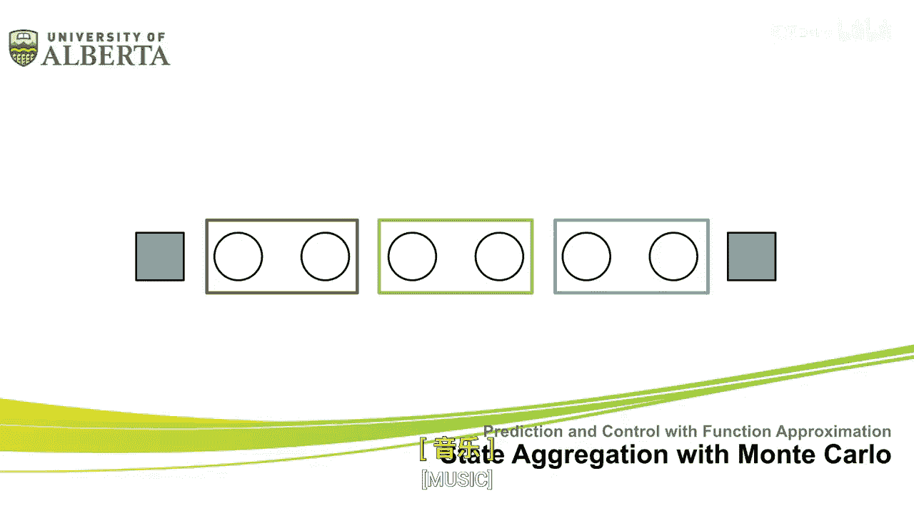
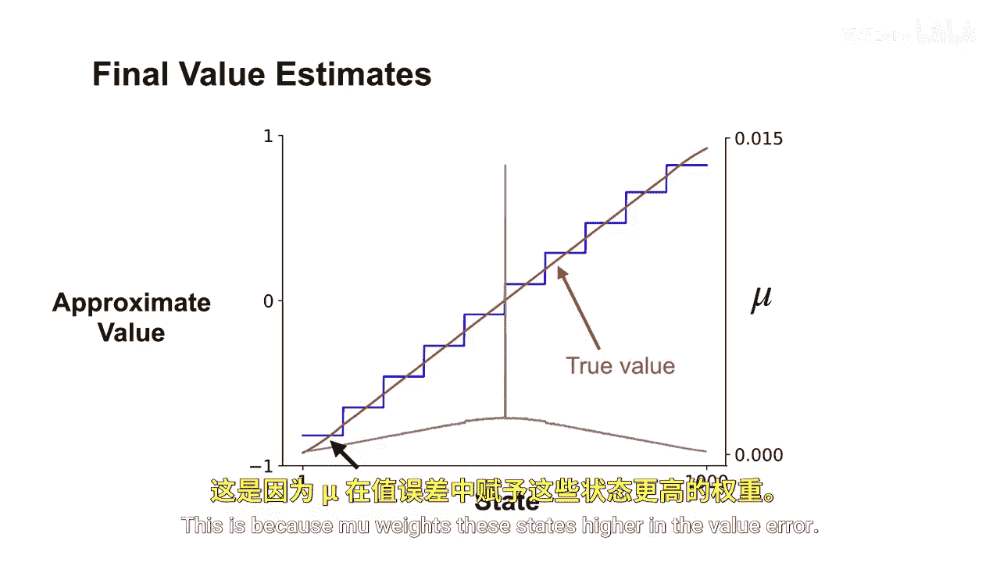

强化学习专项课程：P86：基于蒙特卡洛的状态聚合 🎯

## 概述
在本节课中，我们将学习一个使用**状态聚合**技术进行价值函数近似的具体例子。我们将结合蒙特卡洛方法和状态聚合，来近似求解一个大型随机游走任务中的状态价值。通过这个例子，你将理解状态聚合如何工作，以及如何应用**梯度蒙特卡洛**算法。

## 大型随机游走任务示例
上一节我们介绍了函数近似的概念，本节中我们来看看一个具体的应用场景。考虑一个大型随机游走任务，其中函数近似可以帮助加速学习。

*   状态编号从 1 到 1000，从左到右排列成一条线。
*   所有回合都从线的中间，即状态 500 开始。
*   有两个动作：`左` 和 `右`。
*   `左`动作会使智能体向左移动，但并非只移动一格。智能体会向左随机跳转到 100 个相邻状态中的任意一个。
*   同理，`右`动作会使智能体向右随机跳转到 100 个相邻状态中的任意一个。
*   我们评估的策略是**均匀随机策略**，即以相等概率选择向左或向右移动。
*   靠近左侧终止状态的状态，其左侧的相邻状态少于 100 个。所有试图跳出链条边界的动作都会导致进入终止状态，右侧同理。
*   在左侧终止会获得奖励 `-1`。
*   在右侧终止会获得奖励 `+1`。
*   所有其他转移的奖励均为 `0`。
*   折扣因子 `γ = 1`。

这个任务看似简单，但要学习 1000 个状态的价值可能需要很长时间。因此，我们可以从某种函数近似中受益。

## 什么是状态聚合？
这里我们将使用一种称为**状态聚合**的技术。顾名思义，状态聚合将某些状态视为相同的状态。

例如，在一个有 8 个状态的表格中，我们可以选择每 4 个状态聚合为一组。这样，价值函数就不再是一个有 8 个条目的表格，而只有 2 个条目。当我们更新第一组中任何一个状态的价值时，该组中所有其他状态的价值也会被更新。

状态聚合是**线性函数近似**的另一个例子。
*   每个状态组对应一个特征。
*   如果当前状态属于某个组，则该组对应的特征值为 `1`，否则为 `0`。
*   一个状态的近似价值就是该状态所属组对应的权重。

用公式表示，近似价值函数为：
`v̂(s, w) = w[group(s)]`
其中 `group(s)` 是状态 `s` 所属的组索引。

## 梯度蒙特卡洛与状态聚合
现在，让我们看看结合状态聚合的梯度蒙特卡洛算法。我们已经知道如何计算给定状态的价值，现在需要思考如何计算价值函数的梯度，以便使用核心更新公式。

状态聚合是线性函数近似的一个例子，因此梯度就等于特征向量。对于状态 `s`，其特征向量 `x(s)` 是一个“独热”向量，只有状态 `s` 所属组对应的位置为 `1`。

因此，更新规则仅修改与当前活动组对应的权重。让我们思考这个更新规则如何改变权重：
*   如果估计值 `v̂(St, w)` 小于采样回报 `Gt`，则权重会增加。
*   如果估计值 `v̂(St, w)` 大于采样回报 `Gt`，则权重会减少。

权重更新公式为：
`w = w + α * [Gt - v̂(St, w)] * x(St)`

## 应用于随机游走任务
让我们回到随机游走任务，看看如何应用状态聚合。

首先，我们必须选择如何聚合状态。状态聚合强制同一组中的状态使用相同的价值估计。因此，理想情况下，如果我们有理由相信某些状态的价值相似，就应该将它们分在一组。在这个问题中，选择很容易：彼此靠近的状态应该具有相似的价值。

接下来，我们必须选择每组包含多少个状态。如果分组很小，我们的价值估计最终会更准确，但学习时间会更长。我们使用 **10 个组**，每组包含 **100 个状态**。这比我们开始时面对的 1000 个状态要简洁得多。

以下是梯度蒙特卡洛算法的步骤演示：
1.  输入：策略、我们选择的状态聚合函数、一个小的步长参数 `α`。
2.  将所有权重初始化为零。
3.  生成一个回合（轨迹）。
4.  一旦获得完整的轨迹，我们就逐步遍历所有访问过的状态并进行更新。

假设在一个回合中，智能体在右侧终止，获得奖励 `+1`。那么从每个状态出发的回报 `Gt` 都是 `1`（因为 `γ=1`，且后续奖励均为0）。我们的第一次更新是针对状态 500，它属于第 5 组。因此，我们基于采样回报 `1` 对该组的权重执行梯度蒙特卡洛更新。

我们对轨迹中的每个状态都进行类似的更新，最终处理到状态 936（这是终止前访问的最后一个状态）。由于状态 936 属于第 10 组，我们最后更新的是权重 `w10`。

完成所有更新后，我们的价值估计可能如下图所示。该图显示了**单个回合后**的估计值。我们绘制了从状态 1 到 1000 的每个状态的学习价值。状态空间不是连续的，但将近似价值绘制成一条线是有意义的。

注意，每组的价值估计都是非负的。这是因为第一个回合的回报是正的，而我们的初始估计是零。

再看另一个回合后的同一张图。这次智能体在左侧终止，获得奖励 `-1`。这意味着每个状态的回报都是 `-1`。被访问状态对应的权重略有下降。

运行许多回合后，我们得到的状态价值如下图所示。图中的每个“台阶”对应一组共享相同近似价值的状态。

作为对比，图中也显示了**真实的价值函数**。尽管我们通过聚合许多状态进行了大幅近似，但我们的价值估计并没有差太多。

## 理解近似误差：状态分布 μ 的作用
你可能会问：为什么红色真实价值线没有直接穿过所有蓝色台阶的中心？这就是状态分布 `μ(s)` 发挥重要作用的地方。

回顾一下，`μ(s)` 是状态 `s` 的访问频率。靠近链条中心的状态比靠近终止状态的状态访问更频繁，如下图所示。

例如，让我们看看最左边的一组状态（状态 1 到 100）。靠近状态 100 的状态比靠近状态 1 的状态访问次数多得多。因此，近似价值会偏向靠近状态 100 的那些状态的真实价值。这是因为在价值误差中，`μ` 给这些状态赋予了更高的权重。

## 总结
本节课中，我们一起学习了梯度蒙特卡洛算法在实践中与状态聚合结合时是如何工作的。我们通过一个大型随机游走的具体例子，演示了如何通过将状态分组来简化问题，并应用梯度更新规则来学习近似的价值函数。关键点在于，状态聚合是一种有效的线性近似方法，而状态访问分布 `μ` 会影响我们最终学到的近似函数的形态。