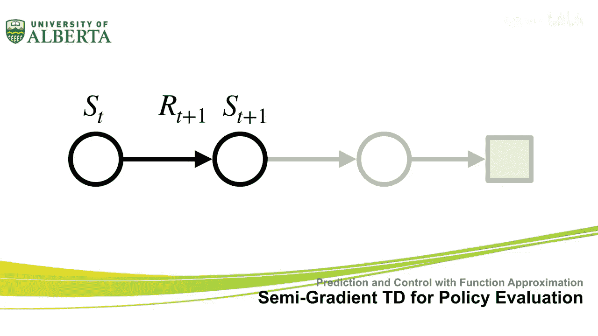
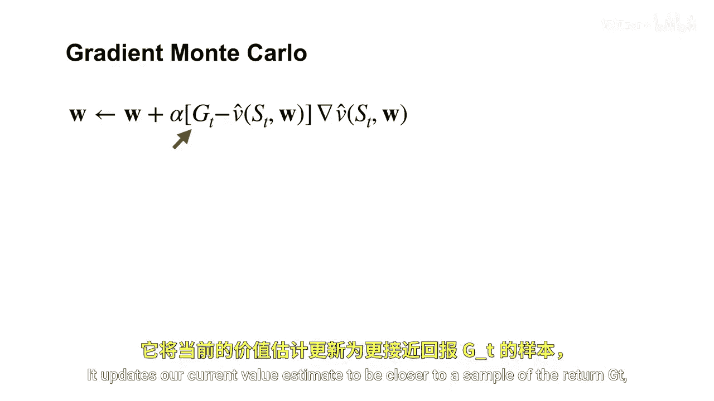
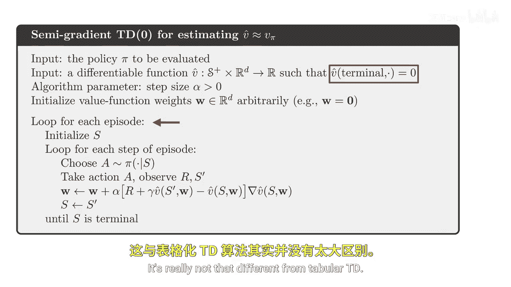

# 087：用于策略评估的半梯度时序差分法 📈

在本节课中，我们将学习如何将时序差分（TD）学习的思想应用于函数近似场景，并理解其核心算法——半梯度时序差分法。

上一节我们介绍了蒙特卡洛方法在函数近似中的应用。本节中，我们来看看如何利用TD学习进行更高效的价值函数估计。

## TD学习与函数近似

TD学习的核心思想是，智能体可以利用其自身对价值函数的估计来更新预测。我们已经在表格型案例中见过TD学习。今天我们将描述它在函数近似下的工作原理。

## 从蒙特卡洛到TD目标

回顾梯度蒙特卡洛更新公式：
`w ← w + α [G_t - v̂(S_t, w)] ∇ v̂(S_t, w)`
该公式将当前的价值估计向回报 `G_t` 的样本靠近。

但我们也可以考虑使用其他目标，而非完整的回报。事实上，我们可以用任何对价值的估计来替换此更新中的回报。
`w ← w + α [U_t - v̂(S_t, w)] ∇ v̂(S_t, w)`
我们称此估计为 `U_t`。如果 `U_t` 是真实价值的无偏估计，那么在适当的条件下，我们的函数近似器将收敛到一个局部最优解。回报 `G_t` 就属于这种情况。

然而，我们也可以用自举目标来替换 `U_t`，例如一步TD目标 `R_{t+1} + γ v̂(S_{t+1}, w)`。这仍然是对回报的一个估计，但此估计是有偏的。TD目标使用了我们当前的价值估计，而该估计很可能不等于真实的价值函数。因此，我们无法保证此算法会收敛到价值误差的局部最小值。

其优势在于，TD目标通常比回报样本具有更低的方差。这意味着TD方法往往能以更少的更新次数收敛。

## 理解“半梯度”

TD更新实际上并非一个真正的随机梯度下降更新。为了理解原因，我们计算单个样本误差相对于权重 `w` 的梯度。记住，`U_t` 等于TD目标。使用链式法则，我们得到单个样本平方误差梯度的展开表达式：
`∇ [1/2 (U_t - v̂(S_t, w))^2] = (U_t - v̂(S_t, w)) (-∇ v̂(S_t, w) + ∇ U_t)`

但这看起来并不像TD更新公式。只有当 `U_t` 的梯度为零时，这两个表达式才会相等。对于TD方法而言，情况并非如此。在TD中，目标包含了对价值的估计，而该估计依赖于权重 `w`。这意味着 `U_t` 的梯度不为零，如下所示：`∇ U_t = γ ∇ v̂(S_{t+1}, w)`。因此，TD并非在平方误差上执行梯度下降更新，我们称之为**半梯度**方法。尽管如此，TD在我们关心的许多情况下都能收敛。我们将在后续视频中讨论TD的收敛性质。

## 半梯度TD算法

以下是半梯度TD的伪代码。它实际上与表格型设置的TD算法非常相似。

该算法无需等到一个回合结束才进行更新。与梯度蒙特卡洛不同，TD在每一步都执行一次更新。

以下是算法的步骤概述：

在每个回合的每一步中：
1.  智能体在状态 `S_t` 下选择一个动作 `A_t`。
2.  利用得到的奖励 `R_{t+1}` 和下一个状态 `S_{t+1}` 计算TD目标：`U_t = R_{t+1} + γ v̂(S_{t+1}, w)`。
3.  立即更新权重：`w ← w + α [U_t - v̂(S_t, w)] ∇ v̂(S_t, w)`。
4.  以这种方式继续，直到到达终止状态（其价值定义为0）。然后开始一个新的回合。

它与表格型TD的区别真的不大。

本节课中我们一起学习了半梯度时序差分算法。你现在应该理解了半梯度TD算法的原理、它与梯度下降的区别，以及其在线更新的步骤。