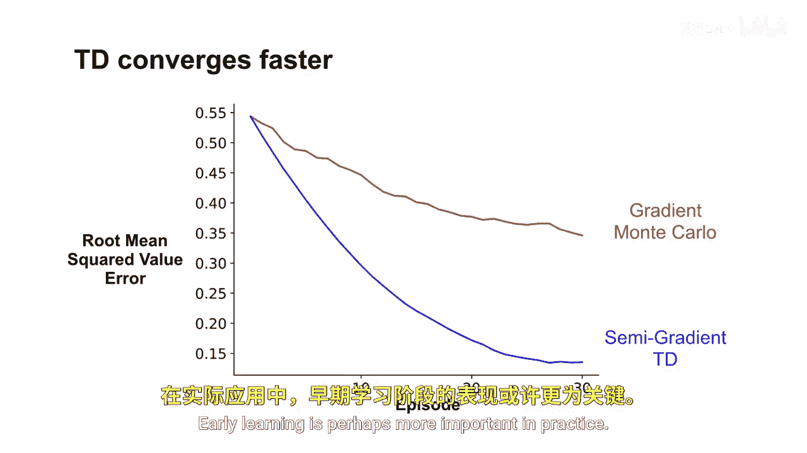

# 088：状态聚合下时序差分与蒙特卡洛方法的比较 🔍

在本节课中，我们将探讨在函数近似背景下，时序差分方法与蒙特卡洛方法的核心差异。我们将通过理论分析和一个小型实验，理解时序差分方法的偏差特性及其对学习速度的影响。

## 概述 📋

上一节我们介绍了函数近似下的蒙特卡洛方法和时序差分方法。本节中，我们将深入比较这两种方法，重点关注时序差分更新的偏差问题，并通过一个随机游走实验来观察它们在实践中的表现差异。

## 理论差异：偏差与收敛性 ⚖️

在合理的假设下，梯度蒙特卡洛方法会随着样本增多，逐渐逼近价值误差均方差的局部最小值。这是因为其使用了价值误差梯度的**无偏估计**。理论上，我们需要运行算法很长时间并衰减步长参数才能实现这种收敛。实践中，我们使用恒定步长，因此算法会在局部最小值附近振荡。

**公式表示**：蒙特卡洛的更新目标是实际回报 `G_t`，它是价值 `v_π(s)` 的无偏估计。

另一方面，时序差分的目标依赖于我们对下一状态价值的估计。这意味着我们的更新可能是**有偏的**，因为目标中的估计可能不准确。由于我们的价值近似永远不可能完美，即使在极限情况下，目标也可能保持偏差。因此，我们无法保证半梯度时序差分会收敛到价值误差均方差的局部最小值。当然，随着我们估计的改进，这种偏差会减小。

**公式表示**：时序差分（TD(0)）的更新目标是 `R_{t+1} + γ * V(S_{t+1})`，其中 `V(S_{t+1})` 是当前估计值，可能不准确。

## 实验：随机游走中的表现对比 🧪

让我们回到三状态随机游走的例子，观察时序差分更新中的偏差如何影响实际表现。这次，我们将使用半梯度时序差分（而非蒙特卡洛）来学习近似价值。

在长时间运行时序差分算法直至价值估计不再变化后，我们得到的结果显示，许多状态的价值估计与真实值吻合得并不好。时序差分的估计不如蒙特卡洛学习到的估计准确。在这个使用状态聚合的领域中，蒙特卡洛在长期性能方面具有优势。

## 学习速度的较量：早期学习性能 ⏱️

但学习速度如何呢？时序差分和蒙特卡洛，谁能更好地利用有限的样本？为了探究这个问题，我们进行了一个专注于早期学习的实验，只运行30幕（上一个实验使用了1000幕）。

两种算法的性能都取决于我们如何设置步长参数 `α`。为了进行公平比较，我们为每种算法测试了在0到1之间均匀分布的100个`α`值，并选取使训练30幕后价值误差最低的那个`α`值作为最佳步长。

以下是实验的关键参数：
*   **最佳TD步长 (α)**: `0.22`
*   **最佳MC步长 (α)**: `0.01`

让我们绘制两种算法的性能对比图。Y轴表示1000个状态上、经过100次运行平均后的**均方根价值误差**。X轴表示幕数。我们预期每种算法的价值误差会从高位开始，随着幕数增加而逐渐降低。

以下是实验结果的分析：
*   时序差分方法更快地达到了更低的误差。
*   这不是偶然结果，时序差分通常比蒙特卡洛学得更快。
*   这是因为时序差分可以在幕内学习，并且其更新的方差更低。

蒙特卡洛更好的长期性能并非总是首要考虑因素。在实践中，我们可能永远无法运行足够长的实验来达到渐近性能，因此**早期学习速度往往更为重要**。

## 总结 🎯

本节课中，我们一起学习了函数近似下时序差分更新的偏差特性。我们看到，尽管时序差分更新可能存在偏差，但我们通常仍然更倾向于使用时序差分学习而非蒙特卡洛，因为它可以**更快地学习**。理解这种权衡对于在实际问题中选择合适的强化学习算法至关重要。