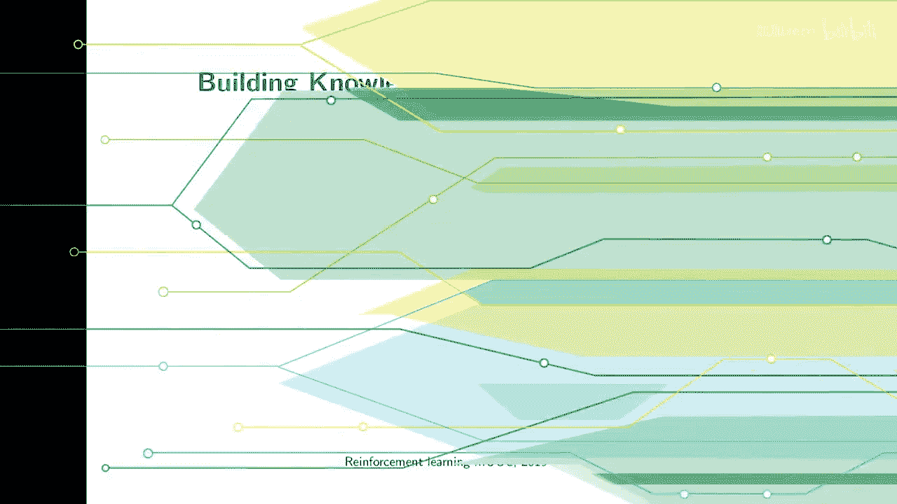

# 089：利用强化学习为AI智能体构建知识 🧠

在本节课中，我们将探讨强化学习智能体如何构建和利用知识。我们将学习智能体需要掌握的两种核心知识类型，并深入理解一种称为“选项”的时域抽象方法，它能让智能体进行更高效、更长远的规划。

---

我的名字是多伊娜·普雷库普，我是麦吉尔大学的教授，同时也作为研究科学家在DeepMind工作。我的许多研究兴趣与强化学习中的抽象概念有关。

强化学习智能体需要获取两种知识。

第一种是**程序性知识**，即“如何做事情”。策略是这方面最基本的一个例子。但实际上，我们可能还希望智能体拥有其他知识，例如如何与特定物体互动，或如何在不同的地点之间移动。我将从**技能**、**选项**或有时称为**目标驱动行为**的角度来讨论这类知识。

第二种是**预测性知识**或**模型知识**。这意味着智能体需要知道在其行为条件下可能会发生什么。价值函数是这类知识的一个例子，但还有其他形式，例如**环境模型**。

我们希望这些知识具备某些特性。首先，我们希望知识是**可学习的**，以便智能体能从数据中获取它。其次，我们希望知识是**可表达的**，智能体应能了解不同事物和不同情境。最后，我们希望智能体能够**组合**已有的知识片段，形成更大的知识单元。

这些是我们对知识表示的主要愿景。知识表示必须在智能体行为的时间尺度上，以及在智能体对其感知世界进行推理的能力上，都能实现**泛化**。这就是状态抽象和函数逼近发挥作用的地方。

接下来，我将更详细地讨论程序性知识在**不同时间尺度**上的泛化。

---

## 为何需要时域抽象？⏳

我们的智能体在“诞生”之初，通常只有一组非常有限的动作，并且这些动作总是持续一个时间步长，这是为了符合马尔可夫决策过程的框架。

但在现实情况下，智能体可能需要执行持续多个时间步长的行动过程。例如，如果你计划从蒙特利尔前往埃德蒙顿，你不会考虑肌肉抽搐级别的动作，而是会考虑“打车去机场”、“飞往埃德蒙顿”、“打车去大学”、“可能顺便吃个晚饭”这样的步骤。这些是**持续一段时间**的行为单元，它们各不相同。

智能体应该能够在这个层面进行推理，因为这意味着它的计划会变得**更短**（可能只有四步，而不是成千上万步），并且这个计划在其他情境下可能是**可复用的**。例如，如果目的地不是埃德蒙顿而是多伦多或其他城市，智能体仍然会经历相同类型（打车、飞行等）的步骤。

---

## 如何形式化时域或行为层面的抽象？🔧

实现这种抽象的一种方法是通过**选项**这个概念。

我们将一个选项视为由三个部分组成：

1.  **启动集**：指可以启动该选项的环境状态集合。例如，只有当我们身处机场时，才能执行“飞行”这个选项。因此，“在机场”就是“飞行”选项的启动集。
2.  **内部策略**：指选项在执行过程中选择原始动作的方式。例如，如果我们正在“走向登机口”，“行走”这个动作序列就是一个策略。它负责接管控制并执行，本质上是在给定智能体状态下选择原始动作的概率分布。
3.  **终止条件**：这通常也是随机的。它告诉我们智能体在任一特定状态下结束该行为的概率。例如，在“走向登机口”时，我们可能因为到达登机口而结束该行为，也可能因为突发警报需要离开建筑而切换到其他行为。

基于这些组件，智能体现在拥有了可以执行的行为单元。我们也可以为这些行为单元配对模型。每个选项都有一个模型，其模型包括智能体在执行过程中可能获得的**预期奖励**，以及一个关于它最终可能到达状态的**转移概率分布**。

由于选项持续的时间长度不同，我们不仅要考虑转移到下一个状态，还要考虑转移到下一个**时间点**。因此，这实际上是一个关于状态和时间的联合分布。

---

## 半马尔可夫决策过程 🔄

一旦智能体被赋予了选项，它的推理方式与在MDP中基本相同，只是现在它在一个**半马尔可夫决策过程**中运行。马尔可夫性质仍然成立，但一个行为的持续时间不再是固定的，而是基于概率分布。

然而，所有你已经熟悉和喜爱的规划与学习算法，例如价值迭代、时序差分学习，以及本课程中讨论的所有其他方法，在SMDP中的工作方式与在MDP中几乎完全相同。因此，我们可以运用所有这些算法的思想来学习关于选项的知识。

---

## 开放的研究挑战 ❓

一个有趣的问题是如何在实现时域抽象的同时，也进行状态抽象或函数逼近。理想情况下，我们希望两者兼得：就像我们希望思考“去机场”的行为而不是肌肉抽搐一样，我们也希望思考“机场”这个概念而不是空间中的具体厘米坐标。

然而，这两者实际上是不同的，我们希望它们能以某种方式协同工作。但如何同时获得良好的时域抽象和状态抽象，并让它们之间能够良好地“沟通”，这仍然是一个开放的研究问题。

同样，另一个有趣的开放研究问题是**确定选项从何而来**。谁告诉我们什么是好的终止条件？这是我们希望弄清楚但尚未完全掌握的问题。

---

在本节课中，我们一起学习了强化学习智能体构建知识的框架。我们明确了**程序性知识**和**预测性知识**的区别，并深入探讨了**选项**作为时域抽象的核心工具，它由启动集、内部策略和终止条件三部分组成。通过选项，智能体可以在**半马尔可夫决策过程**的框架下进行更高效的规划和推理。最后，我们了解到，如何让时域抽象与状态抽象协同工作，以及如何自动发现有用的选项，仍然是该领域激动人心的开放挑战。