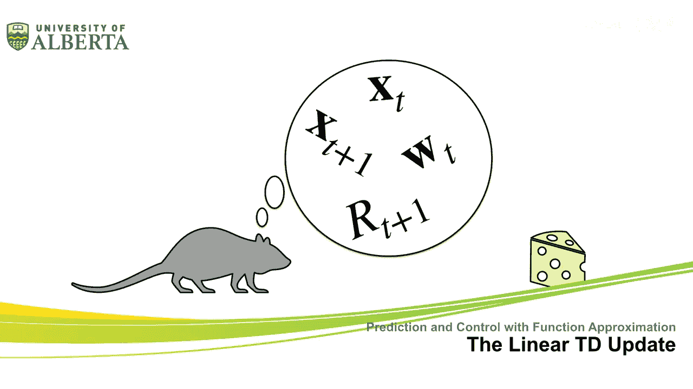
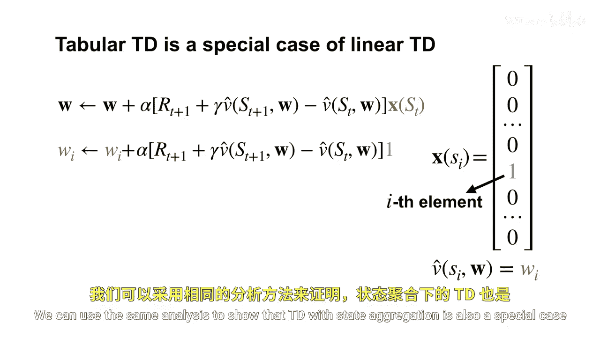

# 090：线性时序差分更新

在本节课中，我们将要学习线性函数近似在时序差分（TD）学习中的应用。我们将推导线性TD更新公式，理解表格型TD是其特例，并探讨线性方法的重要性。

## 线性函数近似简介

原则上，我们可以使用任何类型的函数近似进行强化学习。

线性函数近似是一个重要的特例。它足够简单，便于我们深入理解，同时仍然相当强大。事实上，结合TD的线性函数近似已被用于构建在许多游戏中超越人类表现的Atari智能体。

## 线性半梯度TD更新推导

上一节我们介绍了函数近似的概念，本节中我们来看看线性情况下的具体更新规则。

回顾半梯度TD的更新规则。它根据TD误差乘以近似价值函数关于权重的梯度方向来调整权重。

在线性情况下，某个状态的近似价值函数的梯度就是该状态的特征向量。

因此，半梯度TD的更新公式如下所示：

**权重更新公式：**
`w ← w + α * δ * ∇w v̂(s, w)`

在线性情况下，`v̂(s, w) = x(s)^T * w`，其梯度`∇w v̂(s, w) = x(s)`。

**线性TD更新公式：**
`w ← w + α * δ * x(s)`

其中，`δ = R + γ * v̂(s‘, w) - v̂(s, w)` 是TD误差。

权重沿着特征向量乘以TD误差的方向更新。如果一个特征值很大，那么对应的权重对预测的影响就很大。反之，如果特征值为零，则该权重对预测没有影响，梯度也为零。

由专家设计的特征所构成的固定基，对更新有重大影响。如果设计得当，我们可以通过简单的更新获得有效的价值函数近似。

## 作为特例的表格型TD

我们已经看到线性价值函数近似是表格型价值函数近似的严格泛化。我们可以证明，线性TD是表格型TD和状态聚合TD的严格泛化。

让我们更仔细地查看算法，以明确地看到表格型TD是特例。

想象我们有一个表格型状态表示。只有一个特征（对应当前状态的那个）等于1，其余特征都为零。一个状态的近似价值等于与当前状态相关联的权重。因此，我们可以将权重向量视为一个价值表，每个状态对应一个值。

以下是使用这些表格特征时半梯度TD的更新公式：

**表格型TD更新公式：**
`w(s) ← w(s) + α * δ`

在更新中，状态`s`的特征向量`x(s)`选择了与当前状态相关联的单个权重。这个权重就是该状态的价值估计，因此这个更新对应于我们在先前课程中看到的表格型TD更新。

我们可以使用相同的分析来证明，状态聚合TD也是线性TD的一个特例。

## 为何关注线性函数近似？

但是，为什么我们如此关注线性函数近似这个特例呢？

以下是几个关键原因：

*   **易于理解和分析**：线性方法更简单，便于数学理解和分析。TD学习的大部分理论都是针对线性设置的，我们将在下一个视频中进一步讨论。
*   **可利用专家知识**：在某些应用中，你可能拥有专家知识来帮助你设计好的特征。也许你就是领域专家，或者你可以与非常了解你应用的人交流。
*   **性能与效率**：如果我们能很好地设计这些特征，那么我们可以期望线性方法学习得更快，并达到良好的预测精度。特征设计提供了一种融入领域知识的方式，可以在实践中获得良好的性能。

## 总结

本节课中我们一起学习了线性TD更新。我们推导了线性半梯度TD的更新公式，理解了表格型TD是其一个特例，并探讨了线性函数近似之所以有用的原因。下次见。