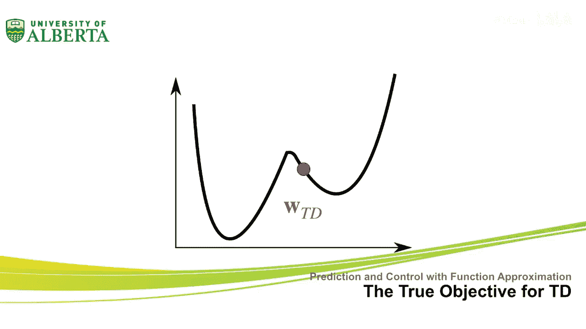
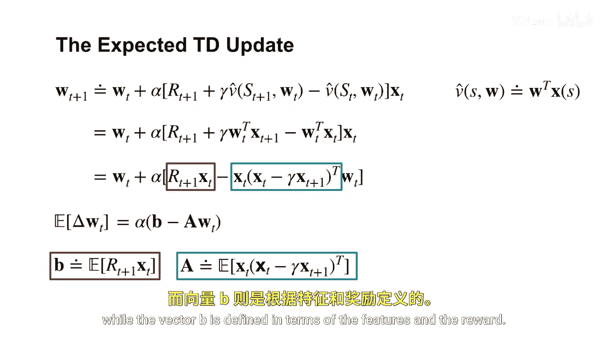
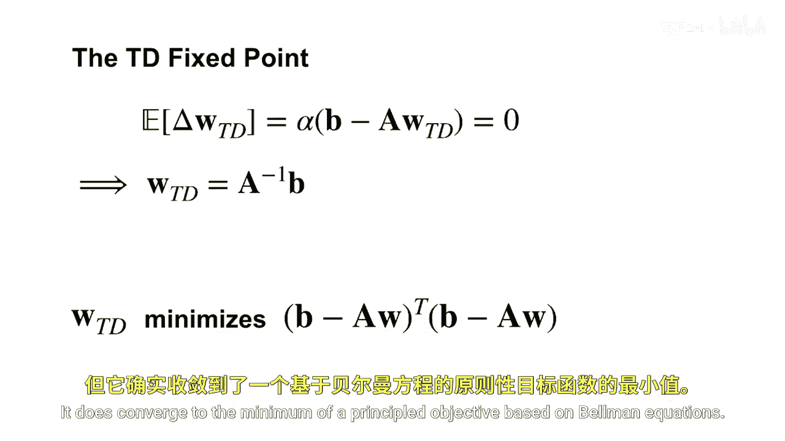

# 091：时序差分法的真实目标 🎯

在本节课中，我们将深入探讨线性函数逼近下时序差分法的理论基础。我们将了解TD算法收敛到的“TD不动点”，并分析该解与最小均方值误差解之间的关系。

---

在之前的课程中，我们介绍了半梯度TD算法，将其视为在均方值误差上的近似梯度下降。但这只是对一个更微妙故事的简化。TD算法并不精确地优化这个目标。实际上，对于线性函数逼近的半梯度TD，我们可以考虑一个不同的目标。

事实上，线性TD被证明会收敛到一个被充分理解的近似解，称为**TD不动点**。我们今天就来讨论这个内容。

通过本视频的学习，你将能够理解线性TD的不动点，并描述在TD不动点处均方值误差的一个理论保证。

---

## 线性TD更新公式的深入分析 🔍

上一节我们介绍了TD不动点的概念，本节中我们来看看线性TD的具体更新过程。

在函数逼近下，一个状态的价值是状态特征与学习权重向量的内积。为了简化符号，我们用 `Xt` 表示与状态 `St` 相关联的特征向量。

价值函数可以表示为：
`V(St) = Xt^T * w`

我们可以将TD更新规则展开如下：
`w ← w + α [Rt+1 + γ * Xt+1^T * w - Xt^T * w] * Xt`

我们可以用一点线性代数知识重写这个公式。首先，将 `Xt` 提取到括号内。然后利用标量的转置等于其本身这一事实。

现在，让我们思考一下这个更新在期望下的表现。理解期望更新是证明收敛性的关键。TD更新可以重写为期望更新加上一个噪声项，因此其行为主要由期望更新的行为主导。

期望更新描述了权重从一个时间步到下一个时间步的预期变化。

---

## TD不动点的定义与性质 ⚖️

理解了期望更新后，我们来看看TD算法最终会收敛到哪里。

期望TD更新可以写成一个向量 `b` 减去一个矩阵 `A` 乘以当前权重 `w`：
`E[Δw] = b - A * w`

其中，矩阵 `A` 是根据特征的期望定义的：
`A = E[ Xt * (Xt - γ * Xt+1)^T ]`

而向量 `B` 是根据特征和奖励定义的：
`B = E[ Rt+1 * Xt ]`

当这个期望TD更新为零时，我们说权重收敛了。我们称这个点为 `w_TD`。如果 `A` 是可逆的，我们可以将其表示为：
`w_TD = A^{-1} * b`

更一般地说，`w_TD` 是这个线性系统的解。我们称这个解为 **TD不动点**。可以证明，线性TD会收敛到这个点。事实上，可以证明TD最小化了一个基于这个 `A` 和 `B` 的目标。

这个目标将TD与贝尔曼方程之间的联系扩展到了函数逼近的设置中。回想一下，在表格型设置中，我们将TD描述为求解贝尔曼方程的基于样本的方法。线性TD类似地近似求解贝尔曼方程，最小化所谓的**投影贝尔曼误差**。

这个目标的细节超出了本课程的范围，但你可以参考课程教科书以获取更多细节。关键要点是，尽管TD没有收敛到最小均方值误差，但它确实收敛到了一个基于贝尔曼方程的有原则的目标的最小值。

---

## TD不动点与最小均方误差解的关系 🔗

尽管如此，我们仍然希望理解TD找到的解与最小值误差解之间的关系。我们可以用以下公式正式描述这种关系：

`||w_TD - w_MSE|| ≤ C * (1 / (1-γ)) * 最小可能误差`

如果折扣因子 `γ` 接近1，TD不动点与最小价值误差解之间的差异可能会很大。另一方面，如果 `γ` 非常接近零，则TD不动点非常接近最小价值误差解。

这个界限也取决于特征的质量。如果特征有限，最小均方值误差和TD不动点处的值误差都可能很大。如果我们能完美地表示价值函数，那么无论 `γ` 是多少，TD不动点都等价于最小价值误差解。这是因为不等式两边都将是零。

那么，为什么一般情况下TD不动点不等于最小价值误差解呢？这是因为函数逼近下的**自举**。如果由于函数逼近，我们对下一个状态的估计持续不准确，那么TD可能会永远朝着一个不准确的目标更新。另一方面，如果我们的函数逼近器非常好，那么我们对下一个状态的估计将变得非常准确，因此基于这个估计的自举就不会有问题，TD解的误差就接近最小价值误差。

---

## 总结 📝

本节课中我们一起学习了线性半梯度TD算法收敛性的理论基础。

你现在应该更了解为什么线性半梯度TD保证会收敛到一个称为TD不动点的点，以及TD不动点与最小均方值误差之间的关系。关键在于，TD优化的是一个与投影贝尔曼误差相关的目标，而非直接的均方值误差，其最终解的质量受到折扣因子 `γ` 和特征表示能力的共同影响。