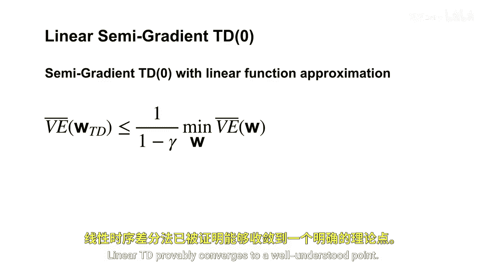

# 092：函数逼近方法总结 🧠

在本节课中，我们将总结第一周关于如何将强化学习从表格型方法扩展到函数逼近方法的核心内容。许多现实世界问题无法通过枚举所有可能状态来构建表格，因此转向函数逼近是使强化学习更广泛应用的关键一步。

## 本周内容概览

本周我们学习了大量关于函数逼近的知识，内容繁多，容易混淆。现在，让我们退一步，看看本周的主题如何融入整个课程的宏观图景。

下图展示了本专项课程中涵盖的所有算法及其相互关系。请注意，此图仅包含课程中介绍的算法。

本周的主要概念转变是采用了**参数化函数逼近**的框架。这意味着我们不再使用表格来存储每个状态的价值，这使我们处于地图的左侧。关于平均奖励的讨论将在后续进行，本周我们主要关注**策略评估**问题。

## 核心算法回顾

在策略评估的框架下，我们介绍了两种算法：**梯度蒙特卡洛**和**半梯度时序差分**。

*   **梯度蒙特卡洛**：在每个回合结束时进行更新。
*   **半梯度时序差分**：利用下一时间步的价值估计进行自举更新，因此无需等待一个回合结束即可学习。

## 函数逼近的关键概念

现在，让我们快速回顾一些关键细节。

我们描述了**参数化价值函数**，它是一个从状态到实数的映射。其输出由一个实值权重向量 **W** 控制。我们使用符号 **v̂(s, W)** 来表示近似价值函数，这表明价值估计由当前状态和学习的权重向量共同决定。

以下是参数化价值函数的两个例子：
*   **线性函数**：基于固定或专家设计的特征。
*   **神经网络**。

我们讨论了函数逼近的两个关键属性：**泛化**和**区分**。
*   **泛化**：更新一个状态的价值可以改进其他状态的价值估计，这可以加速学习。
*   **区分**：我们希望价值函数在状态差异很大时能赋予不同的价值。

## 从监督学习到价值函数学习

接下来，我们讨论了如何利用监督学习的思想来学习近似价值函数。我们无法保证对每个状态的价值都做到完美逼近，因此需要定义一个**目标函数**，来衡量我们的近似值与真实值之间的距离。

我们使用了**均方价值误差**作为目标函数，即每个状态的真实价值与我们的近似价值之间的平方误差之和，并按状态访问频率 **μ** 进行加权。

我们讨论了如何使用**随机梯度下降**来优化这个目标函数。
*   **梯度蒙特卡洛算法**：使用采样得到的回报来执行随机梯度下降更新权重。这意味着它可以从智能体与世界交互产生的经验中学习近似价值。
*   **半梯度时序差分**：作为随机梯度下降的一种近似被引入。它利用了自举法的优势，在实践中可能比蒙特卡洛方法收敛得快得多。其名称中的“半梯度”提醒我们，它并非一个严格的梯度下降算法。

最后，我们讨论了**线性半梯度时序差分算法**，或称**线性函数逼近的TD**。线性TD被证明可以收敛到一个有明确理论解释的点。

## 总结与展望

本节课中，我们一起学习了将强化学习扩展到函数逼近的核心思想。你现在已经具备了理解**参数化函数强化学习**的良好基础。我们介绍了从表格法到函数逼近的转变，探讨了泛化与区分的概念，并学习了梯度蒙特卡洛和半梯度时序差分这两种关键的策略评估算法。

接下来，我们将讨论构建状态和状态-动作特征的不同方法。下次课再见！