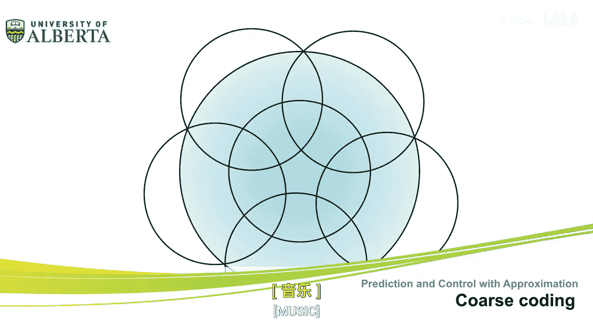
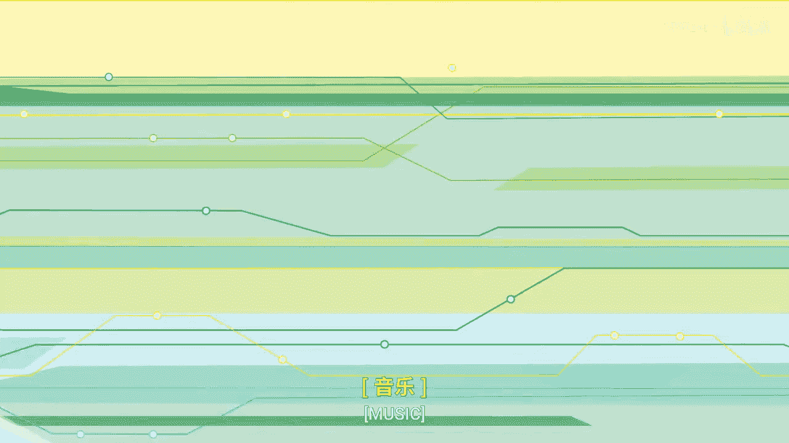
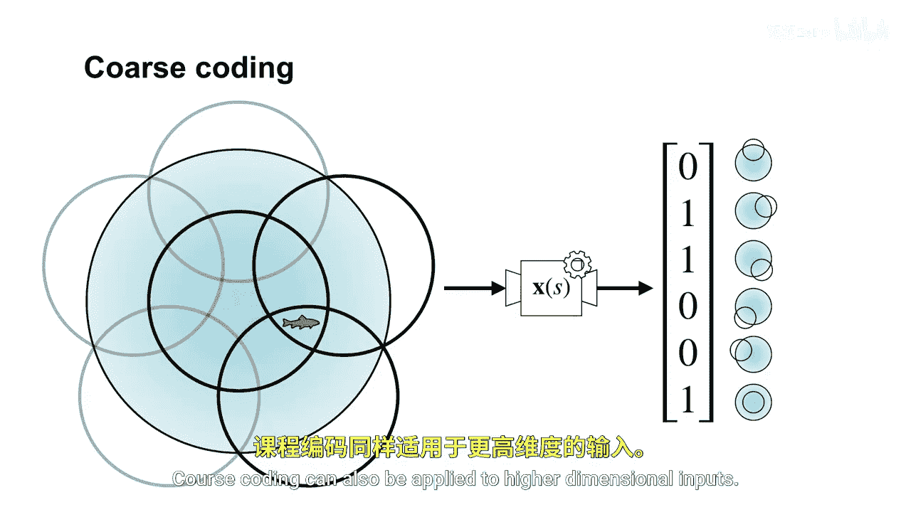

# 093：粗编码

在本节课中，我们将学习一种为线性价值函数创建特征的有效方法——粗编码。我们将了解它如何从表格表示法和状态聚合中演变而来，并理解其工作原理。

## 概述

用于构建价值估计的特征是强化学习智能体最重要的组成部分之一。本节将讨论一种简单但有效的特征构建方法。通过本视频的学习，你将能够描述粗编码，并阐述其与状态聚合的关系。

## 从表格表示到特征向量

首先，让我们回顾一下如何为线性价值函数创建特征。近似价值函数由一个权重向量 **W** 参数化。要计算一个状态的价值，我们首先需要计算其特征，并构建该状态的特征向量 **x(S)**。然后，状态的价值近似为权重向量与特征向量的点积：`V(S) ≈ W · x(S)`。

表格表示法可以表达为一个二进制特征向量。每个状态对应一个不同的特征。如果智能体处于某个状态，那么该状态对应的特征值为1，所有其他特征值均为0。表格情况只是线性函数近似的一个特例，其中特征向量是状态的指示器或独热编码。当然，当状态空间的大小远大于智能体可用内存时，这种方法就不可行了。

## 状态聚合的引入

假设我们想表示一条在池塘中游动的鱼的位置，这是一个二维状态。鱼可以处于无限多个位置中的一个。用一个有限的查找表来表示所有这些位置是不可能的。

回想一下，我们可以使用状态聚合，将附近的状态与相同的特征关联起来。这就像将每个方格内的所有状态视为同一个状态。在这个例子中，所有组都有大致相同的形状。但使用相同的形状并非必要。一般来说，我们可以使用任何我们想要的形状来聚合状态，只要这些形状没有间隙或重叠。状态聚合通常不允许形状重叠，但这个限制并非必需。事实上，通过允许重叠，我们获得了一类更灵活的特征表示，称为粗编码。

## 粗编码的工作原理

让我们看一个池塘中鱼当前位置的特征向量示例。请记住，特征向量中的每个索引对应一个形状。如果鱼在某个圆圈内，则对应圆圈的特征被激活或设置为1；否则，该特征设置为0。特征的感受野对应于激活该特征的位置。

当鱼移动到一个新位置时，它通常被一组不同的圆圈覆盖。附近的状态将具有相似的特征激活模式，但它们也可能激活不同的特征分量，包括不同数量的激活特征。在这个例子中，总是至少有一个激活特征，最多有三个激活特征。

我们目前讨论的所有思想并不局限于二维状态空间，粗编码也可以应用于更高维度的输入。

## 总结

本节课中，我们一起学习了表格情况如何用状态的二进制独热编码来表示，以及粗编码如何作为状态聚合的推广。通过允许特征感受野的重叠，粗编码提供了一种更灵活、更强大的方式来为大规模或连续状态空间构建特征。