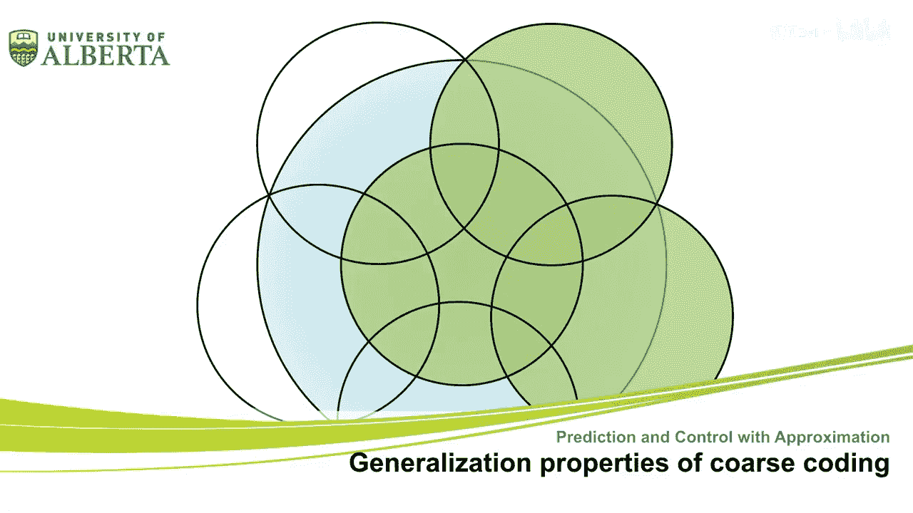
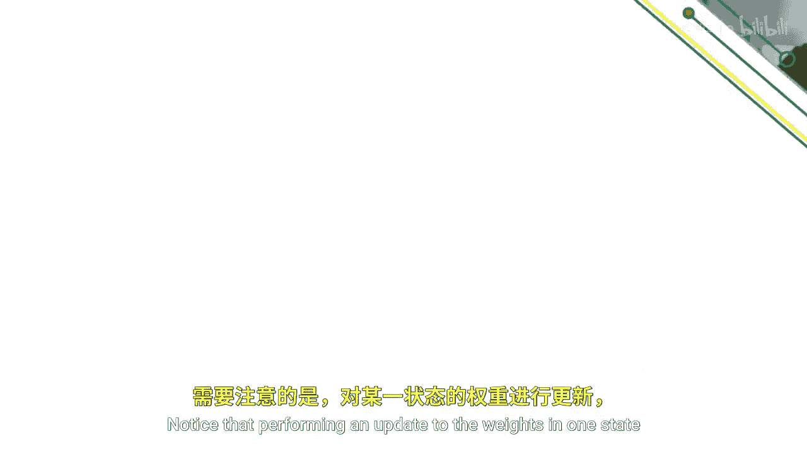
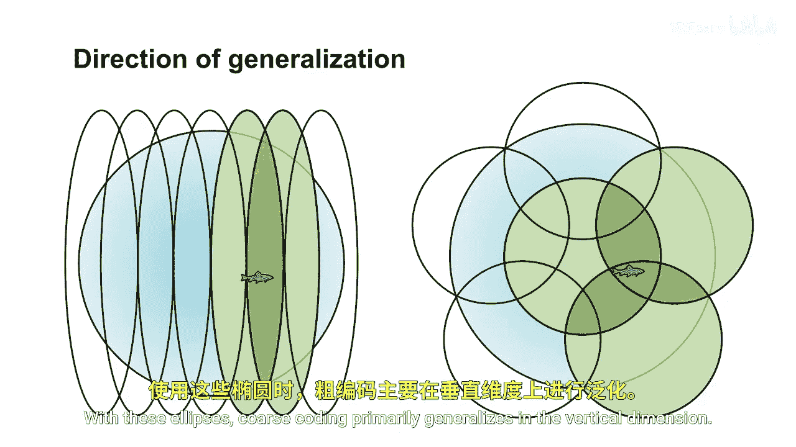
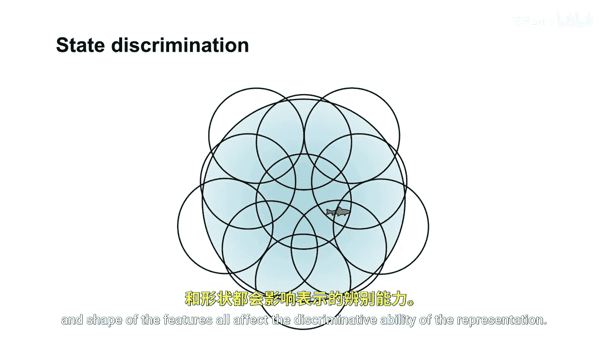

# 094：粗编码的泛化特性

在本节课中，我们将要学习粗编码（Coarse Coding）表示方法中，特征形状、大小和数量等属性如何影响智能体的泛化能力和区分能力，并最终影响学习的速度与价值函数近似的准确性。

上一节我们介绍了几种不同的特征表示方法，包括表格法、状态聚合和粗编码。但我们没有解释为什么粗编码可能有用。本节中，我们来看看改变粗编码的属性如何影响泛化与区分。

通过本视频的学习，你将能够描述粗编码的参数如何影响泛化与区分，以及这如何影响学习的速度和准确性。

## 🎯 特征形状与大小对泛化的影响

我们讨论过，粗编码将状态分组到任意形状和尺寸的特征中。这些特征可以是圆形、椭圆形、正方形或不同形状的组合。

以下是特征形状和大小如何影响泛化与区分，进而影响学习速度和我们能表示的价值函数。

请注意，对一个状态的权重进行更新，会改变所有位于**激活特征感受野**内的状态的价值估计。

如果激活特征的感受野的**并集**很大，则特征表示的**泛化**程度更高。反之，如果并集很小，则泛化程度很低。上图中，右侧较大的圆形泛化更广，将更新分布到了更多的状态上。

然而，泛化不仅仅是一个标量。在粗编码中使用不同的形状也可以改变泛化的方向。

让我们将之前圆形的例子与使用**垂直拉长的椭圆形**进行粗编码的泛化方式进行比较。

由椭圆形构成的感受野长度大于宽度。使用这些椭圆形，粗编码主要在**垂直维度**上进行泛化。

## 🔍 感受野重叠与区分能力

我们已经讨论了感受野的形状和大小如何影响泛化及学习速度。但关于我们估计的最终准确性呢？这就涉及到**区分**能力。

回忆一下，区分两个不同状态价值的能力被称为**区分**。

在粗编码中，圆形之间的**重叠**决定了区分的水平。我们不可能做到完美的区分，因为我们永远无法更新一个状态的价值而不影响其他状态的价值。

下图中的彩色形状描绘了这种特定粗编码的区分能力。为了可视化简洁，我们只高亮显示了几个区域。

**每个位于同一彩色形状内的状态将拥有完全相同的特征向量**。因此，它们都必须具有相同的近似价值。这些区域越小，我们的区分能力就越好。

使用更多的圆形，区域会变得更小，我们就能更精细地区分不同状态的价值。或者，我们也可以使圆形本身变小。

因此，特征的**大小**、**数量**和**形状**都会影响表示的区分能力。

## 📈 一维示例：学习阶跃函数

让我们看一个一维输入空间的简单例子：考虑学习一个阶跃函数的近似。

我们假设可以采样真实函数值来更新我们的估计。这个例子将帮助你更好地理解表示选择如何影响学习速度和最终近似的质量。

对于我们的一维函数，每个特征的感受野将被表示为重叠的区间。让我们从这个相对较短的区间开始。我们将放置大约50个这样的区间，让它们在我们的函数定义域上随机重叠。

以下是随着我们随机采样函数的真实值，我们的函数估计如何变化。

我们从初始估计值0开始，描绘为一条平坦的线。

每个特征的感受野相当小，因此即使在许多次采样之后，我们对阶跃函数的近似也不是很好。经过更多训练，我们的近似最终与真实函数接近匹配，但并不完美。通过检查函数顶部的近似很容易看出这一点，它远不够平坦或平滑。

让我们用更长的区间再试一次。

每个特征的感受野相当大。这意味着我们可以用相对较少的样本来近似函数的粗略形状。

随着我们对函数进行更多采样，我们的估计形成了对真实函数越来越好的近似。

较长区间的广泛泛化使学习速度更快，我们需要更少的样本来获得良好的近似。大量较长区间也带来了更好的区分能力，即对真实函数更好的最终近似。

在这个例子中，较长的区间最终实现了更好的泛化和区分，但这可能并非总是如此。每个任务可能需要不同的特征属性，并没有一个通用的解决方案。

## ✅ 总结

本节课中我们一起学习了特征的**大小**、**数量**和**形状**如何影响泛化，以及由此产生的形状交集如何影响区分能力。

粗编码是一种非常通用的表示类型。理解它在学习过程中如何进行泛化和区分，将帮助我们理解其他表示方法，包括神经网络。