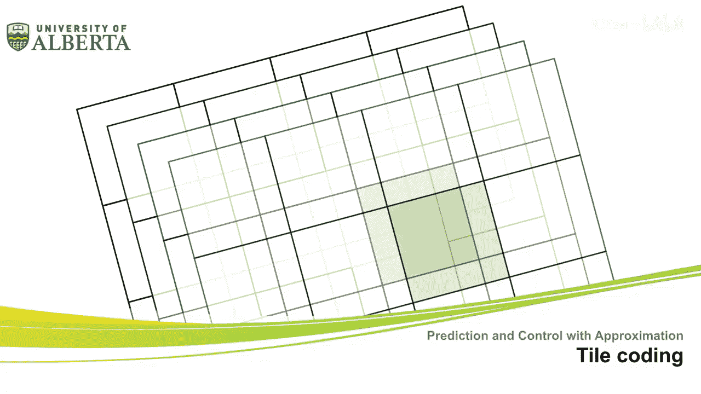
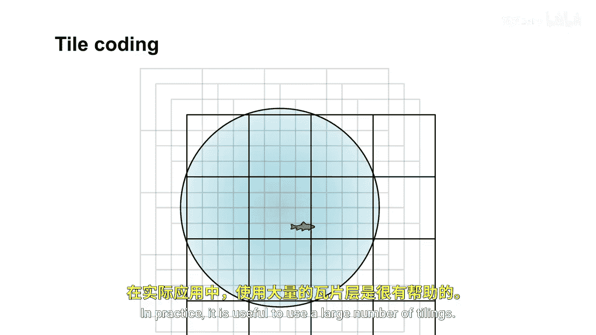
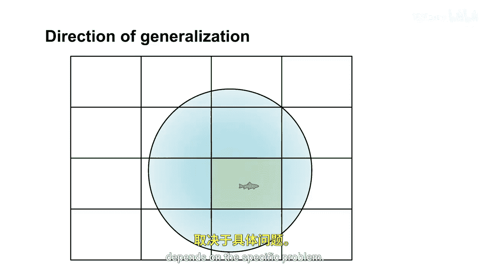

# 095：瓦片编码 🧱

在本节课中，我们将学习一种计算高效的粗编码方法——瓦片编码。我们将探讨其工作原理、优势与局限性，并理解它如何实现泛化与区分。

## 概述

上一节我们介绍了粗编码。本节中，我们来看看一种计算高效的粗编码实现方式：瓦片编码。通过本视频的学习，你将能够解释瓦片编码如何同时实现泛化与区分，并理解其优势与局限性。

## 什么是瓦片编码？

瓦片编码是粗编码的一种特定类型。它使用重叠的网格对状态空间进行详尽划分。

这或许通过一个例子能更好地理解。

让我们重新审视生活在二维连续状态空间（池塘）中的鱼朋友。与使用任意形状的粗编码不同，瓦片编码使用正方形。

在一个空间上布置一堆正方形最便捷的方式是什么？那就是网格。

我们称这个网格为一个“瓦片层”。到目前为止，这仅仅是状态聚合。更大的瓦片将导致更强的泛化能力，尽管理想的瓦片大小取决于具体问题，但通常使用较大的瓦片是个好主意。

## 提升区分能力

为了提升瓦片编码的区分能力，我们可以将多个瓦片层叠加在一起。每个瓦片层都偏移一个很小的量。

偏移每一层瓦片会创建许多小的交叉区域，这带来了更好的区分能力。在实践中，使用大量瓦片层是有用的。

对于单个瓦片层，泛化只发生在正方形内部。但有了多个瓦片层，对这个状态的更新会泛化到这些其他状态。在这种情况下，泛化是沿对角线的。如果我们使用了随机偏移，那么泛化将更接近球形且均匀。这在教科书中有更详细的讨论。

## 控制泛化属性

接下来，我们谈谈如何进一步控制泛化属性。

我们可以通过创建矩形网格而非正方形网格来实现这一点。一个高效的方法是缩放状态空间的每个维度。

环境在这里看起来被挤压了。实际上，在这个被挤压的环境上叠加正方形，就像在未被挤压的环境上叠加矩形一样。

通过使用矩形，我们可以控制泛化在状态空间每个维度上的广度。

## 优势与局限性

瓦片编码可以表示广泛的函数，但其效用不止于此。瓦片编码还具有计算高效的特点。由于网格是均匀的，很容易计算当前状态位于哪个单元格中。

得益于其计算效率，瓦片编码可用于在低维环境中快速运行初步实验。

然而，随着维度的增加，所需的瓦片数量呈指数级增长。因此，有时可能需要单独处理输入维度。输入维度是否可以独立处理，取决于具体问题。

## 总结

本节课中，我们一起学习了瓦片编码，理解了它是如何通过重叠网格实现高效计算，并在泛化与区分之间取得平衡的。我们看到了它作为状态聚合的泛化形式，在低维问题中的实用性，也认识到了其在高维空间面临的挑战。下一节再见。