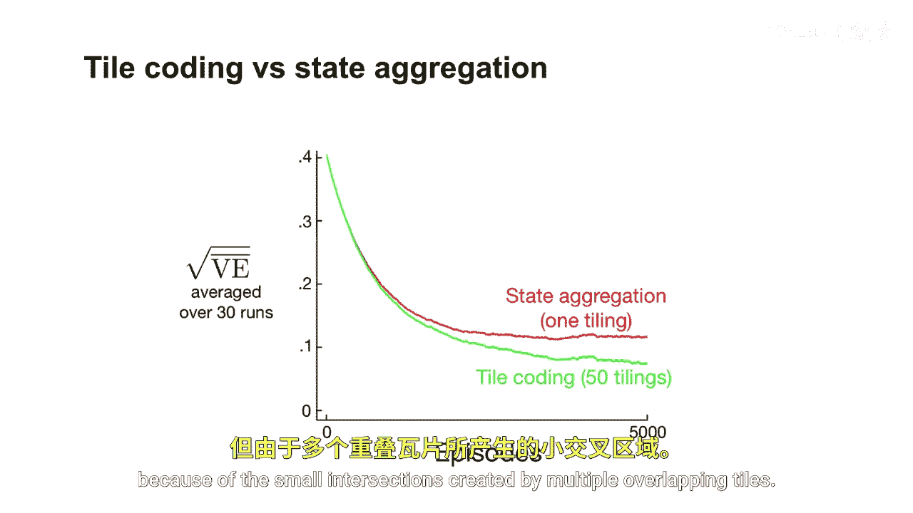

强化学习专题：P96：在时序差分法中使用瓦片编码 🧩

在本节课中，我们将学习如何将瓦片编码与线性时序差分学习结合使用，以高效地近似价值函数。我们将探讨瓦片编码表示的重要特性，并通过一个实验将其与状态聚合方法进行比较。

到目前为止，你已经学习了瓦片编码，但我们尚未将其与强化学习联系起来。今天，我们将解释如何将瓦片编码与线性时序差分法结合使用。

通过本视频的学习，你将能够解释如何在时序差分学习中使用瓦片编码，并识别瓦片编码表示的重要属性。

瓦片编码表示的一个重要属性是：**激活瓦片的数量始终显著少于瓦片总数**。我们可以利用这一特性来高效地计算价值函数。

回想一下，在线性函数近似中，价值函数是权重向量和特征向量之间的点积。让我们看看当特征向量是稀疏的二进制向量时，这个点积是什么样子。

如果我们对两个向量进行逐元素相乘，许多元素乘积将为零。这意味着我们只需要考虑特征向量中非零元素对应的权重。由于特征是二进制的，非零特征处的权重将乘以一。

以常规方式计算点积会非常耗时。相反，我们可以直接对激活特征对应的权重进行求和。请注意，这需要的时间是恒定的，因为每个状态中激活特征的数量是相同的。瓦片编码产生的特征向量使得查询价值函数在计算上非常廉价。

让我们看一个使用瓦片编码特征计算价值函数的例子。

假设我们回到有两个瓦片覆盖的旧池塘环境，每个瓦片覆盖包含四个瓦片。我们已经用颜色编码了瓦片覆盖，每个瓦片方格都有索引，如图所示。

如果鱼的位置和权重因子如图所示，鱼所在位置的价值是多少？

我们可以看到，鱼与紫色瓦片覆盖中的方格1和橙色瓦片覆盖中的方格4相交。这为该状态生成了以下特征向量。

现在，我们只需通过点积计算该状态的价值。特征向量是二进制的，因此我们可以直接将非零特征位置对应的权重相加。这给我们一个价值为2。

现在，让我们运行一个使用瓦片编码的实验，并将其与状态聚合进行比较。

回想一下，瓦片编码本质上是多个状态聚合实例（或称瓦片覆盖）的叠加。我们的环境是1000个状态的随机游走，状态编号从1到1000，所有回合都从状态500开始。在每个时间步，智能体随机转换到任一侧的200个相邻状态之一。超出状态1或1000将导致转换到终止状态。例如，查看状态2左侧的可能转换：一个会转到状态1，其余199个会转到终止状态。

让我们讨论如何在这个问题中使用函数近似。我们将从状态聚合开始。假设我们使用一个包含5个组的状态聚合，每组对应200个状态。现在，让我们为这个问题设计一个包含50个瓦片覆盖的瓦片编码器。我们将1000个状态视为一个区间，其中每个瓦片对应200个状态。由于每个瓦片有200个状态，你可能会认为我们只需要5个瓦片就能覆盖1000个状态的整个空间。然而，每个瓦片覆盖都相对于其他覆盖有轻微的偏移。由于这种偏移，需要一个额外的瓦片来覆盖因此留下的未覆盖空间。所以，我们的每个瓦片覆盖包含6个瓦片，而不是5个。

让我们使用梯度蒙特卡洛方法来比较这两种函数近似器。步长参数alpha根据激活特征的数量进行缩放：瓦片编码为50，状态聚合为1。让我们看看结果。

我们绘制了每个回合后30次运行的平均价值误差。由于积极的泛化，两个智能体都学习得很快。然而，瓦片编码表示能够更好地区分状态，并实现了更低的价值误差。有趣的是，尽管瓦片编码器有更多的参数，但它学习的速度与核心状态聚合一样快，同时还实现了更好的区分能力。这是因为多个重叠瓦片创建的小交叉区域。

本节课中，我们一起学习了如何将瓦片编码用于策略评估中的价值函数近似，并通过一个简单示例比较了瓦片编码与状态聚合。下次课，我们将超越固定表示，开始学习使用神经网络学习表示。