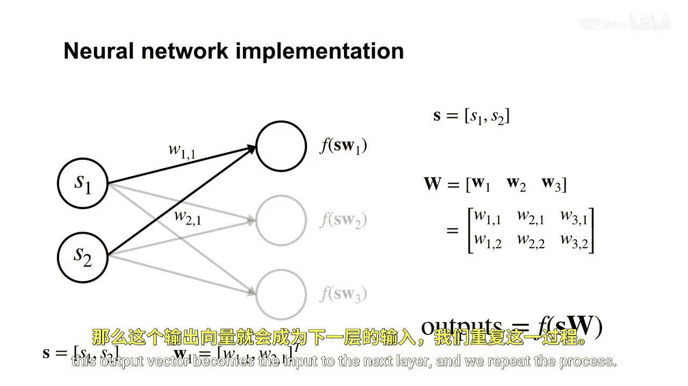

# 097：什么是神经网络 🧠

在本节课中，我们将学习神经网络。这是一种灵活且强大的非线性函数近似器。我们将了解其基本结构、工作原理，以及如何将其视为一个参数化的函数。

---

## 前馈神经网络的结构

上一节我们介绍了神经网络的概念，本节中我们来看看它的具体结构。

神经网络由节点和连接组成。节点被组织成不同的层。数据从输入层进入，通过连接传递到下一层的节点。每一层对数据进行计算，然后将结果传递给下一层，直到最后一层产生最终输出。

我们称之为**前馈神经网络**，因为数据始终向前通过各层。没有任何连接会回环到网络的前面。如果存在回环，一个节点的输出可能影响其自身的输入，这种网络则被称为**循环神经网络**。

以下是神经网络的基本组成部分：
*   **节点**： 进行计算的单元。
*   **连接**： 节点之间的信息传递通道，每条连接都有一个**权重**。
*   **层**： 节点的集合，包括输入层、隐藏层和输出层。

---

## 节点的计算与激活函数

了解了网络结构后，我们来看看单个节点是如何工作的。

当数据通过一条连接传递时，会乘以一个权重。节点将所有加权输入求和，然后对这个和值应用一个**激活函数**。激活函数通常是一个非线性变换。

常见的激活函数包括：
*   **Sigmoid型函数**： 如 `tanh` 或逻辑函数。
*   **整流线性单元**： 即 `ReLU` 函数。
*   **阈值单元**。

---

## 数学表示：前向传播

现在，让我们从数学角度看看如何表示神经网络的前向传播过程。

在每个节点，我们有两个向量：输入向量和每个输入对应的权重向量。权重 `w_{ij}` 的第一个下标 `i` 表示连接来源的节点，第二个下标 `j` 表示连接指向的节点。

节点的计算可以表示为：
`output_j = activation_function( sum_i (input_i * w_{ij}) )`

注意，这里输入 `S` 被视为行向量，因此计算加权和时无需转置。

每一层都由许多这样的节点组成。因此，神经网络本质上就是一个**参数化的函数**，尽管从节点集合的角度看可能不太直观。

---

## 矩阵化表示

为了更清晰地理解神经网络作为参数化函数的本质，让我们使用矩阵向量乘法来重写网络中的运算。

我们可以将一层的输入视为一个行向量，将该层的所有权重视为一个矩阵（即一个二维数组）。这样，我们可以使用矩阵乘法计算整个层的输出。

公式如下：
`Z = X * W + b` （其中 `X` 是输入行向量，`W` 是权重矩阵，`b` 是偏置向量）
`A = activation_function(Z)`

然后，我们对输出向量 `Z` 的每个元素应用激活函数，得到该层的激活值 `A`。如果这个输出不是最终层，那么 `A` 就成为下一层的输入向量，我们重复这个过程。

通过这种表示，可以清楚地看到，神经网络就是一系列参数化（权重 `W` 和偏置 `b`）的线性变换与非线性的激活函数的组合。

---

## 总结

本节课中，我们一起学习了神经网络的基础知识。我们解释了神经网络如何由处理和传递信息的节点网络构成，讨论了前馈神经网络的结构，并通过数学公式和矩阵运算展示了它如何作为一个参数化的函数进行工作。理解这些基本概念是后续学习深度强化学习的重要基石。