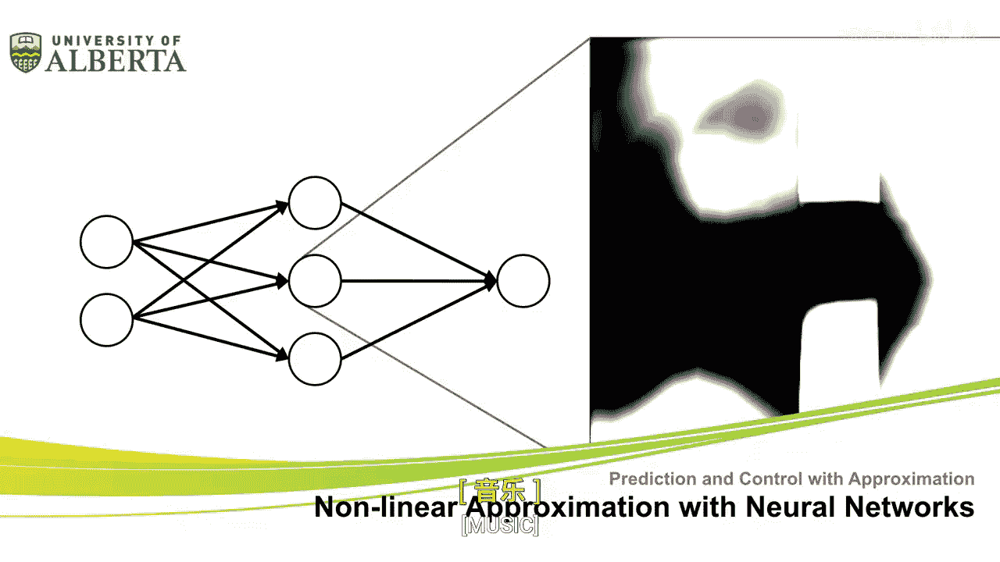
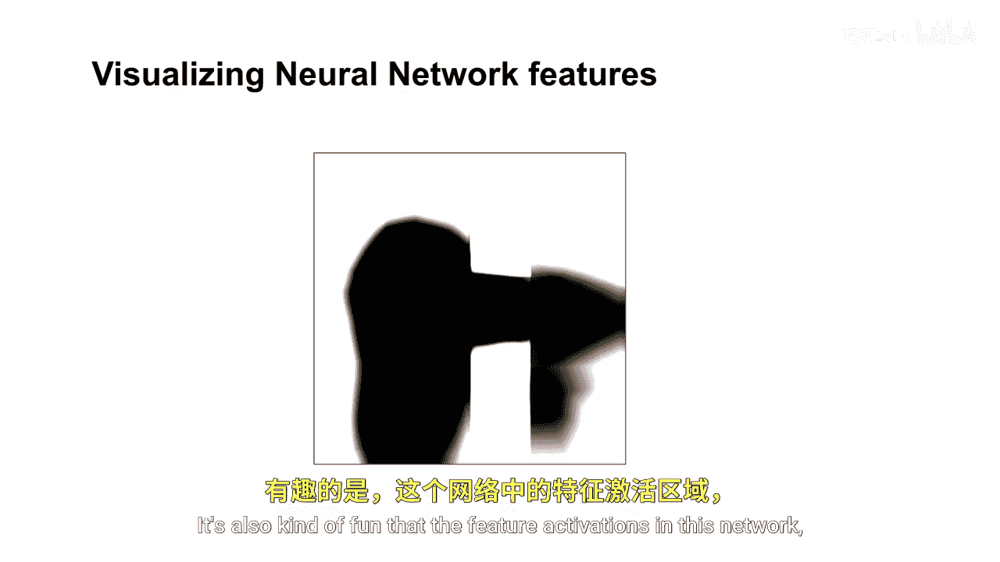

强化学习专项课程：P98：使用神经网络进行非线性逼近

在本节课中，我们将学习神经网络如何作为一种特征构造策略，用于非线性函数逼近。我们将理解神经网络如何从输入状态中学习并生成有用的特征表示，并将其与之前学习的瓦片编码方法进行对比。

瓦片编码是一种为预测创建固定特征集的方法。神经网络则提供了一种学习有用特征集的策略。本节将讨论神经网络如何创建这些特征。

通过本视频的学习，你将理解神经网络如何进行特征构造，以及神经网络如何成为状态的非线性函数。

### 重温前馈神经网络

当我们首次构建神经网络时，需要指定初始权重。初始化权重的方式很重要，但关于这一点我们稍后再详述。现在，我们假设权重是从某个随机分布中抽取的。

让我们看看当给定输入向量通过网络传递时会发生什么。首先，我们只关注网络中的一个节点。

以下是单个节点的计算过程：
1.  每个输入乘以对应的权重。
2.  这些加权输入的总和被传递给一个非线性激活函数。
3.  最终结果是输入的一个非线性函数。

这个过程在层中的每个节点上重复进行。每个节点都有一组不同的权重，因此会产生不同的输出，我们称之为一个“特征”。所有这些新特征共同构成了新的表示。

### 与瓦片编码的类比

这个过程实际上与瓦片编码没有太大不同。我们将输入传递给瓦片编码器，得到一个新的表示。因此，在这两种情况下，我们都构建了一个输入到特征的非线性映射。并且，在这两种情况下，我们都对表示进行线性组合以产生输出，即当前状态的近似价值。

通过对比瓦片编码，我们可以更深入地理解神经网络的表示。

回想一下，在创建瓦片编码器时，我们必须设置几个参数：瓦片的大小和形状，以及瓦片的数量。这些参数在学习之前是固定的。

在神经网络中，我们有类似的参数，对应于层数、每层的节点数和激活函数。这些通常也在学习之前固定。从这个意义上说，两者都利用先验知识来帮助构造特征。

然而，除此之外，神经网络还具有可调整的参数，这些参数可以在学习过程中改变特征。神经网络可以利用数据来改进特征，而瓦片编码器则可以从数据中整合新信息。

### 非线性特征的可视化

瓦片编码和神经网络都产生在输入空间上非线性的特征。我们可以通过可视化预训练神经网络的隐藏层来更好地理解这一点。

我们训练了一个智能体在一个连续的二维空间中，该空间包含两面墙之间的狭窄走廊。这里我们绘制了网络学习到的单个特征的感受野。

坐标轴对应于XY位置，即MDP的状态空间。图中的每个点对应于该XY状态的特征值，颜色越深表示激活程度越大。如果是白色，则表示该特征在该状态下未被激活。

这个图意味着什么？它显示了该特征对哪些状态是活跃的，即特征幅度超过了一个小阈值。因此，在更高层次上，这个图展示了这个特征如何进行泛化：对其权重的更新会改变所有这些状态的值。

观察几个特征的感受野，我们可以看到不同的特征以不同的方式泛化，并形成复杂的非线性形状。这些激活不像瓦片编码那样具有硬边界。

这些学习到的特征可以具有平滑变化的边界。这个特征根据状态的不同，具有不同程度的泛化能力。有趣的是，这个网络中的特征激活还向我们展示了两面墙的位置。

本节课到此结束。你学习了神经网络如何被视为一种构造特征的方式，并且认识到神经网络是状态的非线性函数。