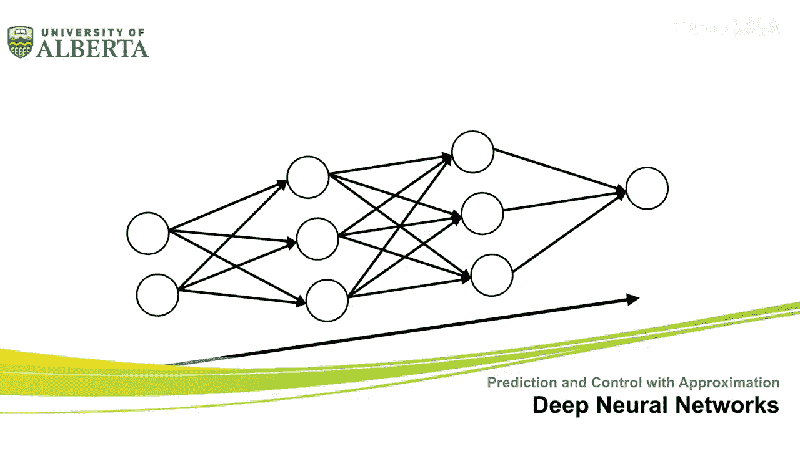
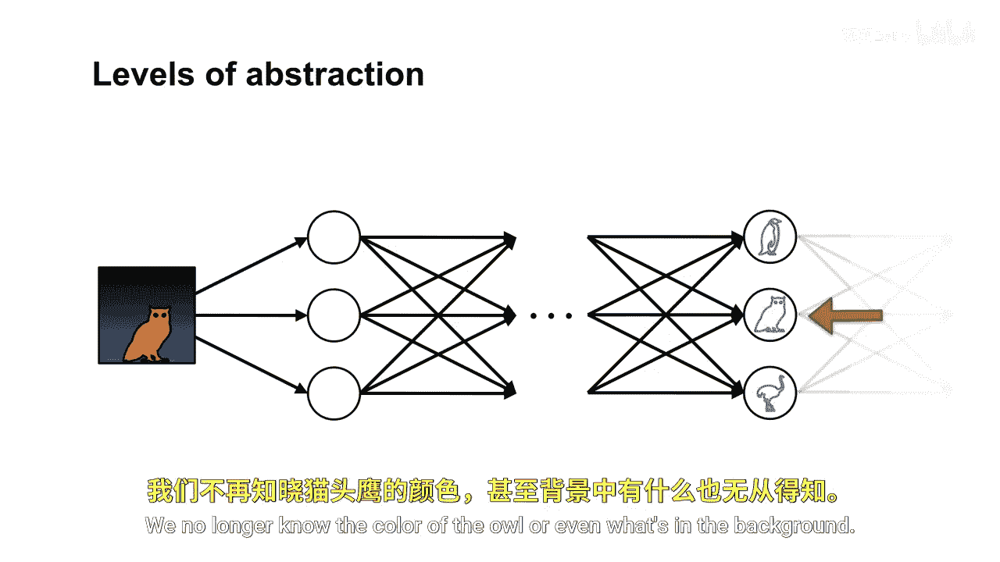

# 099：深度神经网络

在本节课中，我们将要学习神经网络架构的选择如何影响性能。我们将重点探讨“深度”在神经网络中的作用，理解深度如何通过特征的组合与抽象来促进学习。

神经网络架构的选择对性能有很大影响。这包括节点的数量、激活函数的选择，以及节点如何排列和连接。今天我们将提供一些关于网络深度所扮演角色的直观理解。

通过本视频的学习，你将理解深度神经网络如何由许多层组成，并理解深度如何通过组合与抽象来促进特征学习。

## 神经网络作为模块化系统 🧱

我们可以将神经网络视为一个模块化系统，其中每一层都是一个模块。我们可以添加或移除层，也可以更改我们使用的层类型。

网络的深度由网络中隐藏层的数量定义。从理论上讲，神经网络不一定是深的。一个具有单个隐藏层的神经网络，只要足够宽，就可以近似任何连续函数。我们称之为**通用近似定理**。

然而，实践经验和理论都表明，深度神经网络可能使近似复杂函数变得更容易。

## 深度促进特征组合 🔗

深度之所以有益，一个原因是它允许特征的组合。组合可以通过组合模块化组件来产生更专门化的特征。

考虑一个直观的例子：输入是图像的原始像素。较早的层可能学会捕捉低级特征，比如各种角度的线条。下一层可能学会将这些线条组合成各种形状。基于这些，网络或许能够检测图像中的物体或动物。这种方法通常比试图直接从原始像素推断这些信息效果更好。

通过向每一层添加更多层或更多单元，我们可以表示更复杂的函数。

## 深度有助于获得抽象 🎯

深度神经网络组合了许多较低层次的抽象层，每一连续层都有助于形成越来越抽象的表示。

考虑之前的例子，网络最终可能用一个比特来表示“猫头鹰”这个概念。0 表示图像不包含猫头鹰，1 表示图像包含猫头鹰。在这个层次上，图像中所有额外的细节都已被移除。我们不再知道猫头鹰的颜色，甚至不知道背景中有什么。

事实上，我们可以明确地设计网络来从输入中移除不必要的细节。例如，可以设计一个带有**瓶颈层**的网络。其思想很简单：每一连续层包含的节点都比前一层少。表示层是节点最少的层，它包含了预测所需的关键细节。

## 总结与展望 📝

总的来说，网络的深度可以显著提高我们智能体学习特征的能力。在本视频中，我们描述了网络如何由多层组成，并讨论了深度如何促进组合与抽象。

今天我们讨论了深度神经网络在实践中可能带来的一些好处。选择合适的架构可能很困难，并且会显著影响性能。在本课程中，我们将不再进一步讨论网络架构。关于这个主题有很多优秀的资源，如果你想了解更多，可以去查阅。

接下来，我们将讨论如何学习神经网络的参数。

本节课中我们一起学习了深度神经网络的基本概念，理解了深度如何通过特征的组合与抽象来增强网络的学习能力，并简要介绍了瓶颈层等设计思想。