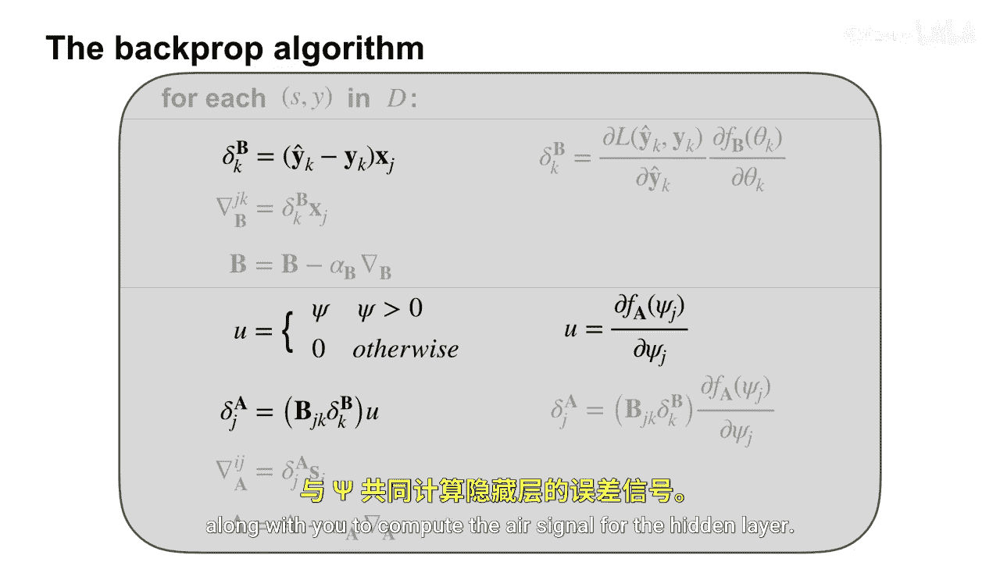

# 100：训练神经网络的梯度下降法 🧠

在本节课中，我们将学习如何为神经网络推导梯度，并实现梯度下降算法。我们将看到，尽管神经网络结构更复杂，但其训练的核心思想仍然是梯度下降。

## 概述

我们之前讨论的算法更新通常比较简单，并且大多基于梯度下降。对于神经网络而言，情况也是如此。反向传播算法实际上并不复杂，它本质上就是梯度下降，但由于嵌套函数的存在，梯度的计算会稍微复杂一些。

通过本视频的学习，你将能够推导神经网络的梯度，并在神经网络上实现梯度下降。

## 定义损失函数

与线性函数近似一样，第一步是定义关于神经网络参数的损失函数，然后推导其梯度。

损失函数衡量了网络预测值与正确值之间的差距。我们训练神经网络的目标是找到能够最小化这个损失函数的参数。

函数的梯度指向函数值增长最快的方向。通过向梯度的相反方向移动，我们就能朝着最快速最小化损失的方向前进。

## 计算神经网络的梯度

那么，我们如何计算神经网络损失函数的梯度呢？在开始之前，让我们先建立一些符号约定。

*   网络的输入是 **S**，输出是 **Ŷ**。
*   隐藏层学习特征，我们称之为 **X**。权重 **A** 用于生成特征，权重 **B** 则对 **X** 进行线性加权以产生输出。
*   网络每一层的输出都可以表示为一个向量，这里就是 **X** 和 **Ŷ**。
*   权重矩阵的第一个索引指向该层的输入，第二个索引指向输出。

我们暂时假设有一个通用的损失函数 **L**，以便描述基本思想。**L** 的一个例子是平方误差。在推导过程中，我们将保持 **L** 的通用性，稍后会给出使用平方误差时的具体更新公式。

在深入推导之前，让我们先了解一下方向。虽然推导过程有些复杂，但我们会发现最终的更新公式相当简单。

每一层参数矩阵的更新都类似于一个误差项 **δ** 乘以该层的输入。对于 **A**，输入是 **S**；对于 **B**，输入是 **X**。此外，我们还会发现 **δ_A** 可以有效地计算为 **δ_B** 的函数。来自网络输出的误差 **δ_B** 被反向传播到更早的层，以帮助确定 **A** 在产生该误差中所起的作用。

## 推导梯度

现在，我们如何得到 **δ_A** 和 **δ_B** 呢？为了趣味和教育目的，让我们现在进行完整的推导。让我们从网络的输出开始，向后推导，这样做有一个很好的理由，你马上就会看到。

我们首先计算损失函数 **L** 对第一组权重 **B** 的偏导数。

我们使用链式法则，得到 **L** 对 **Ŷ** 的导数乘以 **Ŷ** 对 **B** 的导数。

下一步是再次使用链式法则计算这个导数。为了简化，我们引入一个新变量 **θ**。**θ** 是隐藏层输出与最后一组权重的乘积。让我们把它写在旁边以便记住。现在，让我们用 **θ** 重写 **Ŷ**。

让我们展开 **Ŷ** 对 **B** 的导数。使用链式法则，我们得到 **f_B** 对 **θ** 的导数乘以 **θ** 对 **B** 的导数。

**θ** 对 **B** 的导数是 **X**。这是因为 **θ** 是 **B** 的线性函数，并且 **X** 不依赖于 **B**。

现在我们已经完成了对 **B** 的梯度推导，接下来我们将推导 **A** 的梯度。但在那之前，让我们为损失函数和激活函数做出一些选择，以便能看到 **B** 的通用方程的一个具体实例。

让我们定义 **L** 为平方误差，并在最后一层使用线性激活函数。

损失函数对 **Ŷ** 的导数是：
`∂L/∂Ŷ = Ŷ - Y`

输出层激活函数的导数是 1。这是因为 **f_B** 是恒等函数，**θ** 对自身的导数是 1。

这是损失函数对 **B** 的通用梯度：
`∂L/∂B = (∂L/∂Ŷ) * (∂f_B/∂θ) * (∂θ/∂B)`

将其代入对 **B** 的梯度，我们得到：
`∂L/∂B = (Ŷ - Y) * 1 * X`

为了在计算对 **A** 的梯度时简化符号，让我们定义一个新项 **δ_B**：
`δ_B = (∂L/∂Ŷ) * (∂f_B/∂θ)`

现在，对 **B** 的梯度可以重写为 **δ_B** 乘以它的输入 **X**。

接下来，为了计算对 **A** 的梯度，我们需要经历与 **B** 相同的步骤，主要区别在于我们多了一个链式法则步骤，因为权重 **A** 也会影响 **X**。

让我们从这里开始。让我们使用链式法则展开这个导数。在展开下一项之前，让我们引入另一个辅助变量 **ψ**：
`ψ = 输入 S * A`

我们把它放在一边，并用它重写 **X**。然后我们展开下一项。

再次使用链式法则，我们得到 **f_A** 对 **ψ** 的导数乘以 **ψ** 对 **A** 的导数。

因为 **ψ** 是 **S** 乘以 **A**，所以我们得到 **∂ψ/∂A = S**。

将所有部分放在一起，我们最终得到了对 **A** 的导数。我们现在拥有了计算网络参数梯度所需的一切。我们可以通过再次定义一个项 **δ_A** 来简化这个导数。

现在，对 **A** 的导数是 **δ_A** 乘以它的输入 **S**。

请注意，两个梯度都可以重写为相似的形式：它们都有一个包含误差信号的 **δ** 项乘以它们的输入。

## 反向传播算法伪代码

让我们简要看一下实现随机梯度下降反向传播算法的一些伪代码。

对于数据中的每个数据点 **(S, Y)**：
1.  我们首先从网络获得预测值 **Ŷ**，这通常称为**前向传播**。
2.  然后我们从输出开始计算梯度。
    *   我们首先计算 **δ_B** 和 **B** 的梯度。
    *   然后我们使用这个梯度更新参数 **B**，步长为 **α_B**。
3.  接下来我们更新参数 **A**。
    *   我们计算 **δ_A**，它使用了 **δ_B**。
    *   请注意，通过首先计算网络末端的梯度，我们避免了为 **A** 重新计算那些已经为 **δ_B** 计算过的相同项。实际上，这正是反向传播背后的主要思想。它只是梯度下降，并配有一个高效计算梯度的策略。
    *   然后我们计算 **A** 的梯度，并使用步长 **α_A** 用这个梯度更新 **A**。

这个推导和算法很容易扩展到更深的网络：更早层的 **δ** 类似地使用下一层的 **δ** 递归计算。每一层的更新总是采用 **δ** 乘以该层输入的形式。

本质上，网络将存储在每个层 **δ** 中的误差信息传递回去。为了让这更具体，让我们看一个特定网络的反向传播算法。

以下是如果我们对隐藏层使用 ReLU 激活函数、对输出层使用线性单元时的伪代码：
1.  首先，我们计算输出层的误差。
2.  然后我们计算 ReLU 单元对 **ψ** 的导数。
3.  最后，我们使用来自输出层的误差信号以及导数来计算隐藏层的误差信号。

其余部分保持不变。

## 总结

本节课到此结束。今天我们推导了神经网络的梯度，并讨论了反向传播的主要思想：从网络输出开始计算梯度可以节省计算量。

这是一个相当详细的推导，你实际上不需要记住所有这些步骤。我们的目标是让你对神经网络的更新方式有一些了解，以及它如何随着损失函数、激活函数和网络层的不同选择而变化。在你的评估中，你将实现本视频末尾给出的伪代码。

在下一个视频中，我们将为你提供更多工具，使你的神经网络实现在实践中更加有效。