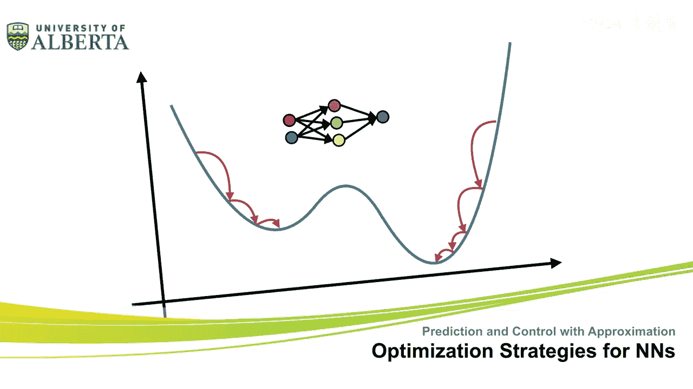
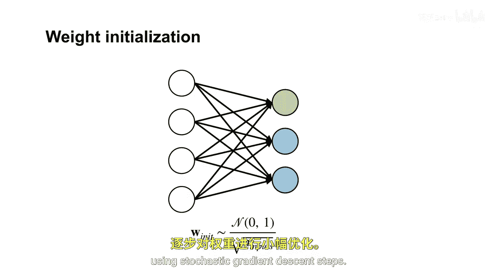
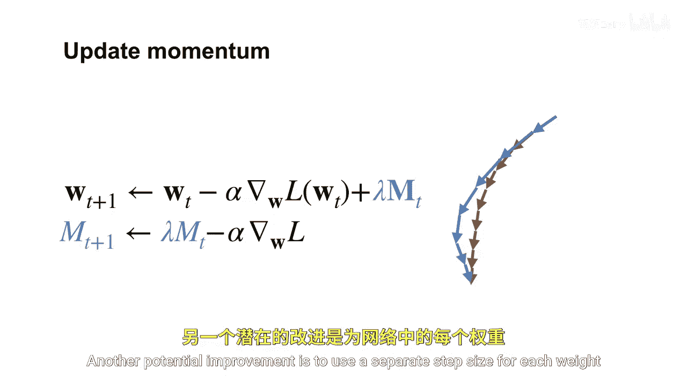
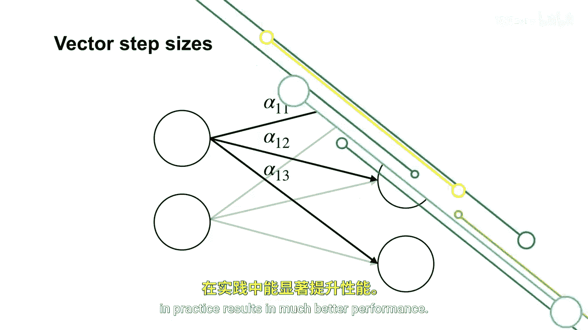

# 101：神经网络的优化策略 🚀

在本节课中，我们将学习如何更有效地训练神经网络。我们将探讨两个关键方面：如何为网络设置一个好的起点（权重初始化），以及如何改进训练过程中的更新机制（优化策略）。这些简单的策略极大地促进了深度神经网络的训练和广泛应用。

## 权重初始化的重要性 🎯

上一节我们介绍了神经网络训练是一个迭代过程。本节中我们来看看这个过程的起点——权重初始化。这个起点的选择对神经网络的性能有重大影响。

让我们看一个只有一个权重的例子。在y轴上，我们展示损失函数；在x轴上，我们展示权重的值。梯度下降法会迭代地将权重移向最近的驻点。

但神经网络的损失函数并非如此简单。如果我们从这个近乎平坦的区域开始，由于梯度接近0，梯度下降法可能很难取得进展。相反，如果我们从这个小的“碗”状区域内部开始，就能快速找到局部最优点。然而，如果我们能从某个更好的位置开始，从而快速找到更优的点，岂不是更好？

一个简单而有效的初始化策略是从一个方差很小的正态分布中随机采样初始权重。这样，同一层中的每个神经元都有与其他神经元不同的输出，这提供了一组更多样化的潜在特征。通过保持方差很小，我们确保每个神经元的输出与其相邻神经元的输出在同一范围内。

这个策略的一个缺点是，当我们为一个神经元增加更多输入时，其输出的方差会增大。我们可以通过将权重的方差按 `1 / sqrt(输入数量)` 的比例进行缩放来解决这个问题。

## 改进更新机制：动量法 ⚡

在确定了网络的起点之后，我们开始使用随机梯度下降步骤对权重进行增量式的小改进。另一种改进训练的方法是考虑更复杂的更新机制。两种常见策略是使用“重球法”（也称为动量法）和向量步长自适应。我们先来谈谈动量法。

想象一下，这是二维权重向量在随机梯度下降下的轨迹。这是标准的随机梯度下降更新规则：
`w_{t+1} = w_t - α * ∇L(w_t)`

这是修改后包含动量的更新规则：
`w_{t+1} = w_t - α * ∇L(w_t) + λ * (w_t - w_{t-1})`
注意，它类似于常规的随机梯度下降更新，加上一个称为动量的额外项。动量项使用梯度衰减和（衰减率为λ）来总结梯度的历史。

如果最近的梯度都指向相似的方向，那么我们就会在该方向上获得动量。这意味着我们在该方向上迈出一大步。如果最近的更新方向相互冲突，那么它会抵消动量，动量项对更新的影响很小，我们将进行常规的梯度下降步骤。

动量法被证明可以加速学习，意味着它能更快地到达驻点。

## 改进更新机制：步长自适应 📈

另一个潜在的改进是为网络中的每个权重使用单独的步长。到目前为止，我们只讨论了一个全局标量步长α。众所周知，这可能会出现问题，因为这可能导致对某些权重的更新太大，而对其他权重的更新太小。

在实践中，根据学习过程的统计数据为每个权重自适应调整步长，可以带来更好的性能。

那么更新规则如何改变呢？改变非常简单。不再使用标量α进行更新，而是使用一个步长向量（用下标t表示它在每个时间步可以变化）：
`w_{t+1} = w_t - α_t ⊙ ∇L(w_t)`
其中 `⊙` 表示逐元素乘法。梯度的每个维度都由其对应的步长（而不是全局步长）进行缩放。

有多种方法可以自适应调整步长向量，你将在作业中实现其中一种。

## 总结 🎓

本节课中我们一起学习了改进神经网络训练的方法。具体来说，我们讨论了一种初始化神经网络权重的策略，以及如何使用动量法和步长自适应来加速学习。现在，你已经准备好用神经网络实现一个TD智能体了。祝你学习愉快！