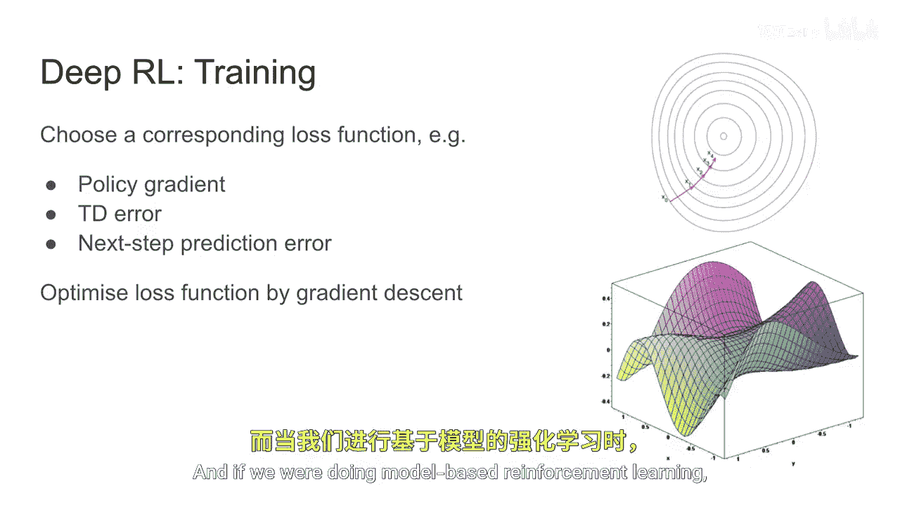

# 102：深度强化学习与人工智能 🧠

在本节课中，我们将探讨深度强化学习，了解其如何将强化学习的问题框架与深度学习的解决方案相结合，从而解决复杂的人工智能任务。

---

## 强化学习：一个通用的决策框架 🤔

上一节我们介绍了课程背景，本节中我们来看看为什么需要强化学习。

强化学习是一个通用的框架，用于思考各类决策问题。它提供了一种思考方式，适用于任何涉及智能体的问题。该智能体在世界中采取行动，其行动会影响世界，世界随之变化并向智能体返回一些观察结果。智能体的目标是选择能最大化其性能的行动，该性能由某种奖励信号衡量。

这是一个非常通用的问题，可以应用于从机器人到游戏，再到金融交易等各种场景。强化学习就是这样一个让我们能够处理所有这些问题的框架。

---

## 深度学习：通用的表示学习方法 🎯

上一节我们了解了强化学习的问题框架，本节中我们来看看深度学习的角色。

深度学习是一种帮助我们解决广泛问题的通用框架。它是一种以非常通用的方式思考表示学习的方法。具体来说，如果给定一个目标，深度学习提供了一种构建能够实现该目标的表示的方法。它从输入开始，通过系统过滤并构建一些特征，以有助于理解这些输入，从而在无需向系统注入大量知识的情况下解决问题。

例如，你只需输入一张猫或狗的图片，系统就会构建特征来理解图像的局部区域，然后是更复杂的特征，最终做出决策，例如判断这是猫还是狗。

---

## 深度强化学习：问题与解决方案的结合 ⚡

上一节我们分别介绍了强化学习和深度学习，本节中我们来看看如何将它们结合。

深度强化学习是两者的结合。我们试图寻找一个能够解决任何人类级别任务的智能体，这是我们许多人对人工智能感兴趣的终极目标。如果我们想实现这个目标，该如何做？问题可以由强化学习定义，而深度学习或许为我们提供了实现目标的机制。因此，强化学习像是问题，而深度学习更像是解决方案。

这里有一个重要的猜想：**强化学习 + 深度学习**。将两者结合，为我们提供了一条可能实现宏大目标的途径，即解决任何此类问题的雄心。

---

## 深入理解深度学习 🧠

上一节我们提出了结合猜想，本节中我们更深入地理解深度学习的核心。

深度学习的核心是**神经网络**。深度神经网络可以被视为一个多层函数，一个复合函数，即函数的函数。

以下是其主要组成部分：
*   **输入**：进入系统的数据，例如描述猫或狗的图片。
*   **处理层**：由一系列不同的函数处理，产生内部状态或特征。每个函数都有权重参数 **`w`**，决定了函数的具体行为。
*   **输出**：经过所有计算层后，神经网络输出结果，例如系统认为这是猫还是狗。
*   **损失函数**：定义系统目标的最后一步，它是一个标量值，用于衡量系统表现的好坏。例如，分类正确则为1，错误则为0。

深度神经网络的特别之处在于，你不仅可以正向计算，还可以反向传播信息流，以确定哪些参数导致了损失的好坏。我们可以理解，如果朝特定方向调整这些参数，这些变化将如何影响输出和最终的损失。我们通过反转信息流方向，并利用微积分的链式法则计算整个系统的梯度来实现这一点，这被称为**反向传播**。

训练深度神经网络的主要思想就是利用这个梯度来调整参数。我们计算损失相对于参数的梯度，这可以看作是指引我们在“地形”中下坡的方向。这个“地形”的每个点代表参数的一种潜在选择，“地形”的高度代表其好坏（损失大小），下坡意味着更低的误差。我们通过沿着梯度方向移动参数，不断向误差最低的点前进。

这就是训练神经网络的基本思想，也是深度学习的核心理念。

---

## 构建深度强化学习智能体 🤖

上一节我们掌握了深度学习的训练原理，本节中我们回到强化学习，看看如何将这些部分结合起来。

理解强化学习智能体的结构非常有用。我认为，智能体内部可能包含以下主要组件，这定义了智能体的类型：
*   **策略**：决定智能体行为的组件。如果智能体包含策略，我们称之为**基于策略**的强化学习方法。
*   **价值函数**：描述智能体对其将获得多少奖励（或其他项）的预测的组件。如果包含价值函数，我们称之为**基于价值**的强化学习智能体。
*   **模型**：描述智能体认为环境如何工作的组件，即它认为接下来会发生什么。如果包含模型，我们称之为**基于模型**的强化学习方法。

我们可以通过使用深度神经网络作为**函数近似器**来结合深度学习和强化学习。这个函数近似器可以用来表示强化学习这三个主要组件中的任何一个：
*   它可以用来表示**策略**。
*   它可以用来表示**价值函数**。
*   它可以用来表示**模型**。

为了训练这个系统，主要思想是必须选择一个损失函数，即一个目标，该目标根据强化学习算法的这三种类型之一来描述我们真正想要的东西：
*   如果进行**基于策略**的强化学习，我们可能会选择遵循**策略梯度**。
*   如果进行**基于价值**的强化学习，我们可能会选择最小化**时序差分误差**。
*   如果进行**基于模型**的强化学习，我们可能会选择最小化**下一步预测误差**。

那么算法是什么？算法非常简单，就像在深度学习中一样，我们所要做的就是通过**梯度下降**来优化那个损失函数，沿着“地形”不断下降，直到我们的损失越来越低，表现越来越好。

---

## 深度强化学习的应用与成就 🏆

上一节我们介绍了深度强化学习智能体的构建方法，本节中我们来看看其实际应用和取得的成就。

将上述内容结合起来，为我们提供了一套在强化学习中实现各种有趣目标的方案。其中一些已经促成了近年来我们看到的一些激动人心的成功案例。

例如：
*   **游戏**：使用深度强化学习方法可以将游戏玩到非常高的水平。我们已经看到智能体能够在围棋游戏中击败人类世界冠军，在国际象棋等其他游戏中也是如此。在现代，你也可以用它来玩电子游戏。我们有深度强化学习智能体能够玩雅达利系统中的50多个完全不同的游戏。最近，一个系统能够玩极具挑战性的游戏《星际争霸》，这是对人类来说最具挑战性的视频游戏之一。
*   **机器人操作**：深度强化学习智能体可以学习以高度的灵活性操纵物体。
*   **化学合成**：深度强化学习智能体能够通过称为“逆合成”的方法解决化学合成问题。
*   **金融交易**：深度强化学习智能体可以在现实世界中进行交易，例如在交易平台上算法化地决定如何操作。

---

## 总结 📝

本节课中我们一起学习了深度强化学习的核心概念。

当我们把强化学习的问题与深度学习的解决方案结合起来，并使用这些深度学习方法为我们提供强大的函数近似工具包时，我们实际上拥有了一种非常灵活且强大的方法。这种方法能够让我们在解决人工智能中许多我们关心的问题上走得很远。