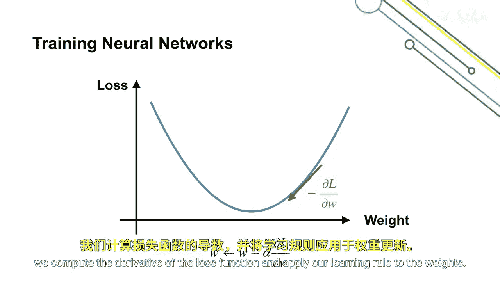

# 103：大规模状态空间表示方法复习 🧠

在本节课中，我们将复习第二周的核心内容：如何表示大规模甚至连续的状态空间。我们将探讨特征构建的方法，并理解表示学习与函数近似之间的关系。

---

表示是智能体对状态的一种内部编码方式。智能体通过构建特征来总结当前的输入信息。当我们讨论特征和表示学习时，我们实际上已经进入了**函数近似**的领域。

这让我们来到了课程地图的左侧部分。

---

上一节我们提到了表示学习，本节中我们来看看几种具体的特征构建方法。以下是两种主要技术：

*   **粗编码**：这种方法与状态聚合相关，它将相邻的状态分组在一起，每个分组可以具有任意的形状。一个二维粗编码的例子可以用一系列重叠的圆来表示。每个圆是一个特征：当状态位于圆内时，该特征值为1；在圆外时，值为0。
*   **瓦片编码**：这是粗编码的一种特定类型。它使用一组重叠的网格来生成特征。每个网格被称为一个**铺砌**。一个铺砌内部的方格之间没有重叠或间隙，因此同一铺砌内每次只有一个特征能被激活。

通过堆叠多个偏移的铺砌，我们可以区分不同的状态。铺砌的形状、大小和数量帮助我们平衡**泛化能力**、**区分能力**和**计算效率**。

---

我们之前讨论的方法都是在学习开始前就固定了表示。接下来，我们探讨一种能够在线学习表示的强大工具：神经网络。

一个前馈神经网络通过一系列层来生成表示。在每一层中，多个神经元接收相同的输入并产生不同的输出；这些输出随后被馈送到下一层，该过程不断重复。

每个神经元通过计算其输入的加权和，并将该和通过一个**激活函数**来产生输出。这个过程可以用以下公式描述：
`输出 = 激活函数(权重 * 输入 + 偏置)`

为了训练神经网络，我们使用一种称为**梯度下降**的迭代过程：
1.  将输入传入网络以产生预测。
2.  将这些预测与真实输出进行比较，并计算损失函数。
3.  计算损失函数关于权重的导数，并应用学习规则来更新权重。

---

本节课中我们一起学习了如何为大规模状态空间构建表示。我们介绍了**粗编码**和**瓦片编码**这两种预定义特征的方法，以及使用**神经网络**进行在线表示学习的原理。这些技术是解决复杂强化学习问题的基石。

下周，我们将讨论如何结合函数近似来学习最大化奖励。