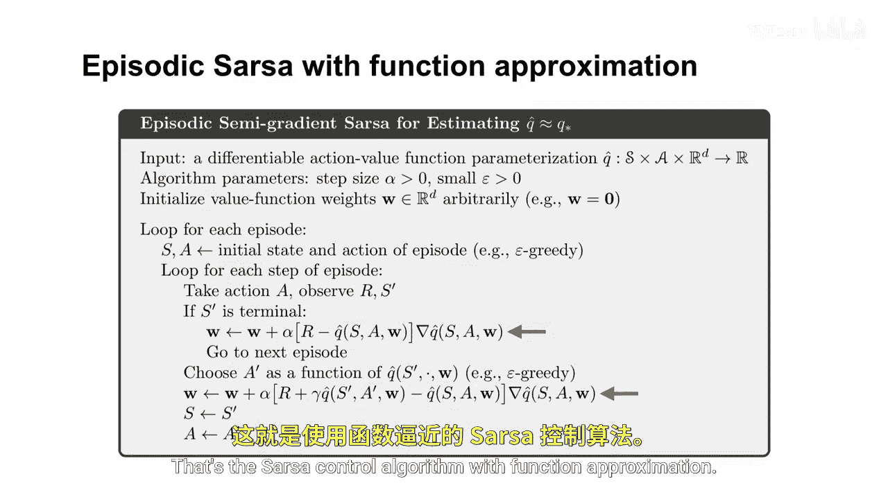

强化学习专项课程：P104：基于函数逼近的分段式Sarsa算法 🧠

在本节课中，我们将学习如何将函数逼近方法应用于控制问题，并重点介绍分段式Sarsa算法。我们将从如何构建依赖于动作的特征表示开始，然后讲解如何将Sarsa算法与函数逼近结合，用于回合制任务。

---

我们之前已经学习了如何构建特征和逼近函数，但那些都是在固定策略下进行预测的背景下进行的。本周，我们将讨论基于函数逼近的控制方法。在本视频中，我们将从广义策略迭代（GPI）算法——回合制Sarsa开始。通过本视频的学习，你将能够理解如何为近似的动作价值函数构建依赖于动作的特征，并解释如何在函数逼近的回合制任务中使用Sarsa算法。

回想一下，价值函数逼近包含两个组成部分：一个权重向量和一个特征向量。在给定状态下，价值估计是这两个组成部分的点积。

为了从TD方法过渡到Sarsa，我们需要动作价值函数。因此，特征表示也必须能够表示动作。

一种方法是为每个动作使用一个独立的函数逼近器。这可以通过**堆叠特征**来实现，即我们可以为每个动作使用相同的状态特征，但只激活对应动作的特征。为了更清楚地理解这一点，让我们看一个例子。

假设有四个状态特征和三个动作。这四个特征代表你所在的状态。但我们想学习一个关于状态和动作的函数。我们可以通过为每个动作重复这四个特征来实现。

现在，特征向量在这里有12个分量，每四个特征组成的片段对应一个独立的动作。我们称这种特征表示为“堆叠的”，因为每个动作的权重是堆叠在一起的。因此，只有指定动作的特征会被激活，而其他动作的特征则被设为零。

让我们看一个如何从给定状态计算动作价值的例子。

假设有四个特征和三个动作。权重向量如下所示：

`w = [w0, w1, w2, w3, w4, w5, w6, w7, w8, w9, w10, w11]`

使用堆叠特征，我们得到状态S下动作0的特征向量如下（其他动作的特征被置零）：

`x(S, a0) = [f0, f1, f2, f3, 0, 0, 0, 0, 0, 0, 0, 0]`

然后，我们提取权重向量中对应每个动作的片段。动作价值就是每个权重片段与特征向量的点积：

`Q(S, a0) = w0*f0 + w1*f1 + w2*f2 + w3*f3`
`Q(S, a1) = w4*f0 + w5*f1 + w6*f2 + w7*f3`
`Q(S, a2) = w8*f0 + w9*f1 + w10*f2 + w11*f3`

你可能会认为，通过堆叠特征来创建动作价值是线性函数逼近特有的，但事实并非如此。例如，用神经网络表示动作价值的常见方法是生成多个输出，每个输出对应一个动作价值。然而，这等同于我们刚刚描述的堆叠过程。

神经网络输入状态，最后一个隐藏层产生状态特征。每个动作价值都是使用这些状态特征，通过一组独立的权重计算出来的。一个动作价值的权重与另一个动作价值的权重互不干扰，就像在堆叠中一样。

出于与泛化状态相同的原因，我们可能也希望泛化动作。那么这在神经网络中如何实现呢？我们会将状态和动作都输入网络。网络只有一个输出，即该状态-动作对的近似动作价值。我们也可以通过将状态和动作都作为输入，在瓦片编码中实现类似的功能。

好的，现在我们知道了如何处理函数逼近中的动作价值。接下来，让我们讨论如何使用Sarsa进行基于函数逼近的控制。

该算法与表格版本非常相似，因此我们只回顾其中的不同之处。

我们使用参数化的动作价值函数来估计动作价值。

更新规则也改为使用梯度来更新权重，类似于半梯度TD方法。

就是这样，这就是基于函数逼近的Sarsa控制算法。

以下是算法的关键步骤：

1.  初始化权重向量 **w**。
2.  对每个回合：
    *   初始化状态 S。
    *   根据当前权重 **w** 和状态 S 的特征，选择动作 A（例如使用 ε-贪心策略）。
    *   对回合中的每一步：
        *   执行动作 A，观察奖励 R 和下一个状态 S‘。
        *   如果 S’ 是终止状态：
            *   **目标** = R
        *   否则：
            *   根据当前权重 **w** 和状态 S‘ 的特征，选择下一个动作 A’（例如使用 ε-贪心策略）。
            *   **目标** = R + γ * Q(S‘, A’)
        *   计算**时序差分误差**：δ = 目标 - Q(S, A)
        *   更新权重：**w** ← **w** + α * δ * **∇**Q(S, A)
        *   设置 S ← S‘， A ← A’。

---

在本视频中，我们讨论了依赖于动作的特征，并介绍了基于函数逼近的回合制Sarsa算法。在接下来的课程中，我们将介绍更多的控制算法。下次见。