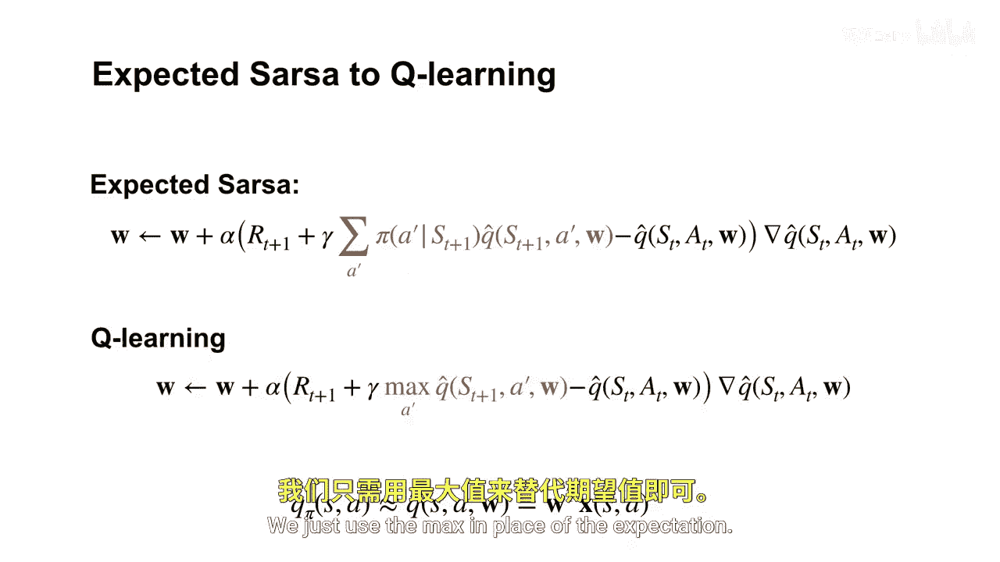

**强化学习专项课程：P106：基于函数逼近的期望Sarsa算法**

在本节课中，我们将学习如何将期望Sarsa算法与函数逼近方法结合。我们将从回顾Sarsa的函数逼近形式开始，然后推导出期望Sarsa的更新公式，并最终展示Q学习作为其特例的实现方式。

到目前为止，我们已经讨论了结合函数逼近使用Sarsa算法。现在，让我们继续探索近似控制方法，并了解期望Sarsa算法。通过本视频的学习，你将能够解释基于函数逼近的期望Sarsa更新公式，以及基于函数逼近的Q学习更新公式。

**从Sarsa到期望Sarsa**

上一节我们介绍了函数逼近下的Sarsa算法，本节中我们来看看如何在使用函数逼近时，将Sarsa转变为期望Sarsa。

首先，回顾Sarsa的更新公式。Sarsa的更新目标包含了下一个状态和动作的动作价值。

现在回想一下，期望Sarsa则使用其目标策略下的期望值来计算。为了计算这个期望，我们只需将动作价值按其目标策略下的概率加权求和。

即使我们使用函数逼近，也可以计算相同的期望值。让我们看看具体如何操作。

**期望Sarsa的函数逼近更新**

以下是实现步骤：

首先，回顾使用函数逼近的Sarsa更新公式。它看起来与表格型设置类似，只是动作价值估计由权重向量 **W** 参数化。我们还有一个梯度项，用于将误差适当地分配到权重上。

基于函数逼近的期望Sarsa遵循类似的结构。我们为下一个状态的所有动作计算来自权重向量的动作价值。然后，我们计算这些价值在目标策略下的期望。这就是将Sarsa改为期望Sarsa所需做的全部工作。

**扩展到Q学习**

现在，我们如何为函数逼近下的Q学习实现这一点？幸运的是，Q学习是期望Sarsa的一个特例。在Q学习中，目标策略是关于近似动作价值的贪婪策略。在贪婪策略下计算期望，等同于计算最大动作价值。

因此，使用函数逼近的Q学习更新实际上非常直接。我们只需用最大值代替期望值。

**总结**

本节课中，我们一起学习了基于函数逼近的期望Sarsa算法，并展示了如何将其扩展到基于函数逼近的Q学习。核心在于将下一个状态-动作对的单一采样值，替换为目标策略下所有可能动作的期望值（对于Q学习则是最大值）。

下一次，我们将探讨在使用函数逼近时如何进行探索。在那之前，请保持清晰的学习路径。