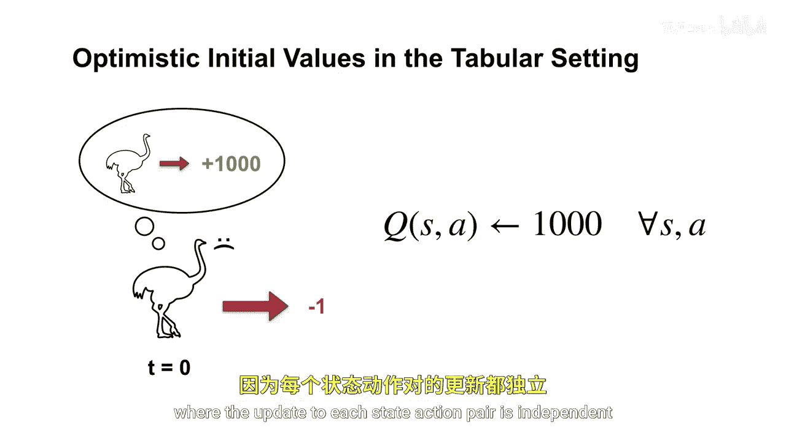
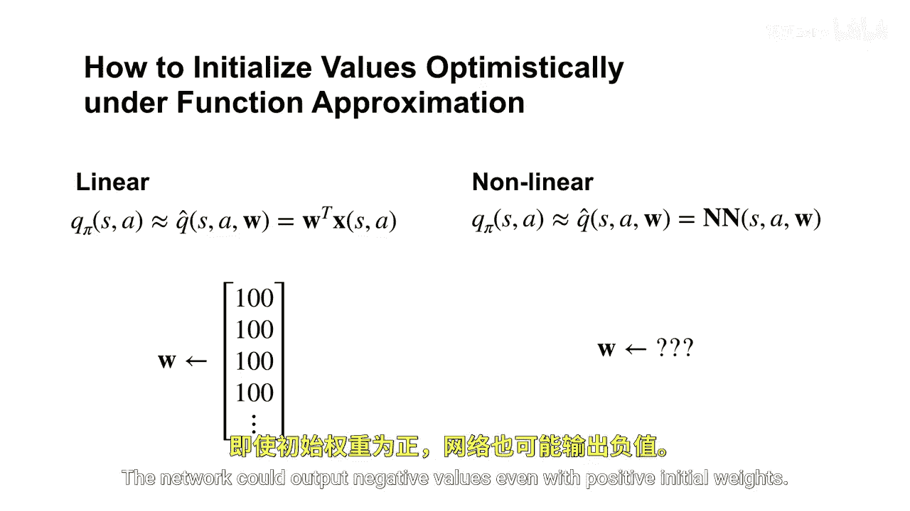
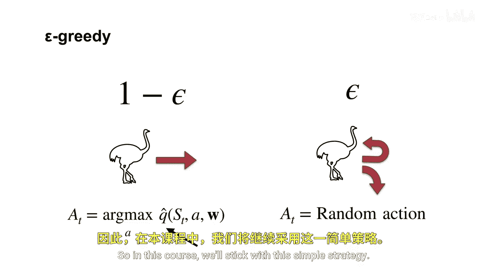

# 107：函数逼近下的探索策略 🧭

在本节课中，我们将学习如何在函数逼近的背景下进行探索。我们将回顾乐观初始值在表格型设置中的工作原理，并探讨将其以及ε-贪心策略应用于函数逼近时需要考虑的细节。

平衡探索与利用的需求，是序列决策问题的一个决定性特征。

我们之前讨论过在赌博机和表格型强化学习中促进探索的几种简单方法。但在函数逼近的背景下，探索有什么特别之处吗？今天，我们将一探究竟。

在本视频结束时，你将能够描述如何将乐观初始值和ε-贪心策略与函数逼近结合使用。

## 表格型设置中的乐观初始值回顾 📊

首先，让我们简要回顾一下如何在表格型设置中使用乐观初始值。

我们将价值函数初始化为高于其真实值的数值。这就像是智能体想象自己通过采取某个动作能获得的奖励，比现实中实际能获得的更多。

通常，以这种方式初始化价值函数会导致智能体系统地探索状态-动作空间。随着智能体对价值的估计越来越准确，这种初始化的影响会越来越小。

这在表格型设置中很容易实现，因为每个状态-动作对的更新都独立于其他所有状态-动作对。

## 函数逼近中的乐观初始值 🧠

上一节我们回顾了表格型方法，本节中我们来看看函数逼近的情况。

在函数逼近中，乐观初始值对应于初始化权重参数，使得产生的价值估计是乐观的。在某些情况下，这很简单。例如，当特征是二元的，我们只需将每个权重初始化为可能的最大回报值。那么，只要每个状态至少有一个活跃的特征，其价值估计就会是乐观的，甚至可能过于乐观。

然而，在许多情况下，乐观初始化很困难。例如，在神经网络中，最终输出值与输入特征之间的关系可能非常复杂。

想象一个由ReLU激活函数组成的网络，即使初始权重为正，网络也可能输出负值。

但这还不是全部。根据我们的特征如何进行泛化，乐观初始值可能不会产生我们在表格型案例中看到的那种系统性探索。

考虑一个极端例子：我们只有一个特征，其值始终为1。我们可以乐观地初始化，但每次更新都会改变所有状态的价值。这意味着，在某些状态甚至被访问之前，其价值估计就已经下降到不再乐观的程度。

为了促进系统性探索，对价值函数的改变需要更加局部化。例如，使用瓦片编码的函数逼近可以产生这种局部化的更新。神经网络也能提供局部更新，但神经网络也可能进行激进的泛化。

在实践中，如果没有特殊考虑，神经网络会相对较快地失去其乐观性。

## 函数逼近中的ε-贪心策略 ⚖️

接下来，我们探讨一个更通用的探索策略。

ε-贪心策略通常适用且易于使用，即使在非线性函数逼近的情况下也是如此。ε-贪心策略唯一需要的就是动作价值估计，这与它们如何初始化或如何近似无关。

然而，ε-贪心策略不是一种有导向的探索方法。它依赖随机性来发现当前策略附近状态下的更好动作。因此，它不如那些依赖乐观性的探索方法那样系统。

改善函数逼近设置下的探索仍然是一个开放的研究问题，因此在本课程中，我们将坚持使用这种简单的策略。

## 总结 📝

本节课中我们一起学习了将探索策略与函数逼近结合时的诸多微妙之处。

在本视频中，我们讨论了结合乐观初始值与函数逼近时的许多细微差别，以及ε-贪心策略如何能与任何函数近似方法结合使用。

下次见。