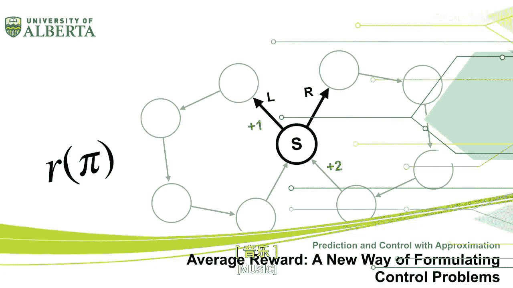
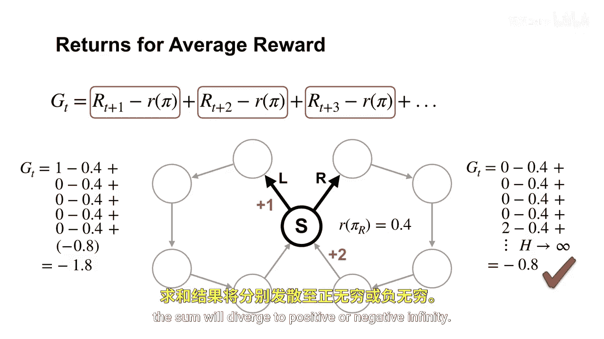
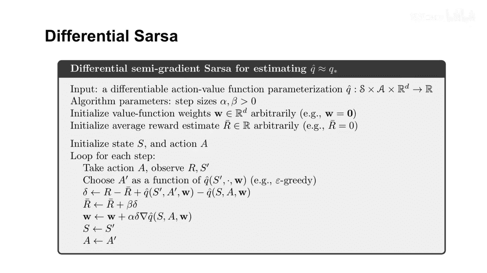

# 108：一种新的控制问题表述方式 📈



在本节课中，我们将学习一种针对持续性任务的新目标函数——平均奖励。我们将探讨平均奖励的定义、它与折扣奖励的区别，并介绍差分价值函数的概念。通过本讲，你将能够描述平均奖励设定，解释平均奖励最优策略与折扣奖励策略的不同之处，并理解差分价值函数的基本原理。

## 概述

在持续性任务中，我们可能关注极长视野下的性能表现。到目前为止，我们使用折扣奖励来处理持续性任务，以平衡短期表现和长期收益。然而，这不是表述问题的唯一方式。今天，我们将学习一种称为平均奖励形式的新方法。

## 近视MDP示例

为了理解平均奖励，我们首先来看一个简单的示例任务，其中状态排列在两个相交的环中，我们称之为近视MDP。

在大多数状态下，只有一个动作可用，因此无需做出决策。只有一个状态可以做出决策，在该状态下，智能体可以决定遍历哪个环。这意味着存在两种确定性策略：遍历左环或遍历右环。

奖励在所有地方都为零，除了每个环中的一个转移。在左环中，奖励在状态S之后立即为+1。在右环中，奖励在状态S之前立即为+2。

直观上，你会选择正确的动作，因为你知道会获得+2奖励。但价值函数会告诉我们做什么呢？

## 折扣奖励下的价值函数

如果我们使用折扣奖励，这两种不同策略下状态S的价值是多少？

选择左动作的策略的价值为：
```
V_L = 1 / (1 - γ^5)
```

选择右动作的策略的价值为：
```
V_R = (2 * γ^4) / (1 - γ^5)
```

让我们思考特定γ值下这两种策略的状态S价值。

如果γ为0.5，V_L约为1，V_R约为0.1。这意味着在这种更近视的折扣下，采取左动作的策略更可取。

尝试更大的γ值，0.9。V_L现在约为2.4，V_R约为3.2，因此现在我们更倾向于另一种策略。

实际上，我们可以计算出使智能体偏好向右策略的最小γ值。γ需要至少为0.841。

这里的问题是折扣幅度取决于具体问题。对于这个示例，0.85足够大，但如果每个环有1000个状态，这个折扣因子需要超过0.99。

一般来说，确保智能体动作随时间最大化奖励的唯一方法是不断增加折扣因子趋近于一。根据问题，我们可能需要γ相当大，并且记住在持续性设定中不能将其设为一，因为那样回报可能是无限的。

## 大γ值的问题

那么，拥有大γ值有什么问题呢？大的γ值也可能导致更大且更易变的总和，这可能难以学习。那么有替代方案吗？

## 平均奖励目标

让我们讨论一种称为平均奖励的新目标。

想象智能体与世界交互了H步。这是它在这些步骤中平均获得的奖励，换句话说，是它的奖励率。如果智能体的目标是最大化这个平均奖励，那么它对近期和远期奖励同等重视。

我们用R(π)表示策略的平均奖励。更一般地，我们可以使用状态访问分布μ来写平均奖励：

```
R(π) = Σ_s μ_π(s) Σ_a π(a|s) Σ_s' p(s'|s,a) r(s,a,s')
```

内项是策略π下状态的期望奖励。外和取该状态被访问频率的期望。合起来，我们得到跨状态的期望奖励，换句话说，策略的平均奖励。

在近视示例中，两种可能的确定性策略无限期地访问左环或右环。在这两种情况下，每个环中的五个状态被访问的次数相等。

在左环中，除了一个获得+1的状态外，所有状态的即时期望奖励为+0。这导致每五步平均奖励为1，或0.2。

右环中的大多数状态也有+0的即时期望奖励，但这次最后一个状态获得+2。这给出每五步平均奖励为2，或0.4。

我们可以看到，平均奖励更偏好获得更多总奖励的策略，而无需考虑越来越大的折扣。

## 差分回报

平均奖励定义直观地说明了一个策略是否优于另一个，但我们如何决定从一个状态出发的哪些动作更好？我们需要的是这个新设定下的动作价值。

第一步是弄清楚回报是什么。在平均奖励设定中，回报是根据奖励与平均奖励R(π)之间的差异来定义的，这称为差分回报。

让我们看看近视MDP中的差分回报是什么。差分回报表示智能体从当前状态和动作开始，相比策略的平均奖励，将获得多少额外奖励。

让我们看看从状态S开始，首先选择动作L，然后遵循π_L的差分回报。该策略的平均奖励为0.2。

差分回报是未来奖励的总和，每个奖励都减去平均奖励。这个和从状态S开始，动作为L。

我们可以通过求和到某个有限视野H，然后取H趋于无穷大的极限来计算它。

我们通过这个极限符号稍微简化了事情。虽然这种符号在许多情况下有效，但当环境是周期性时，我们需要使用不同的技术。在这种情况下，我们使用更一般的极限（称为Cesàro和）来计算回报，但这个技术细节并不关键，这里的主要点是直觉。

我们发现差分回报为0.4。现在让我们看看另一个动作。这次，我们可以将差分回报分为两部分。首先，通过右环的单次轨迹的和，我们可以明确写出和，它等于1。然后，对应于无限期采取左动作的和。这个和与我们刚刚计算的差分回报相同，0.4。将两部分加在一起，我们发现差分回报为1.4。

因此，如果智能体的策略总是采取左动作，它可以观察其差分回报并意识到应该切换到采取右动作。

现在让我们看看如果智能体的策略总是采取右动作的差分回报。该策略导致平均奖励为0.4，在状态S采取右动作的策略的差分项为-0.8。

现在，在状态S采取一次左动作然后无限期采取右动作的差分回报是多少？像之前一样，我们将和分为两部分，采取左环一次导致前五个时间步的和为-1。加上从状态S遵循π_R的差分项（我们之前发现为-0.8），得到我们的答案-1.8。再次，我们看到右动作更受青睐。

## 差分价值函数

你可能已经注意到，π_R的差分回报低于π_L的差分回报，即使π_R具有更高的平均奖励。这是因为差分回报表示在特定策略下，在某个状态采取动作比平均情况好多少。



只有在后续时间步遵循相同策略时，差分回报才能用于比较动作。要比较策略，应改用它们的平均奖励。

有趣的是，只有当减去的常数等于真实平均奖励时，差分回报才是收敛和。如果减去较低或较高的数字，和将发散到正无穷或负无穷。

现在我们有了平均奖励的有效回报定义，我们像往常一样将价值函数定义为期望回报。类似地，我们也可以将差分价值函数定义为策略下从给定状态或状态-动作对开始的期望差分回报。

这个量捕捉了智能体从特定状态开始，相比如果遵循固定策略在所有状态上的平均情况，将获得多少额外奖励。

与折扣设定类似，差分价值函数可以写成贝尔曼方程。方便的是，它们看起来像我们之前见过的方程，它们只在从即时奖励中减去R(π)且没有折扣这一点上有所不同。

折扣情况下的许多算法可以重写以适用于平均奖励情况。例如，差分SARSA与你之前见过的SARSA算法非常相似。

让我们逐步了解差异。一个关键区别是，差分SARSA必须跟踪其策略下平均奖励的估计，并在更新中从样本奖励中减去它。这个实现使用了我们在整个课程中见过的增量平均技术。

给定这个估计，它然后在更新中从采样的奖励中减去R_bar。

在实践中，我们可以通过对该算法稍作修改来获得更好的性能。我们使用这个更新来计算R_bar，而不是奖励的指数平均，它具有更低的方差。



## 总结

在本节课中，我们介绍了平均奖励目标，并为此设定定义了差分回报和差分价值函数。下周，我们将讨论优化这个平均奖励目标的另一种方法，届时再见。