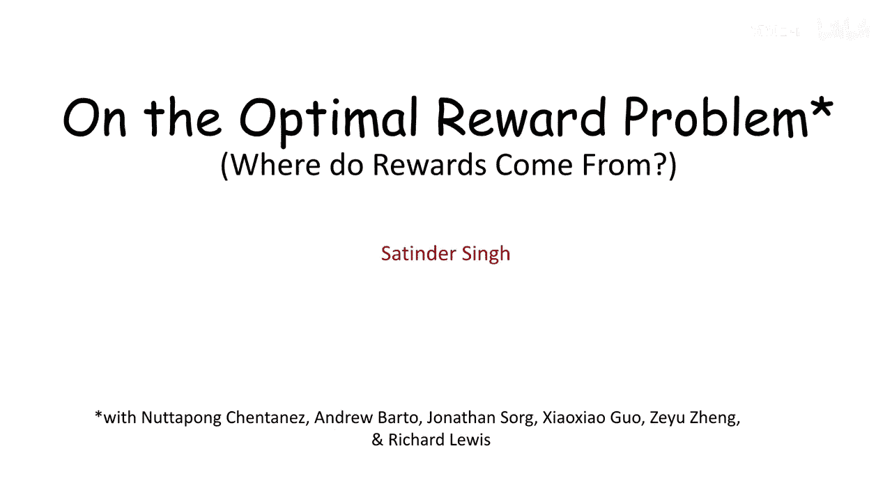
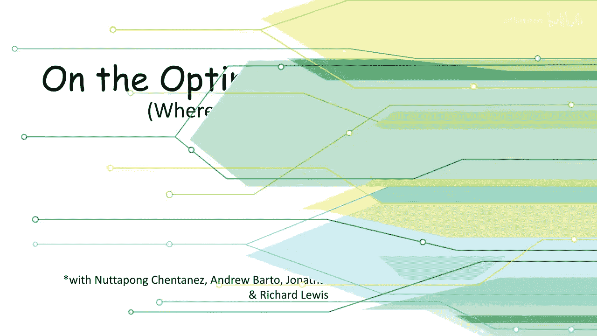
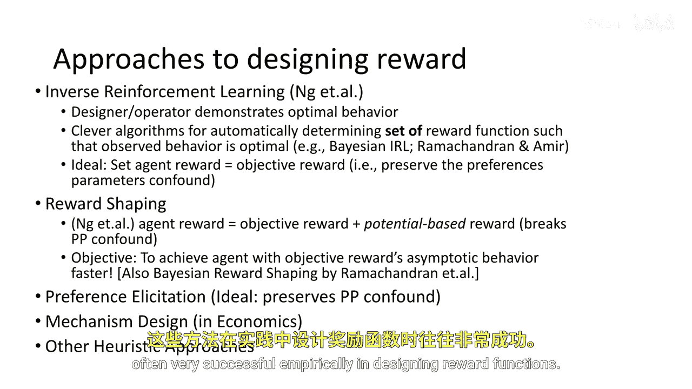
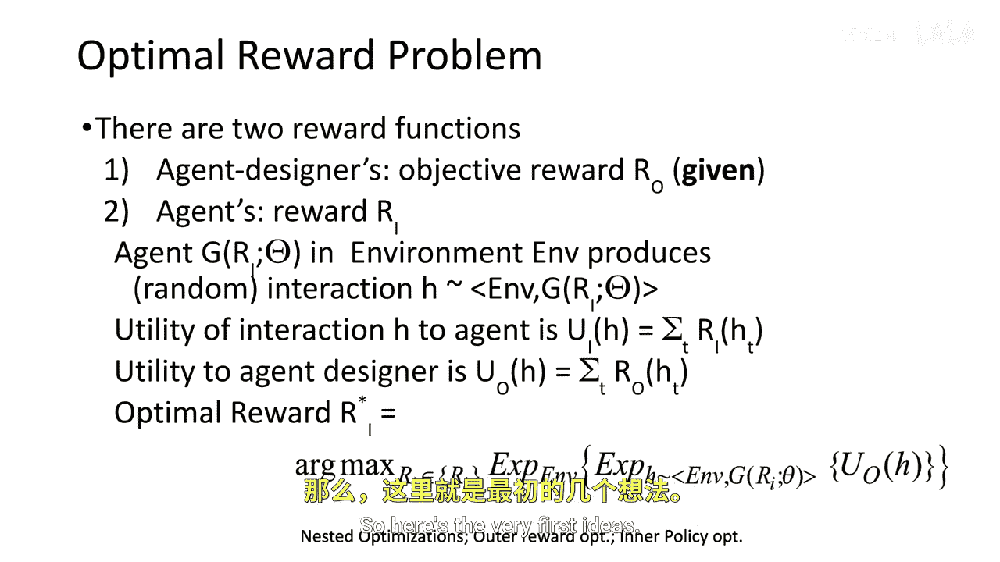
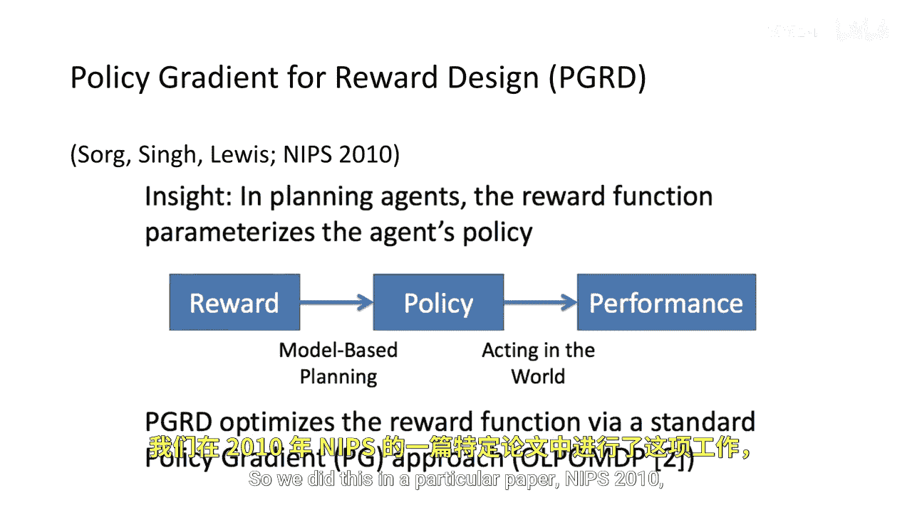
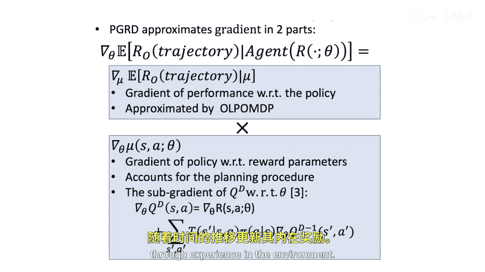
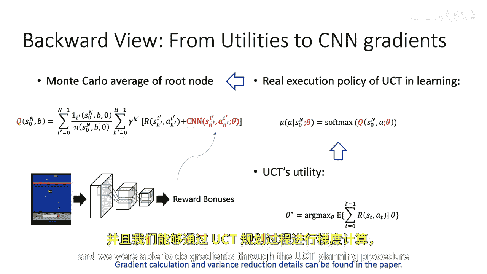
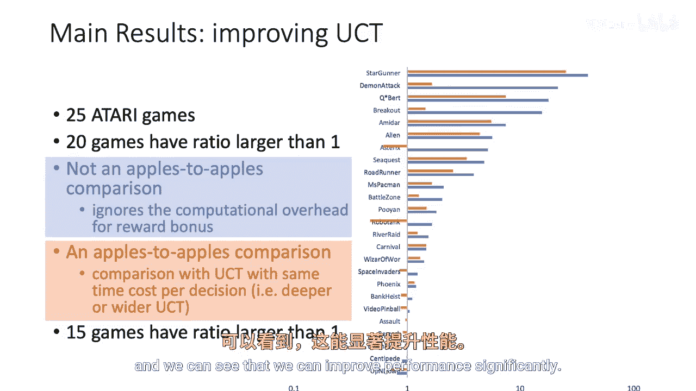
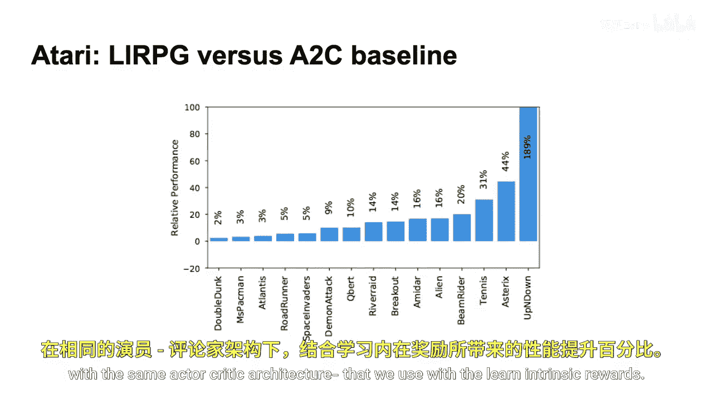

# 109：Satinder Singh论内在奖励 🧠

在本节课中，我们将探讨强化学习中一个根本性问题：智能体的奖励从何而来？我们将跟随Satinder Singh的讲解，了解标准强化学习框架如何将设计者的偏好与智能体的目标参数混为一谈，并介绍一种将两者分离，通过优化内在奖励来提升智能体性能的新思路。

## 概述：奖励的来源问题

当我们学习强化学习时，通常假设奖励函数是给定的，然后研究如何优化这些奖励。但一个有趣的问题是：这些奖励最初从何而来？

## 偏好与参数的混淆

在人工智能领域，起点通常是智能体设计者拥有一个目标或外在奖励函数，该函数规定了设计者对智能体行为的偏好。然而，这个外在奖励函数通常过于稀疏和延迟。因此，问题就变成了：我应该给智能体什么函数？智能体的奖励函数应该是什么？换句话说，奖励从何而来？

从这个角度思考，标准强化学习框架中的单一奖励函数，从设计者的角度来看，同时混淆了两种角色：
1.  **偏好**：它体现或捕捉了设计者对智能体行为的偏好。
2.  **参数**：通过奖励假说，它表达了智能体的目标或目的，因此成为实际智能体行为的参数。

同一个奖励函数在标准RL框架中同时捕捉了两件事：设计者对行为的偏好，以及智能体用于将奖励函数转化为行为的任何算法的参数。我们提出的问题是：这些角色似乎是不同的，它们是否应该被混淆到一个单一的奖励函数中？

## 分离奖励：内在与外在

我们建议的答案是：不应该混淆。我们可以设想两种不同的奖励函数。

以下是标准强化学习智能体的图示，其中奖励函数被认为是环境的一部分。批评者是环境的一部分，智能体的任务是优化该奖励函数的某种累积度量。

这是另一个图示，我们将智能体分解为所谓的“有机体”。在智能体内部有一个批评者，它向智能体提供奖励，然后智能体进行优化。同时存在一个外部环境，它提供了先前环境中存在的外在奖励。

当然，当你想到有机体时，例如自然界的生物，你会认为进化能够深入我们内部并配置我们的内在奖励函数，它是适应的场所。因此，智能体的奖励是内部的或内在的，因为它们本质上是需要由人工智能体的设计者或自然智能体的进化来设计的参数。

## 设计奖励函数的现有方法

许多人思考过如何设计奖励函数，存在许多方法。例如：
*   **逆强化学习**：一种将专家行为转化为奖励函数的方法。
*   **奖励塑形**：关于如何改变奖励函数以使其对智能体学习更有效的想法。
*   **偏好启发**：一种从智能体设计者那里引出偏好或奖励的方法。
*   **经济学中的机制设计**：思考如何设计奖励等等。
此外，还有许多其他启发式方法，在设计奖励函数方面通常凭经验非常成功。

## 最优奖励框架

接下来，我将介绍我一直在追求的一项工作，称为“最优奖励框架”或“最优奖励问题”。

### 问题定义

最优奖励问题是什么？正如我一直主张的，存在两种不同的奖励概念：
1.  **真实奖励**：我们无法改变，因为真实奖励是目标奖励，记作 R₀ 或 R_O。
2.  **智能体奖励**：即内在奖励，记作 R_I。

最优奖励问题用数学语言描述如下：给定一个奖励函数空间，我应该给智能体哪个奖励函数，以便在智能体将该奖励函数转化为行为时，最终能优化设计者的目标奖励函数？

这是一个搜索问题。我们可以将其视为一个元问题，就像一个外循环，你在优化奖励，而内循环则在给定奖励的情况下优化行为。下面我将展示我们在实验室中为优化内在奖励而开发的几个快速想法。

## 方法一：用于奖励设计的策略梯度

第一个想法基于一个简单的观察，我们称之为PGRD。

我们一直有用于优化外在奖励的策略梯度方法。这些策略梯度方法采用以某种方式指定策略的参数。一种思考内在奖励的方式是，它本质上只是参数化了智能体策略的参数。因此，正如策略梯度方法可以优化策略的参数一样，它们也可以优化内在奖励函数。

这是一种基本方法，即利用外在奖励相对于策略参数的梯度，来更新内在奖励的参数。我们在2010年NIPS的一篇特定论文中做了这项工作。

### 梯度计算

这张幻灯片描述了在进行策略梯度时，如何计算相对于内在奖励参数的梯度。

顶部的第一个方框展示了如何定义目标奖励在轨迹上相对于策略（相对于策略中采取行动的概率）的梯度。

第二部分告诉你如何获取这些策略选择或行动概率相对于内在奖励参数的梯度。这基本上是一个相当直接的迭代过程，你可以计算它。这样，智能体就可以随着在环境中的学习经验而更新其内在奖励。

### 应用实例：与UCT规划结合

我们做的第一个项目是在2016年，展示了如何使用PGRD（用于奖励设计的策略梯度）来优化内在奖励函数，并与UCT（一种策略梯度算法）作为规划算法结合使用，以根据给定的内在奖励计算行为。

我们使用UCT，它实际上是一种用于从模型计算策略的搜索过程。UCT具有固定的轨迹数量和固定的搜索深度作为参数。我们使用了一个内在奖励，并且能够通过UCT规划过程进行梯度计算来更新奖励函数。

我们没有详细讲解算法细节，但我们用UCT实现了PGRD。这里有一张幻灯片显示了在25个Atari游戏上的结果。垂直线表示，如果条形图位于垂直线上，意味着我们仅仅匹配了UCT的性能。条形图向右延伸意味着我们提高了UCT的性能。你可以看到，在大多数游戏中，我们能够显著提高性能。

在这些结果中，唯一被学习的是内在奖励函数。我们使用UCT进行规划，因此从内在奖励到行为的转换是通过UCT这个固定的规划过程完成的。我们从经验中学习的唯一东西是内在奖励函数，我们可以看到我们可以显著提高性能。

## 方法二：与学习算法结合

那么，我们能否针对学习算法而不是规划算法来做这件事呢？这就是我要告诉你的下一个结果。

这是在2018年NeurIPS上由我的学生Siyu Zhang和Junlin Guan展示的。这完全是相同的想法，只不过现在我们要通过一个学习算法而不是规划算法来实现。

起初我并不清楚，你实际上可以通过学习过程来获取梯度以更新内在奖励，因为从概念上讲，你可以想象，当你扰动内在奖励时，你扰动了学习的动态。我们需要做的是，通过学习动态变化的梯度来更新内在奖励，从而优化学习过程。我们通过一个元梯度过程展示了我们可以做到这一点。

### 智能体架构

这是该场景下智能体的图示。智能体有两个方框：策略方框执行行动，批评者方框接收内在奖励（在这种情况下是外在奖励和内在奖励的总和），并进行策略梯度（Actor-Critic）来更新策略。我们将使用这个元梯度过程来更新内在奖励。

我将跳过具体的符号表示，但存在一种特定的方式来更新内在奖励的参数，前提是我们正在使用Actor-Critic更新策略的参数。

第一个方程展示了一个标准的Actor-Critic更新（本质上是REINFORCE版本的更新）。第二组方程展示了我们如何根据策略参数的更新来更新内在奖励的参数。因此，我们可以沿着提高学习策略性能的方向移动内在奖励参数。

### 实验结果

这里有一些结果，我们在一些Atari游戏中进行了测试。你可以在X轴上看到游戏名称，Y轴显示了我们相对于仅使用外在奖励（使用相同的Actor-Critic架构）所获得的性能提升百分比。可以看到，学习内在奖励可以显著提高性能。

## 总结与结论

当我们思考强化学习问题时，教科书和你听到的所有讲座都从假设奖励函数是给定的开始，智能体的目标是将该奖励函数转化为良好的行为。

我们在这个简短片段中提出的问题是：我们如何有效地设计这些奖励函数？本片段最后给出的答案是一种用于更新内在奖励的梯度过程，这样我们可以学习到更好的内在奖励。这在许多方面都可能有用。

我今天强调的方式是，智能体可能以多种不同的方式受到限制，而内在奖励是克服这些限制的一种方法。这可以被视为用户和智能体设计者之间价值对齐的一种方式，也可以被视为解决持续学习和终身学习问题的一种途径。

在本节课中，我们一起学习了：
1.  标准强化学习框架中奖励函数混淆了设计者偏好和智能体参数的问题。
2.  将奖励分离为外在奖励和内在奖励的概念。
3.  **最优奖励框架**的核心思想：寻找能使智能体行为最优化设计者目标的内在奖励。
4.  两种实现方法：**PGRD**（与规划算法如UCT结合）和**元梯度方法**（与学习算法如Actor-Critic结合）。
5.  通过优化内在奖励，智能体可以克服自身限制，更高效地学习，并可能更好地与设计者目标对齐。