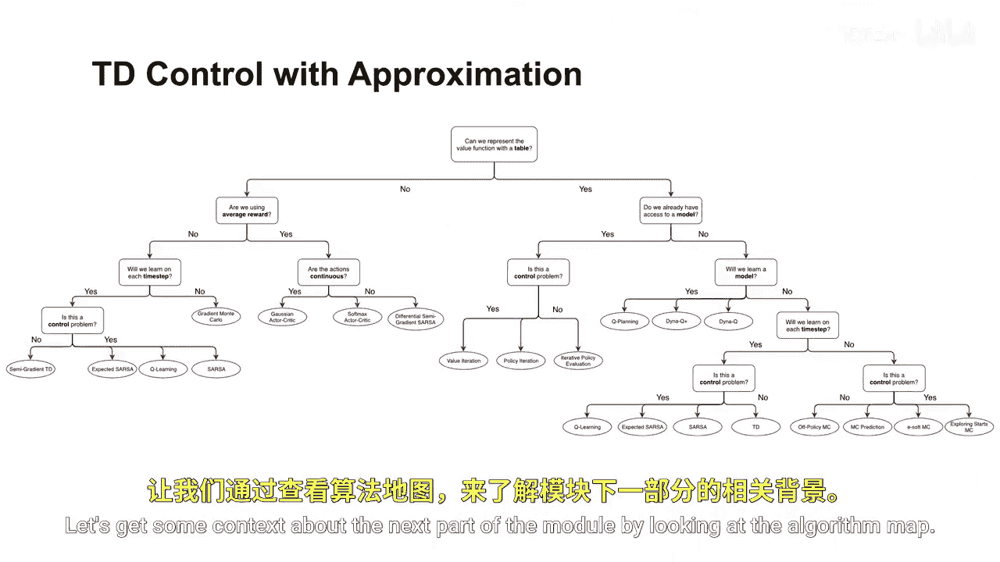
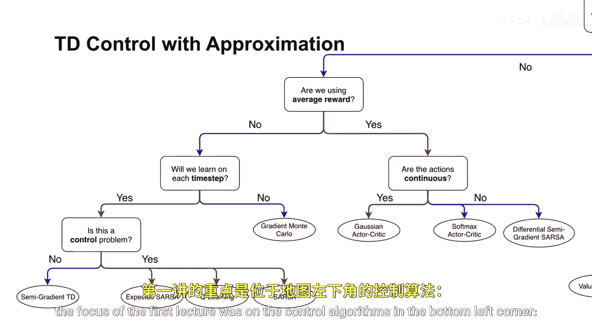
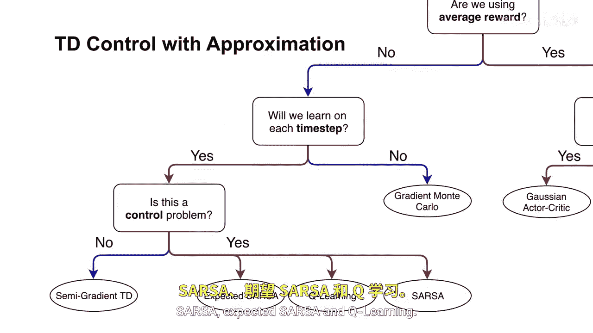
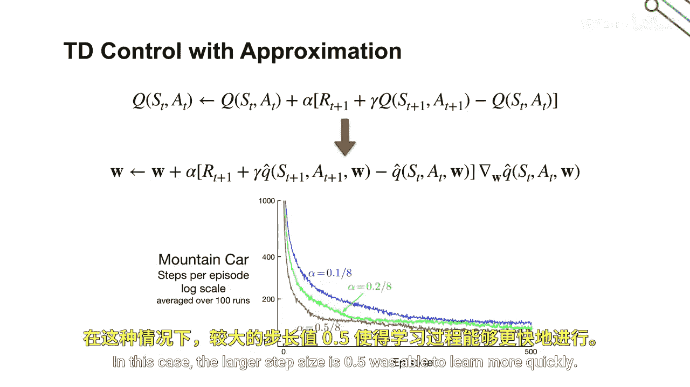
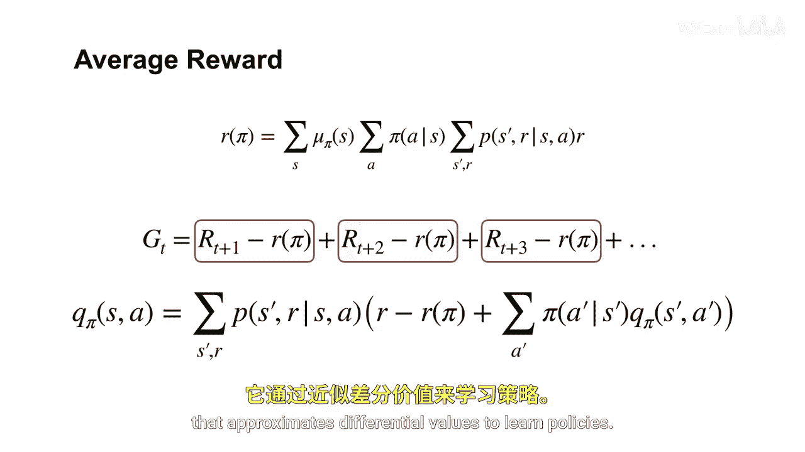
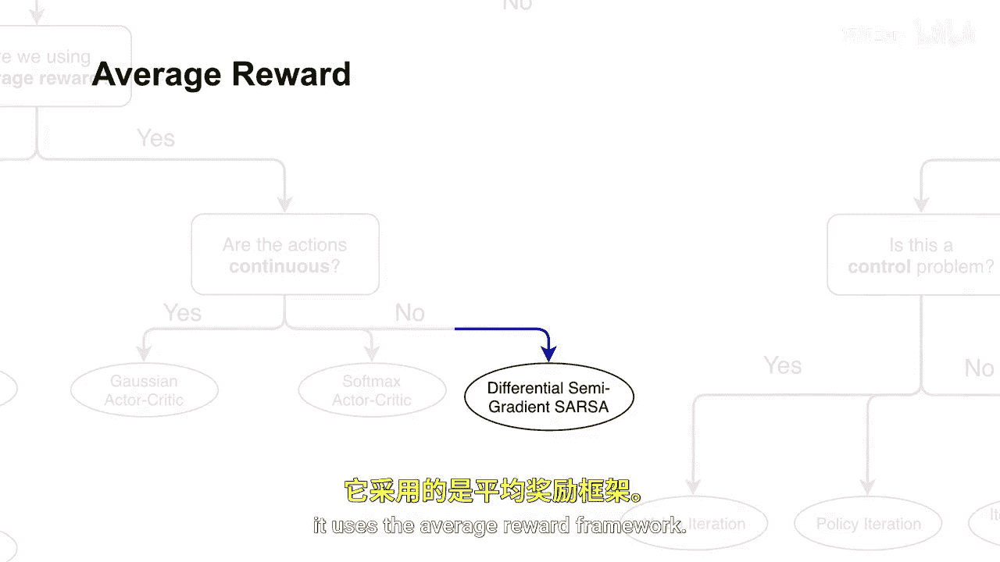

# 110：函数近似下的控制方法复习 🧠


在本节课中，我们将复习第3周的核心内容：如何在函数近似（Function Approximation）的框架下进行控制（Control）。我们将回顾如何估计动作价值、探索不同的控制算法，并介绍一种处理持续性任务的新思路。

---

## 函数近似下的动作价值估计

上一节我们介绍了函数近似的基础。本节中，我们来看看如何用它来估计动作价值。

当动作空间是离散的时，最直接的方法是将状态特征按动作“堆叠”起来。如果动作空间是连续的，或者你希望模型能泛化到不同的动作，那么可以将动作本身作为一个输入变量，与状态特征一同传递给函数近似器。

为了理解后续内容，我们先看一下算法地图。函数近似将我们置于地图的左侧分支。




---



## 控制算法：SARSA、期望SARSA与Q学习



本周第一讲的重点是地图左下角的控制算法：SARSA、期望SARSA和Q学习。


这些算法都是我们在第2周学过的表格型控制算法的扩展。它们与表格型版本唯一的区别在于更新方程。

以下是这些更新方程的通用形式，它们都以相同的方式为函数近似进行了调整，即使用梯度来更新权重参数 `w`：

```python
# 以半梯度更新为例，δ是时序差分误差
w = w + α * δ * ∇_w Q(S, A, w)
```



我们还看到了分幕式SARSA如何被用于解决“山地车”问题。在该案例中，较大的步长参数（如0.5）能使学习速度更快。


---

## 探索策略的考量

接下来，我们讨论了探索策略。乐观初始值法可以与一些结构化的特征表示（如瓦片编码）结合使用。但对于非线性函数近似器（如神经网络），通常不清楚如何进行乐观初始化，并且其效果可能不符合预期（例如，乐观性可能消退过快）。

相比之下，ε-贪婪策略可以不受函数近似器类型的限制，普遍适用。

---

## 持续性任务的新视角：平均奖励框架

最后，我们介绍了一种思考持续性控制问题的新方法。与其最大化从当前状态开始的**折扣回报**，我们可以考虑最大化策略随时间获得的**平均奖励**。

为此，我们定义了**差分回报**和**差分价值函数**。它们使智能体能够在平均奖励设定下评估动作的相对价值。

我们进而引入了**差分半梯度SARSA**算法，它通过近似差分价值函数来学习策略。




差分SARSA同样位于算法地图的左侧，但与本周早先介绍的算法不同，它使用的是平均奖励框架。




---

## 总结

本节课中我们一起学习了：
1.  如何在函数近似下估计动作价值。
2.  将表格型控制算法（SARSA、期望SARSA、Q学习）扩展到函数近似设置，其核心更新依赖于梯度下降。
3.  探索策略（如乐观初始化和ε-贪婪）在函数近似环境下的应用考量。
4.  针对持续性任务，引入了以最大化**平均奖励**为目标的新框架，并学习了**差分半梯度SARSA**算法。

下周，我们将全面探讨如何在不学习价值函数的情况下进行强化学习。