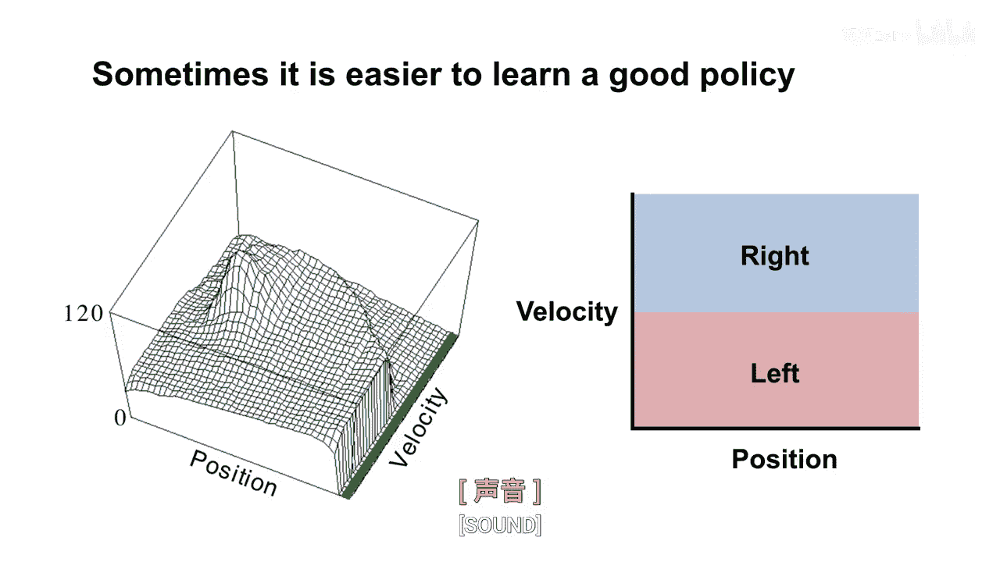

# 112：策略参数化的优势 🎯

在本节课中，我们将要学习直接学习参数化策略的优势。我们将探讨为何这种方法比单纯学习价值函数更具灵活性，并通过具体例子来理解其在实际问题中的应用价值。

## 概述

你已经知道直接学习参数化策略是可行的。这意味着我们在解决问题时可以获得更大的灵活性。目前我们考虑了学习近似价值和学习近似策略。但直接学习策略真的有用吗？通过本视频的学习，你将能够理解使用参数化策略的一些优势。

## 策略参数化的主要优势

直接学习策略参数具有许多优势。以下是其核心优点：

### 1. 实现自主的探索-利用平衡 🤖

上一节我们介绍了参数化策略的概念，本节中我们来看看它的第一个优势：自主性。

智能体可以随着时间的推移使其策略变得更加贪婪。在开始时，智能体的估计并不准确，因此我们希望智能体进行大量探索。随着估计变得更加准确，智能体应该变得越来越贪婪。

回想我们之前使用的ε-贪婪策略。ε步骤选择一个随机动作以确保持续探索。然而，ε概率限制了最终策略能达到的最佳效果。当然，当我们认为智能体已经充分探索时，可以切换到贪婪策略。但我们希望智能体是自主的，不希望它们依赖我们来决定何时完成探索。

使用参数化策略可以避免这个问题。策略可以从随机性开始以保证探索，然后随着学习的进行，策略可以自然地收敛到一个确定性的贪婪策略。一个softmax策略可以通过使某个动作的偏好非常大来充分近似确定性策略。

### 2. 避免确定性策略在函数近似下的失败 🚫

在表格设置中，我们了解到总是存在一个确定性的最优策略。但在函数近似中，我们可能无法表示这个确定性策略。相反，最优的近似策略可能是一个随机策略。这表明学习随机策略可能是有用的。

我们可以通过一个例子来理解这一点。想象智能体在一个走廊中，它总是从最左边的状态开始。在左右状态中，左右动作具有通常的后果。然而，在中间状态，左右动作是互换的：向左移动会使智能体向右，向右移动会使智能体向左状态。每一步的奖励是-1，任务是片段式的。

假设函数近似将所有状态视为相同，所有三个状态共享相同的近似价值。如果我们限制自己使用确定性策略，我们将别无选择，只能在所有状态中选择相同的动作。这只会给我们两种选择：总是向左移动或总是向右移动。

以下是两种确定性策略的结果：
*   如果总是向左移动，我们将永远无法离开起始状态，因此该策略的期望回报是负无穷。
*   如果总是向右移动，我们将到达中间状态，然后移回起始状态并永远持续下去，因此期望回报也是负无穷。

然而，如果我们被允许随机选择动作，我们可以做得更好。我们可能会被困住一段时间，但只要每个动作都有非零概率，我们最终会到达终止状态。事实上，在这种函数近似下的最佳策略有点特别：59%的时间选择向右动作，其余时间选择向左动作。该策略实现了大约-11.6的期望回报，明显优于负无穷。

这个例子可能看起来有点刻意，但类似的情况在现实世界中也会出现。例如，在我们自己的实验室中，一个机器人因为具有确定性策略和有限的函数近似器而卡在房间的角落里。

### 3. 策略有时比价值函数更简单 🏔️

有时策略比价值函数更简单。记住山地车问题，我们花了很多时间设计一个基于价值的智能体来学习最优策略。然而，在这个问题中，我们之前看到的能量泵送策略几乎是最优的。

智能体只需根据当前速度选择其动作：
*   如果速度为负，则智能体采取加速向左的动作。
*   如果速度为正，则智能体采取加速向右的动作。

这个策略允许智能体快速逃离山谷。正如你所看到的，这是一个相当简单的策略。另一方面，价值函数则相当复杂。

## 总结

本节课中我们一起学习了参数化随机策略之所以有用的原因：
1.  它们可以随着时间的推移自主减少探索。
2.  它们可以避免因函数近似能力有限而采用确定性策略所导致的失败。
3.  有时策略本身比价值函数更简单、更易于表示和学习。

在接下来的视频中，我们将看到动作价值方法和基于策略的方法之间并不存在严格的区分。事实上，我们可以使用动作价值来使学习参数化策略变得更加容易。下次见。