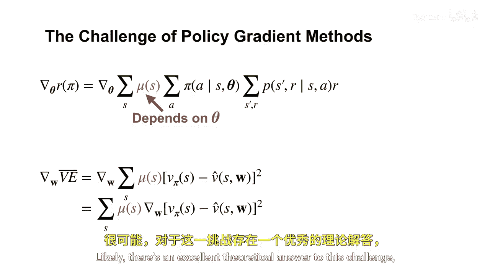

# 113：学习策略的目标 🎯

在本节课中，我们将学习如何为直接参数化的策略设定一个学习目标。我们将看到，与基于动作价值的方法不同，当策略被直接参数化时，我们可以将强化学习的终极目标——最大化长期奖励——直接作为学习目标。

## 从参数化策略到学习目标

上一节我们介绍了直接参数化策略的思想。本节中，我们来看看如何学习并改进一个参数化的策略。

与基于动作价值的方法类似，基本思路是：**指定一个目标函数，然后找出如何从智能体的经验中估计该目标函数的梯度**。完成本节学习后，你将能够描述策略梯度算法的目标。

## 定义策略学习目标

为学习参数化策略制定目标，在某种意义上比基于动作价值的方法更直接。

我们多次强调，强化学习的终极目标是**学习一个能在长期获得尽可能多奖励的策略**。事实证明，当我们直接参数化策略时，我们也可以将这个目标直接作为学习目标。

## 长期奖励的不同表述

在本系列课程中，我们介绍了对“长期获得尽可能多奖励”的几种不同解释：

*   **分幕式任务**：使用**无折扣回报**，即整个幕中奖励的总和。
*   **持续性任务**：引入**折扣回报**，更强调即时奖励，以保证总和有限。
*   **平均奖励表述**：最大化奖励的长期平均值。这里合适的回报是即时奖励与其平均值之差的累加和（因为减去了长期平均值）。即使没有折扣，这个和也是有限的。

我们面临三种潜在的问题表述。接下来，我们将**把注意力限制在具有平均奖励的持续性任务设定上**。

我们的目标是找到一种直接优化策略参数的方法。第一步是将平均奖励目标写成我们可以优化的形式。

## 平均奖励目标的数学形式

之前，我们在Sarsa的平均奖励变体中，通过估计平均奖励来学习动作价值。现在，我们的目标是学习一个直接优化平均奖励的策略。

为此，让我们从一个更有用的形式开始，写出在某个策略下的平均奖励。特定策略 **π** 所获得的平均奖励可以写成如下公式：

**J(π) = Σ_s μ_π(s) Σ_a π(a|s) Σ_{s‘, r} p(s‘, r|s, a) r**

让我们分解这个公式，从内层求和开始向外看：

1.  **内层求和**：`Σ_{s‘, r} p(s‘, r|s, a) r` 给出了从状态 **s** 采取动作 **a** 时的**期望奖励**。这简单来说就是所有可能获得的奖励的加权和，权重由从 **(s, a)** 出发的概率决定。
2.  **中层求和**：`Σ_a π(a|s) [内层求和]` 是对所有可能动作的求和，权重由策略 **π** 下的概率给出。这给出了从特定状态 **s** 出发，在策略 **π** 下的**期望奖励**。
3.  **外层求和**：`Σ_s μ_π(s) [中层求和]` 通过考虑在策略 **π** 下处于状态 **s** 的时间比例 **μ_π(s)**，来获得**整体平均奖励**。状态间的期望奖励是每个状态的期望奖励以其 **μ(s)** 为权重的总和。

**J(π)** 就是我们的平均奖励学习目标。策略优化的目标将是找到一个能最大化平均奖励的策略。

我们的基本方法将是：**估计目标函数相对于策略参数的梯度，并根据这个估计值调整参数**。采用这种思想的方法类别通常被称为**策略梯度方法**。

## 与之前方法的对比

到目前为止，我们使用了一种非常不同的方法：我们使用广义策略迭代框架来学习近似的动作价值，然后间接地使用这些近似值来推断一个好的策略。现在我们感兴趣的是直接学习策略。

还有一个表面上的区别：之前我们是在最小化均方价值误差，而现在我们是在最大化一个目标函数。这意味着我们将希望沿着梯度的方向移动，而不是负梯度的方向。

## 计算梯度面临的挑战

然而，计算这个梯度存在一些挑战。主要困难在于：**修改我们的策略会改变状态分布 μ**。

这与价值函数近似形成对比。在价值函数近似中，我们在特定策略下最小化均方价值误差，那里的分布 **μ** 是固定的，它不随参数化价值函数中权重的变化而改变。因此，我们能够简单地通过遵循策略来对从 **μ** 中抽取的状态估计梯度。

在策略优化中，这就不那么直接了，因为 **μ** 本身依赖于我们正在优化的策略。幸运的是，有一个出色的理论答案可以应对这个挑战，称为**策略梯度定理**。我们将在后续课程中详细讨论。

## 总结

本节课中，我们一起学习了如何为策略优化设定目标。我们了解到，可以将**平均奖励**直接作为优化参数化策略的目标函数。我们还对比了策略梯度方法与之前基于价值函数的方法的区别，并指出了在计算梯度时，由于策略变化会导致状态分布变化所带来的主要挑战。在接下来的课程中，我们将讨论如何从采样经验中实际优化这个目标。