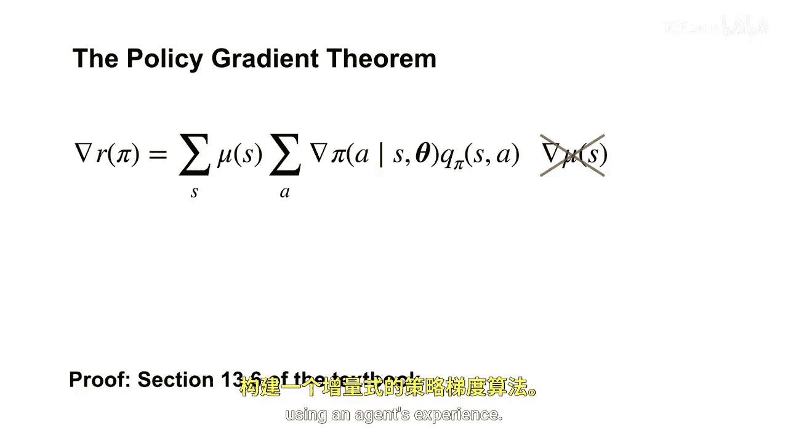

# 114：策略梯度定理 📈

在本节课中，我们将学习策略梯度定理。这是一个关键的理论成果，它允许我们将平均奖励的梯度表示为更容易从经验中估计的形式。

上一节我们讨论了策略优化的目标，本节中我们来看看智能体如何基于自身经验来优化这个目标。

## 梯度上升方法

为了优化平均奖励目标，我们使用基于随机梯度下降的方法。策略梯度方法采用类似的方法，但针对的是平均奖励目标和策略参数θ。

我们希望最大化平均奖励，而不是最小化它。这意味着我们进行梯度上升，并沿着正梯度的方向移动。

解决问题的简单步骤是：首先指定一个目标，然后估计该目标的梯度，最后沿着该方向调整权重。第一步已完成，下一步是估计我们目标的梯度。

## 计算梯度

回忆平均奖励目标，我们来计算其梯度。我们可以对目标应用微积分的乘积法则，得到两项。这看起来相当复杂，让我们更仔细地看一下。

第一项涉及状态平稳分布μ的梯度。不幸的是，μ的梯度不容易估计，因为平稳分布μ依赖于策略与环境之间的长期交互。

## 策略梯度定理

幸运的是，策略梯度定理为我们提供了这个梯度的一个更简单的表达式。以下是定理的结果，值得仔细分析这个表达式。

在内层求和中，我们有策略的梯度乘以动作价值函数。让我们尝试更好地理解这一项。

以下是策略梯度定理给出的梯度表达式：

$$
\nabla J(\theta) = \sum_s \mu(s) \sum_a \nabla \pi(a|s, \theta) q_{\pi}(s, a)
$$

## 理解梯度项

只要我们的策略参数化是可微的，策略的梯度就很容易计算。策略的梯度告诉你如何调整参数以增加特定动作的概率。

考虑这里展示的简单网格世界。通常，智能体可以向上、下、左、右移动。为简化起见，假设策略仅由两个参数控制。

参数当前设置在图中标记的点。箭头表示在当前参数设置下，智能体在特定状态下的动作概率。

图中向上动作的梯度可能看起来像这样。梯度告诉我们如何改变策略参数，使得在给定状态下选择该动作的可能性更大。通过沿着梯度方向移动参数，我们增加了向上动作的概率，这必然意味着降低其他一些动作的概率。

不同的动作有不同的梯度。例如，向左动作概率的梯度可能看起来像这样。沿着该方向移动参数将增加向左动作的概率，并降低其他一些动作的概率。

这听起来可能有点抽象，但在接下来的课程中，我们将展示计算此梯度的具体示例。

## 引入奖励

现在让我们将奖励引入这种情况，并思考整个项的含义。这是每个动作概率梯度的加权和，权重是相关动作的价值。

想象一下，我们在右下角添加了一个有奖励的状态。向上和向左的动作远离它，应该具有负价值；向下和向右的动作朝向它，应该具有正价值。精确的价值取决于当前策略，但假设它们看起来像这样。

加权和给出了一个移动参数的方向，该方向会降低向上或向右移动的概率（因为它们的价值为负），同时增加向下或向左移动的概率（因为它们的价值为正）。这个方向可能看起来像这样。

策略梯度定理给出的梯度表达式将此表达式对每个状态求和。这给出了移动策略参数以最快速提高整体平均奖励的方向。

## 总结

以上就是策略梯度定理的内容。我们现在有了一个简单的梯度表达式。重要的是，这个表达式不包含难以估计的状态分布μ的梯度。

策略梯度定理的证明可以在课程教科书中找到。正如我们将在下一讲中看到的，这个梯度很容易估计，这意味着我们将能够使用智能体的经验构建一个增量策略梯度算法。

本节课中我们一起学习了策略梯度定理如何为我们提供了平均奖励梯度的表达式，并理解了梯度中的各项含义。