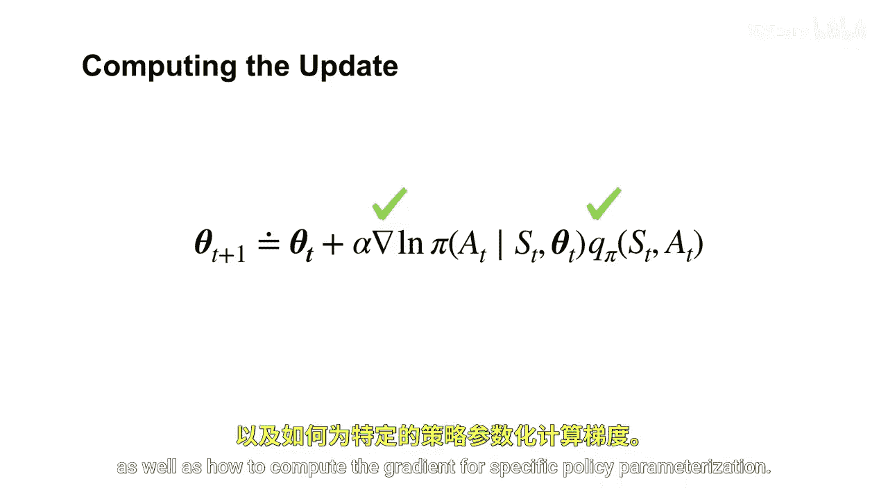

# 115：策略梯度估计

在本节课中，我们将学习如何利用智能体与环境交互的经验，来估计策略梯度定理给出的目标函数梯度。我们将推导出一个基于样本的梯度估计方法，并最终得到一个简洁的策略参数更新规则。

## 从目标到梯度估计

上一节我们介绍了策略优化的目标函数以及策略梯度定理。本节中，我们来看看如何近似计算这个梯度。我们的目标是推导出一个用于策略参数的梯度上升算法。我们已有目标函数及其梯度，现在需要找到近似这个梯度的方法。实际上，我们将获得梯度的随机样本。

回忆平均奖励目标的梯度表达式。对状态求和在实际中难以实现。但我们可以采用与推导策略评估的随机梯度下降规则时相同的方法。

我们只需根据策略 π 观察到的状态进行更新。从状态 `S_t` 计算出的梯度，为平均奖励的梯度提供了一个近似。正如之前讨论的随机梯度下降，我们可以用这个近似来调整权重，并仍能保证收敛到一个驻点。

## 随机梯度上升更新

以下是策略参数的随机梯度上升更新公式：

`θ ← θ + α * ∇θ J(θ) 的近似`

我们可以在此停止，但让我们进一步简化。让我们从基于期望的角度重新审视这个问题。这将帮助我们简化更新规则，并让你更深入地理解更新为何有效。

注意，以 μ 加权的状态和可以重写为在 μ 下的期望。回忆 μ 是 π 的平稳分布，反映了在 π 下的状态访问频率。实际上，我们遵循 π 时观察到的状态是按照 μ 分布的。通过从状态 `S_t` 计算梯度，我们得到了这个期望的一个无偏估计。

将随机梯度视为无偏估计，这提示了另一种简化方法。

## 简化动作求和项

注意，在期望内部，我们有一个对所有动作的求和。我们希望进一步简化这一项，去掉对所有动作的求和。如果这是一个关于动作的期望，我们也可以对其进行随机采样，从而避免对所有动作求和。

接下来，我们将看到如何仅使用智能体采取的那个动作 `A_t` 来获得一个无偏的梯度估计。如果我们的动作和是以 π 加权的，那么它就是在 π 下的一个期望。这样我们就可以使用智能体的动作选择（其分布遵循 π）来对其进行采样。事实证明，解决这个问题很容易。为了得到一个对应于期望的加权和，我们只需乘以并除以 `π(a|s)`。

现在，对于这一项，我们有了一个从 π 中抽取动作的期望。新的随机梯度上升更新规则如下所示：

`θ ← θ + α * ∇θ log π(A_t|S_t, θ) * Q_π(S_t, A_t)`

## 对数梯度技巧

顺便提一下，通常会将这个梯度重写为 `π` 的自然对数的梯度。这是基于微积分中对数梯度的公式。使用这个规则，我们得到 `∇θ log π = ∇θ π / π`，因此这个更新与我们最初的形式是等价的。

为什么要这样做？一个原因是，对于某些分布，计算其对数的梯度实际上更简单。另一个不太重要的原因仅仅是它让我们能更紧凑地书写这个梯度。归根结底，这只是一个数学技巧，所以不要让它分散你对底层算法的注意力。

## 最终的更新规则

我们现在得到的规则看起来像本课程中使用的许多学习规则：我们按照目标函数随机梯度的比例调整参数 θ。我们使用步长参数 `α` 来控制该方向上的步长幅度，因此 `α` 的作用与以往相同。至此，我们得到了一个简洁清晰的策略参数更新规则。

最后要讨论的是如何为给定的状态和动作实际计算这个随机梯度。

我们只需要两个部分：策略的梯度，以及差分动作值的估计。第一部分很简单。我们知道策略及其参数化形式，因此可以计算其梯度。

动作值可以用多种方式近似。例如，我们可以使用一个学习差分动作值的时序差分算法。在接下来的视频中，我们将详细介绍一种特定的选择，以及如何计算特定策略参数化的梯度。

## 总结

本节课中，我们一起推导了平均奖励设定下的策略梯度学习规则。在下一个视频中，我们将看到如何使用这个规则。