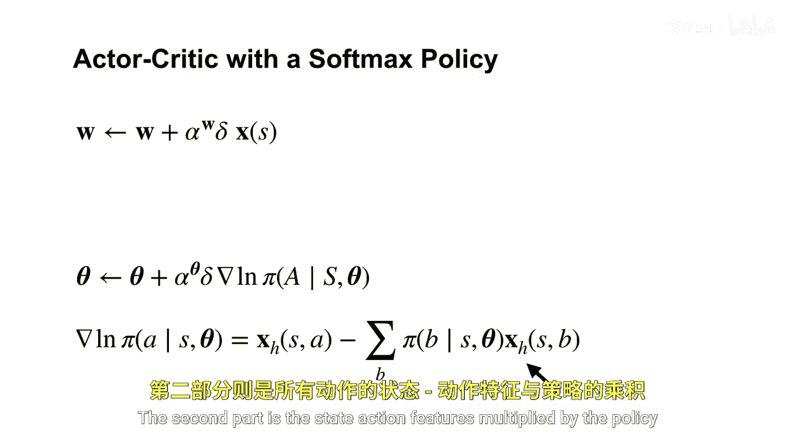

强化学习专项课程：P117：基于Softmax策略的演员-评论家算法 🎭

在本节课中，我们将学习演员-评论家算法的一个具体实现。我们将使用线性函数近似和Softmax策略参数化，来构建一个适用于连续状态和有限动作集的算法。

---

演员-评论家算法巧妙地结合了直接策略优化、价值函数和时间差分学习。我们之前讨论的演员-评论家方法较为通用，没有指定函数近似或策略参数化的具体形式。

本节中，我们来看看一个具体的实现：使用线性函数近似和Softmax策略参数化的演员-评论家算法。

---

### 策略参数化：Softmax策略

我们首先讨论策略的参数化。对于有限动作集，一个常见的选择是之前讨论过的Softmax策略。

我们可以使用函数近似来表示动作偏好。该函数的参数就是策略参数，记作 **θ**。因此，我们的策略梯度学习规则将更新 **θ**。

我们使用一个Softmax策略，它将偏好值进行指数化，然后除以总和。这保证了生成的动作概率为正且总和为1。

**公式**：
`π(a|s, θ) = exp(h(s, a, θ)) / Σ_b exp(h(s, b, θ))`

请注意，策略被写为当前状态的函数。这就像为每个状态都有一个不同的Softmax分布。

智能体在状态空间中移动时，依赖于状态的动作偏好会导致每个状态可能产生不同的分布。

以下是选择动作的步骤：
1.  在当前状态下，我们为每个动作查询Softmax函数。
2.  这会生成一个概率向量，每个动作对应一个条目。
3.  根据这些概率，按比例选择一个动作。

---

### 函数近似的选择

现在，让我们讨论参数化选择如何影响价值函数、动作偏好以及更新方程。

我们为价值估计和策略使用相同的特征。请记住，评论家更新的是状态价值函数的估计。因此，评论家只需要一个表征当前状态的特征向量。

演员的动作偏好则依赖于状态和动作。因此，我们的动作偏好函数需要一个“状态-动作”特征向量。

我们之前遇到过这个问题。我们采用与之前相同的策略：堆叠状态特征。也就是说，我们为每个动作使用一份状态特征向量的副本。

策略参数向量 **θ** 的大小大于评论家使用的权重 **w**。例如，如果有三个动作，**θ** 的大小就是 **w** 的三倍。

---

### 更新方程

接下来，我们看看使用线性Softmax参数化时，演员和评论家的更新方程。

第一个方程很简单。线性价值函数的梯度就是特征向量本身。

因此，评论家的权重更新就是学习率α乘以TD误差δ再乘以特征向量。

**公式**：
`w ← w + α * δ * x(s)`

这与我们熟悉的半梯度TD方法相同。

演员对偏好的更新需要更多思考。幸运的是，梯度并不复杂。我们省略推导过程，直接给出最终结果。你可以自行验证。

梯度由两部分组成：
1.  所选动作的“状态-动作”特征。
2.  所有动作的“状态-动作”特征乘以策略概率后的总和。

**公式**：
`θ ← θ + α * δ * (x(s, a) - Σ_b π(b|s, θ) * x(s, b))`

---

### 总结

本节课中，我们一起学习了演员-评论家算法的一个具体实现。你现在已经掌握了独立实现该算法所需的所有知识。

我们介绍了如何使用线性函数近似和Softmax策略来参数化策略，并推导了相应的演员和评论家更新方程。下次，我们将尝试运行这个算法模型，看看它的实际效果。