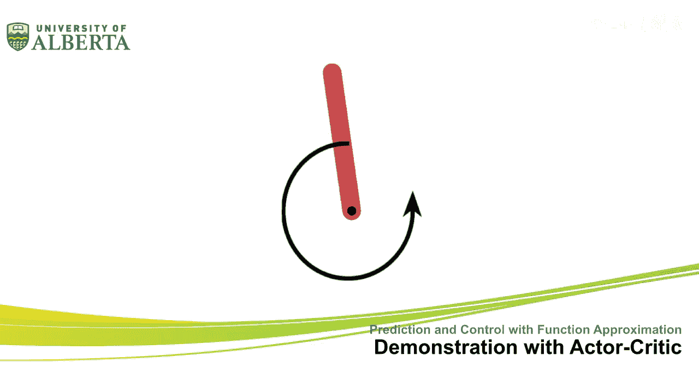
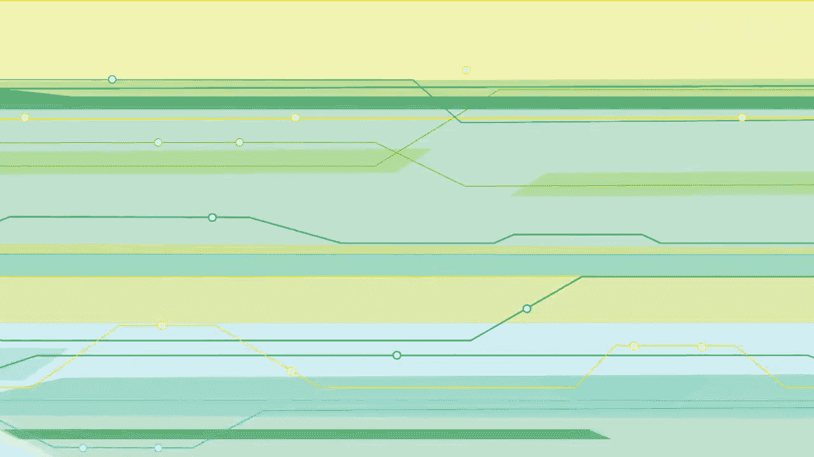
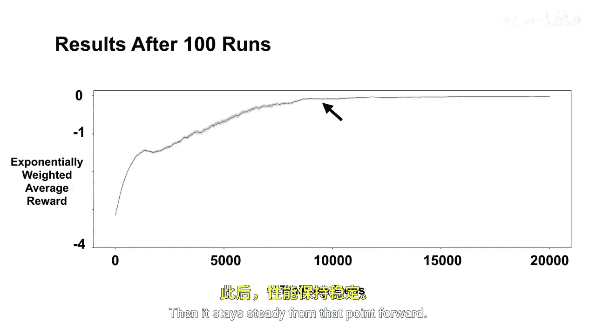

# 118：演员-评论家算法演示 🎬

在本节课中，我们将学习演员-评论家算法如何应用于一个经典的控制任务——钟摆上摆问题。通过本课，你将能够为平均奖励演员-评论家算法设计函数近似器，并分析其智能体的性能表现。

## 任务介绍：钟摆上摆问题 🤖

上一节我们介绍了演员-评论家算法的基本框架，本节中我们来看看它在一个具体问题上的应用。

今天我们将研究钟摆上摆任务。智能体控制一个钟摆；其控制方式很简单，智能体可以在枢轴点（图中黑点所示）施加扭矩。目标是让钟摆平衡在竖直向上的位置。

钟摆从静止位置开始，即无初速度地下垂状态。钟摆可以自由运动，仅受重力和智能体施加的动作影响。

钟摆的状态是杆的角度和角速度。两者都是实数值。我们的模拟只有三个离散动作：施加恒定的顺时针角加速度、逆时针角加速度或不施加角加速度。

我们为此任务使用 softmax 策略，因为动作空间是离散的。稍后，我们将为钟摆任务的连续动作变体使用不同的参数化方法。

## 定义奖励函数与任务形式 🎯

下一步是找到奖励函数。目标是让钟摆直接指向正上方并保持该状态。

因此，奖励等于与垂直方向夹角的**负绝对值**。公式表示为：`奖励 = -|角度|`。

如果钟摆达到较大的角速度，则可能损坏系统，这是不好的。为了避免这种情况，我们将角速度范围限制在 `-2π` 到 `2π` 之间。如果超过此限制，则将钟摆重置到静止位置。

目标是始终让钟摆尽可能接近竖直位置。这个过程无限期持续，没有分幕或终止。因此，将其表述为一个持续性任务是合理的。

## 任务难点与算法应用 🧩

钟摆任务有几个有趣之处：动作的强度不足以将钟摆直接从静止位置移动到竖直位置。一个好的策略必须施加使钟摆远离目标位置的动作，以获得足够的动量向上摆动。最后，竖直位置是不稳定的，因此一个好的策略必须持续平衡杆。

现在，让我们将 softmax 演员-评论家算法应用到模拟的钟摆任务中。在此之前，我们必须设计函数近似器和策略参数化方法。

## 设计函数近似器 🛠️

钟摆任务是一个低维状态问题，只有角度和角速度。这个二维问题非常适合使用**瓦片编码**。

近似价值函数和动作偏好将是瓦片编码特征的线性函数，但在状态变量上是非线性的。

设置瓦片编码的第一步是确定每个状态变量的范围。对于角位置来说这很容易，它只需要在 `π` 和 `-π` 之间。由于之前讨论的约束，角速度将位于 `2π` 和 `-2π` 之间。

通常最好使用大的瓦片和多个瓦片层：宽泛的瓦片支持相当大的泛化，从而实现快速的早期学习；而多个瓦片层有助于区分。这应该能产生对价值函数和动作偏好的准确近似。

我们使用了 32 个大小为 8x8 的瓦片层。请记住，对于动作偏好，我们需要为每个“状态-动作”对准备一个特征向量。和之前一样，我们只需为每个动作使用状态特征的独立副本。

## 设置算法参数 ⚙️

关于平均奖励、演员和评论家的步长参数呢？参数相当多，且每个都对性能有很大影响。

我们进行了系统的参数扫描，以确定每个参数的良好设置。这符合我们的一般节奏：我们希望评论家以更快的速度更新。这样，评论家可以准确地评判变化较慢的策略。

要在此任务上获得良好性能，还需要一些其他细节。由于时间关系，我们将跳过这些，但别担心，你将在评估中学习到所有关于此实现的内容。

## 智能体学习过程演示 📈

让我们看一段视频，了解智能体刚开始与钟摆环境交互时的情况：智能体开始时随机行动，但很快学会增加能量以达到更接近竖直的状态。

让我们快进一点，最终的行为看起来是这样的。我们添加了随机扰动，以展示所学策略的鲁棒性。这就像偶尔用手指轻弹钟摆。扰动仅在智能体学会良好的平衡策略后引入。视频中用黑色箭头显示了这些扰动，我们可以看到训练有素的智能体如何平稳恢复，并对这些轻弹具有鲁棒性。

## 性能评估与结果分析 📊

观看我们编程的智能体掌握钟摆问题确实令人满意，但我们也必须是持怀疑态度的科学家。这只是一个演示，智能体是否每次都成功学会平衡，还是我们只是运气好？它学习的速度和鲁棒性如何？

为了回答这些问题，我们进行了100次实验并平均了性能。为了衡量智能体的性能，我们绘制了所有时间步上奖励的指数加权平均值。误差线显示了均值的标准误。误差线非常小，事实上小到几乎看不见，因此我们相当确信，此图准确地反映了我们智能体在使用所选参数时在此任务上的平均性能。

平均奖励开始时很低，但一开始就迅速增加。经过短暂时间后，改进速度放缓，但随着智能体继续优化其策略，改进仍在继续。性能在接近零处达到峰值，这意味着智能体通常能够平衡钟摆竖直向上，仅有微小偏差。之后，性能从此点开始保持稳定。

## 总结 📝

本节课中我们一起学习了演员-评论家学习系统的一个具体实现，并在一个经典控制任务上进行了测试。我们介绍了钟摆上摆问题，设计了基于瓦片编码的函数近似器，设置了算法参数，并分析了智能体从随机探索到稳健平衡的学习过程与性能。再见。