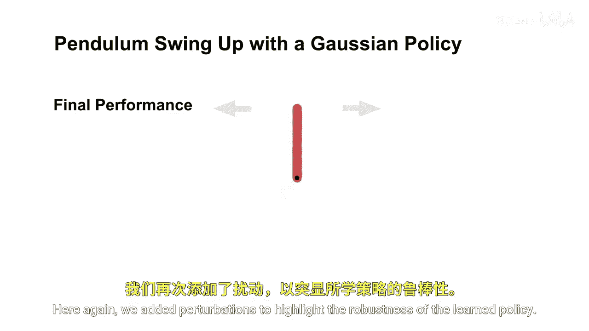

# 119：连续动作的高斯策略 🎯


在本节课中，我们将要学习如何将基于策略的方法应用于连续动作空间。具体来说，我们将探讨如何参数化一个依赖于状态的高斯分布策略，并推导出相应的演员-评论家更新规则。

## 概述

基于策略的方法有一个显著优点：它们为我们处理非常大甚至连续的动作空间提供了一种自然的方式。我们无需为每个独立动作分配概率，而是可以学习某个动作分布的参数。本节视频将讨论如何学习一个依赖于状态的、针对连续动作的高斯分布。

## 从离散到连续动作空间

上一节我们介绍了在离散动作空间下的策略参数化。本节中，我们来看看如何处理连续动作。

让我们回顾之前探讨过的钟摆上摆任务。状态空间和奖励函数完全相同。但这次，我们将为动作空间使用一个连续区间，而不仅仅是三个离散的角加速度等级。角加速度可以在-3到+3之间的任何值，这是最小值和最大值。

我们无法为每个动作单独分配概率，因为可能的动作空间是无限的。一种解决方案是将动作限制在整个可能范围内的一个离散子集，这正是我们之前所做的。但这种方法限制了智能体应用更大加速度的能力。我们更希望智能体能在适当的时候应用大加速度，并用较小的加速度来调整平衡。

## 高斯分布策略

为了实现这个目标，另一种策略是将策略参数化为一个连续分布，例如高斯分布。

一个高斯随机变量X具有如下所示的概率密度函数（PDF）：
```
PDF(x) = (1 / (σ * √(2π))) * exp(-(x - μ)² / (2σ²))
```
以下是具有不同均值和方差的PDF示例。请注意，在这种情况下，y轴表示的是密度，而不是概率。概率密度意味着，对于给定范围，x落在该范围内的概率将是概率密度曲线下的面积。

参数μ控制分布的均值。如果μ为0，分布将围绕零中心。参数σ是标准差，即方差的平方根。如果σ很小，分布将在均值μ周围急剧峰值。随着σ变大，分布会更加分散，x会从更广的值域中抽取。

## 定义高斯策略

让我们使用一个关于动作的高斯分布来定义我们的策略。我们将参数μ和σ定义为状态的函数。这样，智能体可以为不同的状态分配不同的动作分布。

μ(x)可以是任何参数化函数，但为了简单起见，我们将其设为状态特征的线性函数。与μ相关的策略参数记为θ_μ。

参数化函数σ有一个约束：它必须是正数。为了强制执行这一点，我们将将其参数化为一个线性函数的指数。与σ相关的策略参数记为θ_σ。

我们的策略参数现在由这两个大小相等的堆叠参数向量组成。

我们已经定义了高斯策略。请记住，策略的主要目的是为我们提供一种选择动作的方式。要使用此策略选择动作，我们从高斯分布中采样。许多编程库都包含从高斯分布采样的函数，因此我们在此不赘述。

该过程很简单：在某个状态下，我们从该状态计算μ和σ。然后，我们使用该μ和σ调用高斯随机数生成器。

在一个状态下，μ和σ可能看起来像这样。对于这个状态，很可能会采样到广泛范围的动作。这是在此状态下可能采样的一个动作。

在另一个状态下，μ和σ可能看起来像这样。对于这个状态，只有很窄范围的动作可能被采样。这是在此状态下可能采样的一个动作。

σ本质上控制了探索的程度。我们通常将方差初始化为较大值，以便在学习过程中尝试广泛的动作。随着学习的进行，我们期望方差会缩小，策略会集中在每个状态下的最佳动作周围。

与许多参数化策略一样，智能体可以通过学习随时间减少探索量。

## 演员-评论家算法的应用

尽管我们现在有了连续动作而不是离散动作，但我们仍然可以使用相同的演员-评论家架构。算法实际上非常相似，主要区别在于策略的梯度不同，因为参数化方式不同。

从本质上讲，目标函数看起来也略有不同，因为我们对动作进行积分而不是求和。但采样梯度最终是相同的，因此我们所要做的就是计算出策略自然对数的梯度。

我们将跳过这里的推导步骤，但结果如幻灯片所示。作为练习，请尝试自己验证它。

以下是推导出的演员-评论家更新规则的核心公式。对于均值参数θ_μ和标准差参数θ_σ，其梯度更新分别涉及优势函数A(s, a)与对应特征向量的乘积：
```
Δθ_μ = α_μ * A(s, a) * (a - μ(s)) / σ(s)² * ∇_θ μ(s)
Δθ_σ = α_σ * A(s, a) * [((a - μ(s))² / σ(s)²) - 1] * ∇_θ σ(s)
```
其中，α_μ和α_σ是各自的学习率步长。

## 为何使用连续动作？

现在我们有了连续动作的更新规则，但为什么要做所有这些工作呢？考虑到我们之前使用的离散动作在这个问题上似乎效果不错。

最明显的原因是，为问题选择一个离散的动作集可能并不简单。例如，想象一个训练来打高尔夫球的机器人。精确推杆需要相当高的精度。我们可以尝试选择一组离散的力施加到球杆上，并希望它足够好，但不可避免地会出现不够用的情况。根据距离和地形，我们可能需要使用全部的力范围。

连续动作还允许我们在动作之间进行泛化。例如，高斯策略平滑地将概率密度分配给附近的动作。假设发现某个动作很好，更新会增加该动作的密度。附近动作的密度也会增加，智能体会泛化地认为这些动作可能也很好。

最后，即使真实的动作集是离散的但非常大，将其视为连续范围可能更好。这提供了一种自然的方式来对它们进行泛化，并避免了独立探索每个动作的昂贵过程。

## 算法性能演示

现在让我们看看这个演员-评论家算法在钟摆上摆任务上的表现。我们再次扫描了许多步长值。我们为θ_μ和θ_σ使用了单独的步长。

这里我们可视化了早期学习阶段的策略。它看起来与我们使用离散动作集时没有太大不同。它很快学会了来回摆动钟摆。枢轴周围误差的大小表示在给定时间应用的角加速度的大小。

这里我们可视化了学习结束时的策略。它学习到了一个非常好的平衡策略。我们再次添加了扰动，以突出所学策略的鲁棒性。



## 总结

本节课中，我们一起学习了如何将演员-评论家算法应用于具有连续动作的问题。我们展示了如何通过高斯策略参数化在一个简单环境中实现这一点。你现在应该理解如何推导高斯策略的演员-评论家更新，并将其应用于连续动作任务。