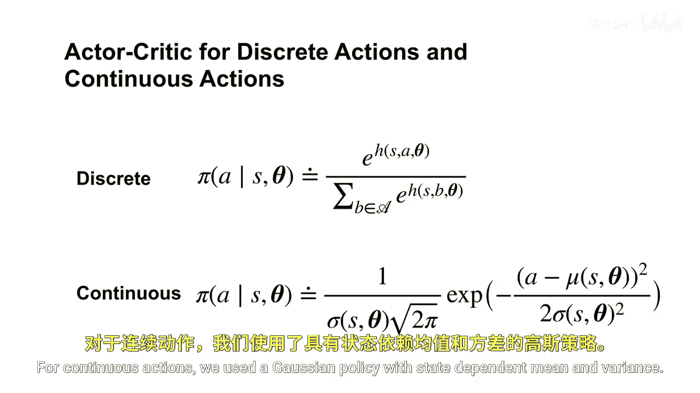
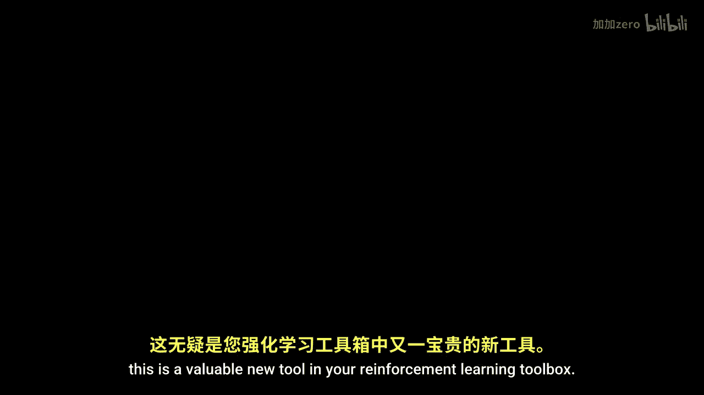

强化学习专项课程：第4周：策略梯度与Actor-Critic方法总结

在本节课中，我们将总结第四周的核心内容：从参数化动作价值函数转向直接学习参数化策略的全新方法。我们将介绍新的优化目标和一个名为Actor-Critic的算法框架。

---

### 课程定位与概览

首先，让我们回顾一下新知识在整个学习版图中的位置。我们使用函数近似来学习策略，因此我们仍处于版图的左侧部分。本周我们聚焦于使用平均奖励目标的Actor-Critic方法，这使我们定位在此处。

根据动作空间是连续还是离散，我们引入了两种可能的参数化方式。对于离散动作，我们使用Softmax策略参数化。对于连续动作空间，我们使用高斯策略，它可以从一个连续范围内采样动作。这是我们首次实现针对连续动作的算法。

平均奖励Actor-Critic可用于与我们之前介绍的差分半梯度Sarsa算法相同的场景中。

---

### 从价值到策略：参数化策略

本周我们首先实现了从参数化动作价值到参数化策略的转变。参数化策略接收状态-动作对，并输出相应的动作概率。这个函数由一个参数向量θ参数化。

一个参数化策略必须是一个有效的概率分布。这意味着每个动作概率必须大于零，并且在给定状态下所有动作的概率之和必须为1。在离散动作空间中，对动作偏好值进行Softmax操作是确保参数化策略遵守这些约束的一种方法。

直接参数化策略具有许多潜在优势。这些优势包括：能够在使用随机策略进行早期探索的同时，随时间自主收敛到确定性策略；能够学习随机策略，这在最优确定性策略无法被函数近似表示时非常有用；最后，一个好的策略可能比精确的动作价值函数更容易学习和表示。

---

### 新的目标与优化策略

为了学习参数化策略，我们必须考虑一个新的优化目标和一种新的优化策略。我们重新审视了平均奖励目标。我们展示了平均奖励可以像这样展开。我们的优化策略是使用随机梯度上升。为此，我们需要一个对平均奖励梯度的估计。

这具有挑战性，因为状态分布μ依赖于策略参数。策略梯度定理提供了一个便于优化的平均奖励目标梯度的表达式。这种形式允许我们通过遵循策略π从μ中采样状态来估计梯度。

---

### Actor-Critic算法框架

利用策略梯度定理，我们推导出了Actor-Critic算法。Actor-Critic同时学习一个参数化策略（Actor）和一个对该策略价值函数的估计（Critic）。

来自Critic的TD误差反映了Actor的表现是优于还是差于Critic的预期。Actor被训练为倾向于选择那些超出Critic预期的动作，而Critic则被训练以改进其对Actor的价值估计，从而知道对于这个Actor它应该期望什么价值。

我们演示了Actor-Critic算法如何用于离散和连续动作空间。对于离散动作，我们使用了Softmax策略参数化。对于连续动作，我们使用了具有状态依赖均值和方差的高斯策略。

以下是高斯策略的公式表示，它使得动作的高斯分布以状态为条件：

**π(a|s, θ) = N(μ(s, θ), σ²(s, θ))**

---

### 总结

现在，除了我们之前研究过的动作价值方法，你也掌握了如何直接参数化和学习策略。这是你强化学习工具箱中一个宝贵的新工具。

本节课中，我们一起学习了：
1.  从价值函数学习转向直接策略学习的动机与优势。
2.  参数化策略的定义与要求。
3.  用于优化策略的平均奖励目标与策略梯度定理。
4.  Actor-Critic算法的核心思想与工作流程。
5.  针对离散（Softmax）和连续（高斯策略）动作空间的具体实现方法。