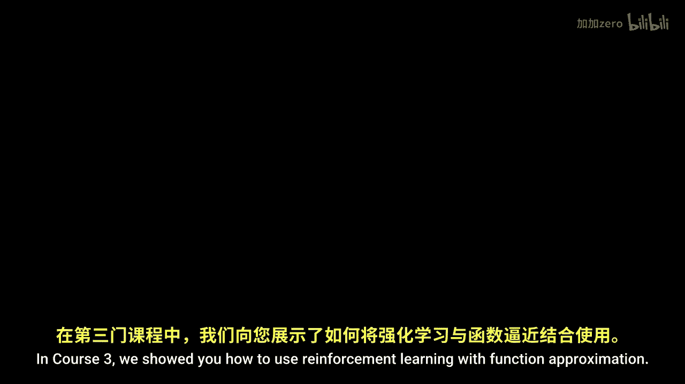

# 121：月球着陆器项目概述 🚀

在本节课中，我们将综合运用前三个课程的知识，完成一个完整的强化学习项目：设计一个智能体，使其能够控制月球着陆器安全着陆。我们将从问题形式化开始，逐步探讨算法选择、函数逼近器设计等关键细节，并最终实现一个完整的系统。

## 从目标到问题形式化

上一节我们介绍了函数逼近在强化学习中的应用与挑战。本节中，我们来看看如何将一个实际目标转化为可计算的强化学习问题。

如果有人要求你“设计一个能让这个月球着陆器着陆的智能体”，你必须首先将这个目标转化为一个具体的问题形式化框架。这是我们开始的地方。

我们将讨论如何将月球着陆任务形式化为一个马尔可夫决策过程。这包括定义状态空间、动作空间、奖励函数和转移概率。

## 选择与设计学习算法

在明确了MDP框架后，下一步是选择合适的强化学习算法。这个过程涉及对算法各个细节的深入思考。

以下是选择算法时需要考虑的一些关键细节：
*   确定智能体如何进行探索。
*   选择函数逼近架构的类型。
*   决定函数逼近器内部的细节，例如它生成的特征数量。
*   以及其他一系列参数设置。

本课程的一个重要部分是理解所有这些细节的重要性，以及如何尝试洞察你的算法在不同选择下的行为表现。

## 实践：理解与实现

实际的实现始于深入的理解。因此，我们不只是空谈理论，让我们直接开始动手，当然，是与月球的尘土打交道。

我们将利用第一、第二和第三课程的知识，实现一个完整的强化学习系统。你将研究一个能突出在现实世界中应用强化学习时可能面临的一些挑战的问题。

---

本节课中我们一起学习了如何启动一个强化学习项目。我们从将高层目标（着陆月球着陆器）形式化为马尔可夫决策过程开始，然后探讨了如何选择并细致设计学习算法，强调了理解算法每个细节对实践成功的重要性。接下来，我们将深入具体实现，让智能体真正开始学习。